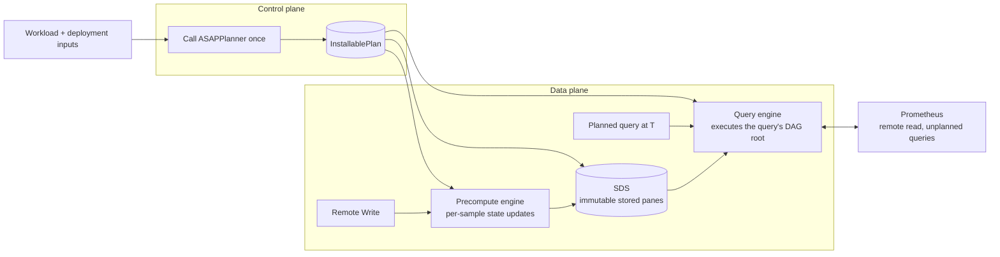

# ASAPQuery-backend on ASAPPlanner's physical DAG

ASAPPlanner turns a query workload and the deployment's inputs into one physical ASAP DAG. ASAPQuery-backend installs that DAG, ingests data, keeps the state the DAG names, and answers queries by executing the DAG. This document covers three things:

1. the boundary between ASAPPlanner and ASAPQuery-backend;
2. how the backend compares with ASAPQuery, and where the benefit comes from;
3. the key points for merging the backend into ASAPQuery.

**Repositories.** The backend's code lives in ASAPQuery-backend for now and later merges into ASAPQuery. ASAPPlanner stays a separate repository, used as a pinned library.



## Boundary between ASAPPlanner and ASAPQuery-backend

ASAPPlanner decides **what** to compute, when, and for how long. ASAPQuery-backend decides **how** to run it on real data. The backend calls the Planner once per installed workload and never changes the plan. The Planner holds no deployment, storage or service concepts.

| Concern | ASAPPlanner | ASAPQuery-backend |
| --- | --- | --- |
| Plan search | Stage 1 candidates, Stage 2 materialization, Stage 3 cost and accuracy selection | None |
| Installed plan | One validated DAG, with pane chains already expanded | Installs it |
| Stored outputs | Lists them: built at ingestion or at query time, pane window, required retention | Stores them |
| Summary identity, dedup, layout, eviction | None | SDS |
| Operators | The physical operator library (`asap-executor`): one columnar operator per plan-node kind, per-sample state updaters, `RawSampleSelector` | The execution engine: walks the DAG node by node with those operators |
| Ingestion, watermark, pane close, late data | None | Precompute engine |
| Threads, scheduling, time binding | None | Query engine and precompute engine |
| Raw samples | States which raw windows a query reads | Local ring buffer, Prometheus remote read |
| Unplanned queries | None | Forwarded to Prometheus |
| Deployment inputs (capabilities, AWS Fargate prices, measured costs, data facts) | Consumes them | Supplies them |

**The interface**

```
// Backend → Planner (one call)
asap_planner::plan_installable(UserInput { workload, models }) -> InstallablePlan

InstallablePlan {
    dag,                    // the selected physical ASAP DAG
    queries,                // each query and the DAG root that answers it
    stored_outputs,         // node, built_at (IngestionRun | QueryRun), pane window, retention_ms
    query_time_raw_windows, // raw-sample windows read at query time
    selection,              // selected candidate and its cost per second, for reporting
}

// Backend → operator library, while running
RawSampleSelector               // which samples a pane or raw window takes
StateColumnUpdater              // per-sample state update, merge across shards, seal
Batch::try_from_columns         // a sealed state column becomes a stored pane
compiled operators per DAG node
```

**Rules**

- The backend depends only on `asap_planner` and `asap_executor`. Planner internals (frontier search, pane-chain expansion) are crate-private.
- The Planner never sees samples, stores, clocks or services. The backend never changes a plan.
- The data plane always executes the installed DAG node by node, for every query shape. There is no hand-written path for particular query shapes beside the DAG.
- Each operator has exactly one implementation, in the operator library. The Planner's tests, the correctness reference and the data plane all use it.
- A plan the backend cannot run is refused at install with a reason, never partly executed.

## ASAPQuery and ASAPQuery-backend compared

**What each does**

| | ASAPQuery | ASAPQuery-backend |
| --- | --- | --- |
| Planner | `asap-planner`: query pattern → one aggregation config; optional MILP | ASAPPlanner Stages 1–3: exact or summary, sketch and parameters per accuracy target, materialization, pane chains, retention |
| Materialization | Ingestion only | Ingestion, query time, or query time kept across evaluations |
| Query shapes | Fixed patterns, binary arithmetic, top-k, quantile | Any root the Planner emits |
| Correctness reference | Differential tests, PromQL compliance suite | Equal answers to the Planner's executor running every node at query time |
| Summary sharing across offsets | Inside one sliding aggregation | SDS identity shared across outputs and offsets |
| Ingestion | Remote Write, VictoriaMetrics, OTLP, files; sharded workers; per-sample update | Remote Write; sharded workers; per-sample update |
| Store | Columnar epochs, interned label ids, `Arc` states | Immutable `Arc` panes under an `RwLock` |
| Query languages | PromQL, SQL, Elastic, ClickHouse adapters | PromQL |
| Workload discovery, plan swap, drop-in | Yes | No |

**Where the backend's overhead came from.** The first benefit runs had the backend using 2–3× Prometheus' CPU. A profile showed the cause was the executor's row layout, not the DAG or the sketches:

- row allocation, cloning, per-row group keys and per-row memory accounting took 68–75% of data-plane CPU;
- sketch and accumulator kernels took 3–7%;
- the rest was JSON fetching of raw ranges, the glibc allocator, and one engine thread.

ASAPQuery avoids all of these: it updates states in place per sample, stores `Arc` states in columns, uses jemalloc, shards ingestion across workers, and never reads raw data.

**Fixes made, and their effect**

- *In ASAPPlanner:* every operator of the operator library is now columnar (Arrow batches, interned group ids, state columns, per-sample updaters).
- *In the backend:* jemalloc, sharded ingestion, a query thread pool, `Arc` panes under an `RwLock`, per-sample ingestion, a local raw ring buffer and Prometheus remote read.

Same data and queries, in process, one core:

| Step | ASAPQuery | Backend before | Backend now |
| --- | --- | --- | --- |
| Summary construction | 2.3 µs/sample | 10.5 µs/sample | 1.2 µs/sample (per-sample updater) |
| `sum by (job) (rate(...[1m]))` | 4.1 ms | 15.4 ms | 5.3 ms |
| `topk by (job) (10, ...)` | 1.0 ms (approximate) | 15.5 ms (exact) | 5.4 ms (exact) |
| `quantile_over_time(0.99, ...[5m])` | 24.8 ms | 31.1 ms | 21.5 ms |
| `quantile_over_time(0.99, ...[60m])` | 33.5 ms | 62.2 ms | 50.4 ms |

The "now" column comes from a later session than the other two, on the same machine.

Whole system, against Prometheus alone (data-plane CPU core-seconds over a 90-minute run; Prometheus 3.5.0; 4 cores each):

| Series | Raw data retained | Prometheus alone | Backend before | Backend now |
| --- | --- | --- | --- | --- |
| 2,000 | yes | 18.9 | 44.6 | 36.6 |
| 2,000 | no | 18.3 | 38.2 | 31.7 |
| 10,000 | yes | 85.0 | 248.0 | 152.6 |
| 10,000 | no | 90.4 | 200.6 | 133.6 |

The "now" row still runs the backend on the row-based executor, because the columnar operator library has not been pinned yet. Correctness: in the benefit runs, all 5,920 planned evaluations equal the Planner's reference answers.

**What still blocks a benefit**

- The backend must move to the columnar operator library and the per-sample updater.
- Stage 3 under-predicts the runtime's CPU by 400–1,500×. It then picks query-time plans that rebuild sketches from raw data at every evaluation. The runtime's measured costs must be fed back to the Planner as a deployment input.
- Joint planning over the Kubernetes rule set drops cheaper plans, and several common rule shapes are not yet supported (regex matchers, `histogram_quantile`, `sum without`, chained rules).

## Merging with ASAPQuery

The merged runtime keeps ASAPQuery's low-overhead data path and the backend's single planner and DAG execution.

**Key points**

1. **One planner.** ASAPPlanner replaces `asap-planner`. Every query runs the plan Stage 3 selected.
2. **One executor.** The data plane executes the installed DAG with ASAPPlanner's columnar operator library. It replaces `SimpleEngine` and pattern matching.
3. **ASAPQuery's data path.** Sharded per-sample ingestion with a per-worker watermark (the global watermark is their minimum), immutable `Arc` state shared by reference, jemalloc. The per-sample updates use the operator library's updaters, so states equal a batch build.
4. **The backend's SDS.** Definition identity, dedup across offsets, and retention from the plan.
5. **Raw data stays local.** A ring buffer filled by Remote Write serves query-time raw windows; Prometheus remote read covers anything older.
6. **ASAPQuery's features come along.** OTLP and VictoriaMetrics ingestion, idle-window close, the query tracker (now feeding ASAPPlanner), plan swap at runtime, the drop-in deployment and the PromQL compliance suite.
7. **Measured costs go back to the Planner** as a deployment input, never as a plan change.

**Component choice**

| Component | From |
| --- | --- |
| Planner, installed plan, stored outputs, retention | ASAPPlanner |
| Operators and per-sample updaters | ASAPPlanner's operator library |
| DAG execution engine, SDS | Backend |
| Ingestion drivers, sharded router, watermark | ASAPQuery |
| Store concurrency | ASAPQuery's model with the backend's immutable panes |
| Local raw windows, remote read | Backend |
| HTTP adapters, forwarding, tracker, drop-in | ASAPQuery |

**Stages**

| Stage | Change | Status |
| --- | --- | --- |
| A | jemalloc; panes shared by `Arc` | Done in the backend |
| B | Per-sample ingestion | Done in the backend, on the row executor |
| C | Columnar operator library in ASAPPlanner | Done except removing the row form and making compiled plans `Send + Sync` |
| D | Sharded ingestion, query pool, local raw windows, remote read | Done in the backend |
| E | Re-pin the backend to the columnar library; feed measured costs to the Planner | Next |
| F | ASAPQuery features (OTLP, VictoriaMetrics, idle close, tracker, plan swap, compliance suite) | Later |
| G | Merge into ASAPQuery, replacing `asap-query-engine` internals and `asap-planner` | Later |

Each stage reruns the benefit harness and reports absolute numbers against Prometheus alone.

**Open decisions**

- Pane retention. Retention is counted from the newest closed pane. A query evaluated a little late then misses its oldest pane and is forwarded. Options: add a margin of one pane width in the runtime, or have the Planner include the deployment's evaluation delay in `retention_ms`.
- Idle shards. A shard that stops receiving samples holds panes open until a wall-clock close, which is not built yet.
- Whether the local raw buffer becomes a capability the Planner prices, or stays a runtime choice reported through measured costs.
