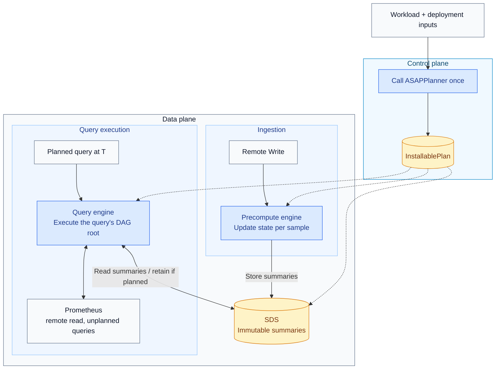

# ASAPQuery-backend on ASAPPlanner's physical DAG

ASAPPlanner turns a query workload and deployment inputs (such as runtime capabilities, prices, and measured costs) into one physical execution plan: a directed acyclic graph (DAG) of operators. ASAPQuery-backend installs that plan, ingests samples, maintains the summaries specified by the plan, and executes its operators to answer queries. Here, backend means the latest runtime PR stack through [#835](https://github.com/ProjectASAP/ASAPQuery-backend/pull/835), at `3158464f`, including its base PRs; these changes are not all merged into `main`. This document covers three things:

1. the boundary between ASAPPlanner and ASAPQuery-backend;
2. how the latest backend runtime PR stack compares with ASAPQuery;
3. the key points for merging the backend into ASAPQuery.

**Repositories.** The backend's code lives in ASAPQuery-backend for now and later merges into ASAPQuery. ASAPPlanner stays a separate repository, used as a library pinned to a specific revision.

Dashed arrows show which data-plane components receive the installed plan; solid arrows show planning inputs and runtime operations. The precompute engine writes summaries to SDS; the query engine reads summaries and can store query-time summaries for reuse. A query's DAG root is the operator that produces its final answer. SDS stores immutable summaries specified by the plan, including time panes, rollups over time ranges, rollups across series, and sliding-window summaries. A pane is one kind of summary, covering a bounded time interval; it is not the only kind SDS can hold.

## Boundary between ASAPPlanner and ASAPQuery-backend

ASAPPlanner decides **what to compute**, **whether to compute it during ingestion or at query time**, and **how long to retain stored outputs** before eviction. ASAPQuery-backend decides **how to execute that plan on incoming samples and query requests**. The backend calls the Planner once per installed workload and executes the returned plan without modifying it. The Planner consumes descriptions of deployment capabilities and costs; it does not operate the deployment's storage or services.

| Concern | ASAPPlanner | ASAPQuery-backend |
| --- | --- | --- |
| Plan search | Stage 1 generates candidate plans; Stage 2 chooses which intermediate summaries to store; Stage 3 selects a plan using cost and accuracy targets | None |
| Installed plan | One validated DAG, with the operators for constructing and combining time panes already included | Installs it |
| Stored outputs | Specifies each output's computation phase (ingestion or query time), time coverage, and retention duration | Stores them |
| Identifying shared summaries, avoiding duplicate storage, storage layout, eviction | None | SDS |
| Operators | The physical operator library (`asap-executor`): one columnar operator per plan-node kind, per-sample state updaters, `RawSampleSelector` | The execution engine: walks the DAG node by node with those operators |
| Ingestion, watermark, pane close, late data | None | Precompute engine |
| Threads, scheduling, binding a query to its evaluation timestamp | None | Query engine and precompute engine |
| Raw samples | Specifies the time ranges of raw samples a query needs | Local ring buffer, Prometheus remote read |
| Unplanned queries | None | Forwarded to Prometheus |
| Deployment inputs (capabilities, AWS Fargate prices, measured costs, data facts) | Consumes them | Supplies them |

**Planning interface: workload and deployment models → executable plan**

Once per installed workload, the backend control plane supplies the query workload and deployment inputs (capabilities, costs, and data facts) to `asap_planner::plan_installable`. The Planner returns `InstallablePlan`, which the backend saves and installs directly.

| Plan field | Role in the latest runtime PR stack |
| --- | --- |
| `dag` | The selected operators and their dependencies. |
| `queries` | Identifies each planned query and the DAG root that answers it. |
| `stored_outputs` | Tells SDS and the engines which summaries to retain, whether ingestion or query execution builds them, their time coverage, and their retention duration. |
| `query_time_raw_windows` | Tells the runtime which raw-sample windows to fetch for query execution. The latest runtime reads this metadata to bind inputs and size its local raw buffer. |
| `selection` | Optional metadata identifying the selected candidate and its estimated price per second. Used for logging and reporting, rather than query computation. |

The DAG describes the computation. The stored-output and raw-window metadata make its storage and input requirements explicit, so the backend does not reconstruct them by walking the DAG. Selection metadata describes the planning decision and is separate from the computation itself.

**Runtime interface: samples and summaries → query answers**

After installation, the backend uses the operator library to execute the plan. The following names refer to separate runtime helpers, not additional plan fields or calls to the Planner.

| Runtime helper | Role |
| --- | --- |
| `RawSampleSelector` | Selects the raw samples that belong to a pane or query-time window. |
| `StateColumnUpdater` | Updates aggregate or sketch states as samples arrive, merges states across shards, and seals them when a pane closes. |
| `Batch::try_from_columns` | Constructs a batch from state columns. The backend can store the batch as an immutable summary; a sealed pane is one example. |
| Compiled operators for DAG nodes | Execute the operations specified by the plan, using input batches to produce output batches. This describes a group of operators, not a single API name. |

The Planner specifies **which summaries to compute and retain**. The operator library supplies **the computation implementations**. The backend supplies **ingestion, scheduling, storage, and query serving**.

**Rules**

- The backend depends only on `asap_planner` and `asap_executor`. Planner internals (frontier search, pane-chain expansion) are crate-private.
- The Planner never sees samples, stores, clocks or services. The backend never changes a plan.
- The data plane always executes the installed DAG node by node, for every query shape. Query shapes do not have separate execution paths that bypass the DAG.
- Each operator has exactly one implementation, in the operator library. The Planner's tests, the correctness reference and the data plane all use it.
- If the backend cannot execute a plan, installation fails with a reason before any part of that plan runs.

**Design references for the runtime capabilities**

The Planner references below are pinned to `92bc1296`, the revision used by the latest backend stack. Runtime details are documented in the corresponding PRs and source-module documentation; the links distinguish those implementation notes from the broader Planner design.

| Capability | Design and implementation references |
| --- | --- |
| DAG execution | [Planner/runtime boundary](https://github.com/ProjectASAP/ASAPPlanner/blob/92bc1296fd33802e8ce3fcab6b75f8e3205c3960/docs/design_docs/architecture/planner-runtime-contract.md), [physical planning and deployment](https://github.com/ProjectASAP/ASAPPlanner/blob/92bc1296fd33802e8ce3fcab6b75f8e3205c3960/docs/design_docs/physical-planning-and-deployment.md), and [#832: compile once and execute shared roots](https://github.com/ProjectASAP/ASAPQuery-backend/pull/832). |
| Sharded ingestion and query concurrency | [#829: worker ownership, watermarks, query pool, and shared store](https://github.com/ProjectASAP/ASAPQuery-backend/pull/829); [latest engine module design](https://github.com/ProjectASAP/ASAPQuery-backend/blob/3158464f/data_plane/src/engine.rs). |
| Columnar operators and per-sample updates | [#832: Arrow batches, state-column updates, and batch-build fallback](https://github.com/ProjectASAP/ASAPQuery-backend/pull/832); [#834: interned series IDs](https://github.com/ProjectASAP/ASAPQuery-backend/pull/834). |
| Summary identity, retention, and reuse | [#828: installable-plan handoff and storage metadata](https://github.com/ProjectASAP/ASAPQuery-backend/pull/828); [latest SDS design](https://github.com/ProjectASAP/ASAPQuery-backend/blob/3158464f/data_plane/src/sds.rs) and [query-engine design for retained summaries](https://github.com/ProjectASAP/ASAPQuery-backend/blob/3158464f/data_plane/src/query.rs). |
| Raw-sample reads | [#831: per-metric local buffers, read boundaries, and remote-read fallback](https://github.com/ProjectASAP/ASAPQuery-backend/pull/831). |
| Measured costs and planning feedback | [#835: operation measurement, prediction reports, and cost-model limitations](https://github.com/ProjectASAP/ASAPQuery-backend/pull/835). |

## ASAPQuery and ASAPQuery-backend compared

This table compares ASAPQuery `main` at `5f0f00a` with the latest backend runtime PR stack through [#835](https://github.com/ProjectASAP/ASAPQuery-backend/pull/835) at `3158464f`. Backend capabilities below include the implementation in those open PRs.

| Concern | ASAPQuery | ASAPQuery-backend |
| --- | --- | --- |
| Planning | Uses its own `asap-planner-rs` to plan supported query patterns. | Calls ASAPPlanner Stages 1–3 to choose the physical DAG using deployment capabilities, costs, and accuracy targets. |
| Plan contract | Aggregation configurations consumed by the existing query engine. | Installs the Planner's `InstallablePlan`, including its DAG, query roots, stored summaries, and raw-input requirements. |
| Query execution | Uses `SimpleEngine` and execution paths for supported query patterns. | Compiles the installed DAG once and executes its roots using the shared columnar operator library; supports instant queries and range-query evaluation steps. |
| When summaries are built | During ingestion. | During ingestion or at query time; retains query-time summaries across evaluations when the plan requires it. |
| Ingestion | Sharded workers update summaries per sample; supports Remote Write and additional ingestion drivers. | Sharded Remote Write ingestion updates summary states per sample using the operator library's updaters. |
| Summary sharing and storage | Uses the existing query engine's summary store and reference-shared states. | SDS identifies equivalent summary definitions across outputs and time offsets; immutable summaries are shared through `Arc` under an `RwLock`, with retention from the plan. |
| Query-time raw samples | Accelerated queries use precomputed summaries; queries it cannot answer are forwarded. | Reads required raw windows from a local buffer, using Prometheus remote read for unavailable ranges. |
| Concurrency and series identity | Sharded ingestion and interned labels in its existing runtime. | Sharded ingestion workers, a query thread pool, and series interned to dense IDs at decode. |
| Cost inputs | Uses its own planner's configuration. | Supplies deployment costs and measured operation costs to ASAPPlanner; provides separate prediction reports for the selected plan. |
| Fallback | Forwards queries it cannot answer to the upstream system. | Forwards unplanned queries and planned queries it cannot answer to Prometheus, with a reason for planned-query fallback. |
| Query languages | Supports PromQL and SQL, with additional adapters. | The current control plane accepts PromQL workloads. |
| Deployment and workload management | Provides quickstart and drop-in deployments, workload discovery, and runtime plan replacement. | Provides explicit workload planning and a Prometheus-compatible service; integration of ASAPQuery's discovery and plan replacement remains merge work. |

The difference is how planning and execution are connected: ASAPQuery uses its existing planner and execution paths, while the backend runs ASAPPlanner's selected DAG with the shared operator library. Both build and query summaries; the backend additionally supports plan-directed query-time construction, retention, and raw-sample reads.

**Latest reported performance**

Source: [#835's measured-cost benchmark runs](https://github.com/ProjectASAP/ASAPQuery-backend/pull/835), using the #834 data-plane binary with the deployment settings produced by #835. These compare the backend plus Prometheus with Prometheus alone. They do **not** provide a direct performance comparison with the current ASAPQuery version; the capability table above should not be read as a performance ranking.

The reported setup is the 90-minute benefit harness, Prometheus 3.5.0, four queries, and four CPU cores allocated to each service. `s10` and `s50` are the benchmark's 1,000- and 5,000-series configurations as labeled in [#834](https://github.com/ProjectASAP/ASAPQuery-backend/pull/834). Prometheus alone was measured in the same session, and the backend setup's Prometheus still receives the samples. All figures below are reported measurements, not new runs for this documentation update.

CPU is core-seconds over the complete run; lower is better. **Total CPU includes both services**, calculated by adding the reported backend and Prometheus values. Peak RSS is backend-only and is not total system memory.

| Configuration | Prometheus alone CPU | Backend CPU | Backend's Prometheus CPU | Total CPU | Backend peak RSS (GiB) | Forwarded evaluations |
| --- | ---: | ---: | ---: | ---: | ---: | ---: |
| s10, raw retained | 18.9 | 11.2 | 8.6 | 19.8 | 0.04 | 90 |
| s10, no raw retained | 19.9 | 19.4 | 6.3 | 25.7 | 0.34 | 5 |
| s50, raw retained | 86.7 | 52.0 | 41.7 | 93.7 | 0.11 | 90 |
| s50, no raw retained | 85.3 | 84.3 | 29.9 | 114.2 | 0.81 | 5 |

Latency for the raw-retained configurations is shown below as **p50 / p99 in milliseconds**. “Backend setup” includes answers forwarded to Prometheus; these are client-visible timings, not timings of backend computation alone. The query columns are rate aggregation, top-k, and the 0.99 quantile over 5- and 60-minute windows.

| Configuration | System | Rate | Top-k | Quantile [5m] | Quantile [60m] |
| --- | --- | ---: | ---: | ---: | ---: |
| s10, raw retained | Prometheus alone | 9.5 / 19.9 | 9.9 / 18.2 | 18.4 / 35.3 | 84.3 / 140.1 |
| s10, raw retained | Backend setup | 10.0 / 11.2 | 10.2 / 11.1 | 22.2 / 34.8 | 107.6 / 138.3 |
| s50, raw retained | Prometheus alone | 44.2 / 71.7 | 45.0 / 77.5 | 93.3 / 140.3 | 379.9 / 583.4 |
| s50, raw retained | Backend setup | 41.7 / 59.2 | 37.6 / 55.0 | 104.5 / 150.1 | 408.3 / 520.6 |

In the raw-retained runs, measured costs make the Planner select an exact quantile candidate that fails executor validation (`per-entity aggregate requires an explicit entity binding`). All 90 quantile evaluations are therefore forwarded to Prometheus. The lower backend CPU and RSS partly reflect that work being done upstream. The combined CPU is above Prometheus alone in all four configurations; these results do not establish a whole-system CPU saving. The source PR reports that all evaluations met their accuracy targets, including forwarded answers, and contains the no-raw latency tables and detailed cost-model gaps.

## Merging with ASAPQuery

The merged runtime keeps ASAPQuery's low-overhead data path and the backend's single planner and DAG execution.

**Key points**

1. **One planner.** ASAPPlanner replaces `asap-planner`. Every planned query executes the plan selected by Stage 3.
2. **One executor.** The data plane executes the installed DAG with ASAPPlanner's columnar operator library. It replaces `SimpleEngine` and pattern matching.
3. **ASAPQuery's data path.** Sharded per-sample ingestion with a per-worker watermark (the global watermark is their minimum), immutable `Arc` state shared by reference, jemalloc. The per-sample updates use the operator library's updaters, so incremental state updates produce the same states as building them from a batch of samples.
4. **The backend's SDS.** Identify summaries by their definitions, reuse them across query time offsets, and evict summaries according to the plan's retention duration.
5. **Read raw samples locally when available.** A ring buffer filled by Remote Write serves query-time raw windows; Prometheus remote read covers anything older.
6. **ASAPQuery's features come along.** OTLP and VictoriaMetrics ingestion, idle-window close, the query tracker (now feeding ASAPPlanner), plan swap at runtime, the drop-in deployment and the PromQL compliance suite.
7. **Measured costs feed future planning.** Supply runtime measurements as deployment inputs for subsequent Planner calls; they do not modify an already installed plan.

**Component choice**

| Component | From |
| --- | --- |
| Planner, installed plan, stored outputs, retention | ASAPPlanner |
| Operators and per-sample updaters | ASAPPlanner's operator library |
| DAG execution engine, SDS | Backend |
| Ingestion drivers, sharded router, watermark | ASAPQuery |
| Store concurrency | ASAPQuery's model with the backend's immutable summaries |
| Local raw windows, remote read | Backend |
| HTTP adapters, forwarding, tracker, drop-in | ASAPQuery |

**Remaining integration work**

1. Replace ASAPQuery's planner and query-pattern execution paths with the backend's `InstallablePlan` installation and compiled DAG execution.
2. Connect ASAPQuery's additional ingestion drivers, workload discovery, query tracking, runtime plan replacement, and deployment support to that execution path.
3. Preserve summary identity, retention, and per-sample update semantics across the combined runtime, and validate answers against the Planner's reference execution.
4. Extend measured-cost coverage and validate candidate executability. The latest cost-feedback PR still reports gaps in the cost model and an exact quantile candidate that falls back after executor validation fails.

**Open decisions**

- Pane retention. [#832](https://github.com/ProjectASAP/ASAPQuery-backend/pull/832) keeps ingestion-built panes for one extra pane width beyond the plan's retention to cover evaluations just behind the newest closed pane. Whether the Planner should model the deployment's evaluation delay explicitly remains a design question.
- Idle shards. A shard that stops receiving samples no longer advances its watermark (the timestamp used to decide which panes can close). Its panes remain open unless the runtime closes them using elapsed wall-clock time; that mechanism is not implemented yet.
- Whether to expose the local raw buffer as an explicit capability with a cost the Planner can compare, or keep it as a runtime choice whose effect is reflected in measured costs.
