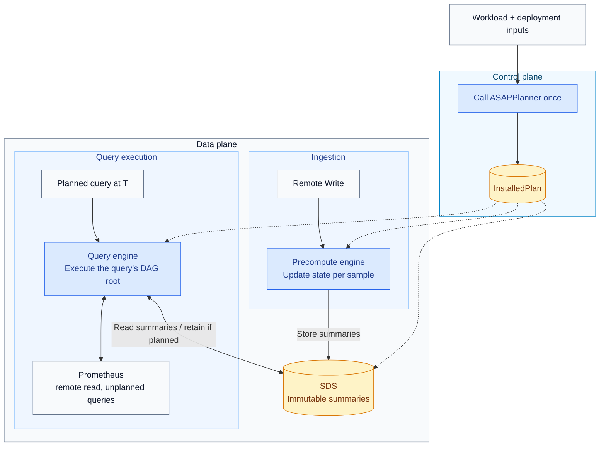

# ASAPQuery-backend on ASAPPlanner's physical DAG

ASAPPlanner turns a query workload and deployment inputs (such as runtime capabilities, prices, and measured costs) into one physical execution plan: a directed acyclic graph (DAG) of operators. In the target architecture, ASAPQuery-backend installs that plan, ingests samples, maintains the states specified by the plan, and executes its operators to answer queries. The comparison below identifies which parts are implemented on the current `main` branches. This document covers three things:

1. the boundary between ASAPPlanner and ASAPQuery-backend;
2. how the current backend implementation compares with ASAPQuery;
3. the key points for merging the backend into ASAPQuery.

**Repositories.** The backend's code lives in ASAPQuery-backend for now and later merges into ASAPQuery. ASAPPlanner stays a separate repository, used as a library pinned to a specific revision.

Dashed arrows show which data-plane components receive the installed plan; solid arrows show planning inputs and runtime operations. The precompute engine writes summaries to SDS; the query engine reads summaries and can store query-time summaries for reuse. A query's DAG root is the operator that produces its final answer. SDS stores immutable summaries specified by the plan, including time panes, rollups over time ranges, rollups across series, and sliding-window summaries. A pane is one kind of summary, covering a bounded time interval; it is not the only kind SDS can hold.

## Boundary between ASAPPlanner and ASAPQuery-backend

ASAPPlanner decides **what to compute**, **whether to compute it during ingestion or at query time**, and **how long to retain stored outputs** before eviction. ASAPQuery-backend decides **how to execute that plan on incoming samples and query requests**. The backend calls the Planner once per installed workload and executes the returned plan without modifying it. The Planner consumes descriptions of deployment capabilities and costs; it does not operate the deployment's storage or services.

| Concern | ASAPPlanner | ASAPQuery-backend |
| --- | --- | --- |
| Plan search | Stage 1 generates candidate plans; Stage 2 chooses which intermediate summaries to store; Stage 3 selects a plan using cost and accuracy targets | None |
| Installed plan | One validated DAG, with the operators for constructing and combining time panes already included | Installs it |
| Stored outputs | Specifies each output's computation phase (ingestion or query time), time coverage, and retention duration | Stores them |
| Identifying shared summaries, avoiding duplicate storage, storage layout, eviction | None | SDS |
| Operators | The physical operator library (`asap-executor`): one columnar operator per plan-node kind, per-sample state updaters, `RawSampleSelector` | The execution engine: walks the DAG node by node with those operators |
| Ingestion, watermark, pane close, late data | None | Precompute engine |
| Threads, scheduling, binding a query to its evaluation timestamp | None | Query engine and precompute engine |
| Raw samples | Specifies the time ranges of raw samples a query needs | Local ring buffer, Prometheus remote read |
| Unplanned queries | None | Forwarded to Prometheus |
| Deployment inputs (capabilities, AWS Fargate prices, measured costs, data facts) | Consumes them | Supplies them |

**Planning interface: workload and deployment models → executable plan**

Once per installed workload, the backend control plane supplies the query workload and deployment inputs (capabilities, costs, and data facts) to ASAPPlanner. The Planner selects a physical DAG. The control plane packages that DAG and its query text into `InstalledPlan`, the backend's current installation contract.

| `InstalledPlan` field | Meaning for the backend |
| --- | --- |
| `dag` | The selected physical DAG, including its operators, dependencies, and query roots, with pane chains expanded. |
| `queries` | Query text in the same order as the DAG roots, associating each query with the root that produces its answer. |

There are no separate `stored_outputs`, `query_time_raw_windows`, or `selection` fields in this contract. Summary definitions and raw-sample read requirements are derived from the DAG. Candidate selection details and estimated costs belong to planning reports rather than the runtime installation contract.

**Runtime interface: samples and summaries → query answers**

After installation, the backend uses the operator library to execute the plan. The following names refer to separate runtime helpers, not additional plan fields or calls to the Planner.

| Runtime helper | Role |
| --- | --- |
| `RawSampleSelector` | Selects the raw samples that belong to a pane or query-time window. |
| `StateColumnUpdater` | Updates aggregate or sketch states as samples arrive, merges states across shards, and seals them when a pane closes. |
| `Batch::try_from_columns` | Constructs a batch from state columns. The backend can store the batch as an immutable summary; a sealed pane is one example. |
| Compiled operators for DAG nodes | Execute the operations specified by the plan, using input batches to produce output batches. This describes a group of operators, not a single API name. |

The Planner specifies **which summaries to compute and retain**. The operator library supplies **the computation implementations**. The backend supplies **ingestion, scheduling, storage, and query serving**.

**Rules**

- The backend depends only on `asap_planner` and `asap_executor`. Planner internals (frontier search, pane-chain expansion) are crate-private.
- The Planner never sees samples, stores, clocks or services. The backend never changes a plan.
- The data plane always executes the installed DAG node by node, for every query shape. Query shapes do not have separate execution paths that bypass the DAG.
- Each operator has exactly one implementation, in the operator library. The Planner's tests, the correctness reference and the data plane all use it.
- If the backend cannot execute a plan, installation fails with a reason before any part of that plan runs.

## ASAPQuery and ASAPQuery-backend compared

This table compares the current `main` branches: ASAPQuery at `5f0f00a` and ASAPQuery-backend at `eabf5ef0`. The architecture above describes the intended backend; the table distinguishes that design from what is implemented today.

| Concern | ASAPQuery | ASAPQuery-backend |
| --- | --- | --- |
| Role | A query accelerator with ingestion, summary construction, query execution, and a drop-in deployment. | A control plane integrated with ASAPPlanner, plus a data-plane service whose execution path is still being built. |
| Planning | Uses its own `asap-planner-rs` to plan supported query patterns. | Runs ASAPPlanner Stages 1–3 with deployment capabilities and cost inputs, then exports the selected physical DAG. |
| Plan contract | Aggregation configurations consumed by the existing query engine. | `InstalledPlan`: the selected physical DAG and the query text corresponding to each DAG root. |
| Query execution | Executes supported queries through `SimpleEngine` and forwards queries it cannot answer. | Currently forwards every query to Prometheus; execution of the installed DAG is not implemented. |
| Ingestion | Builds summaries from incoming samples. | Accepts, validates, and counts Remote Write samples, then discards them; Prometheus must receive its own copy. Summary construction is not implemented. |
| Summary storage | Uses the query engine's summary store to serve accelerated queries. | Defines summaries from ingestion-time DAG outputs and shares definitions across time offsets. Runtime summary storage and retrieval are not implemented. |
| Retaining query-time summaries | Summaries are built during ingestion. | Currently declares that retaining query-time results across evaluations is unsupported and rejects plans requiring it. |
| Query languages | Supports PromQL and SQL, with additional adapters. | The control plane currently accepts PromQL workloads only. |
| Deployment | Provides quickstart and drop-in deployments for an existing Prometheus/Grafana stack. | Provides plan generation and a Prometheus-compatible HTTP service; the planned acceleration path remains to be implemented. |

The main difference today is that ASAPQuery has an operating acceleration path, while ASAPQuery-backend has the external Planner integration and plan-derived summary definitions. The merge aims to combine ASAPQuery's runtime with ASAPPlanner's selected DAG and shared operator library.

## Merging with ASAPQuery

The merged runtime keeps ASAPQuery's low-overhead data path and the backend's single planner and DAG execution.

**Key points**

1. **One planner.** ASAPPlanner replaces `asap-planner`. Every planned query executes the plan selected by Stage 3.
2. **One executor.** The data plane executes the installed DAG with ASAPPlanner's columnar operator library. It replaces `SimpleEngine` and pattern matching.
3. **ASAPQuery's data path.** Sharded per-sample ingestion with a per-worker watermark (the global watermark is their minimum), immutable `Arc` state shared by reference, jemalloc. The per-sample updates use the operator library's updaters, so incremental state updates produce the same states as building them from a batch of samples.
4. **The backend's SDS.** Identify summaries by their definitions, reuse them across query time offsets, and evict summaries according to the plan's retention duration.
5. **Read raw samples locally when available.** A ring buffer filled by Remote Write serves query-time raw windows; Prometheus remote read covers anything older.
6. **ASAPQuery's features come along.** OTLP and VictoriaMetrics ingestion, idle-window close, the query tracker (now feeding ASAPPlanner), plan swap at runtime, the drop-in deployment and the PromQL compliance suite.
7. **Measured costs feed future planning.** Supply runtime measurements as deployment inputs for subsequent Planner calls; they do not modify an already installed plan.

**Component choice**

| Component | From |
| --- | --- |
| Planner, installed plan, stored outputs, retention | ASAPPlanner |
| Operators and per-sample updaters | ASAPPlanner's operator library |
| DAG execution engine, SDS | Backend |
| Ingestion drivers, sharded router, watermark | ASAPQuery |
| Store concurrency | ASAPQuery's model with the backend's immutable summaries |
| Local raw windows, remote read | Backend |
| HTTP adapters, forwarding, tracker, drop-in | ASAPQuery |

**Remaining integration work**

1. Connect Remote Write ingestion to the installed DAG's ingestion-time operators and store the summaries defined by SDS.
2. Execute planned queries from their DAG roots, reading stored summaries and any required raw samples; forward queries the runtime cannot answer.
3. Integrate ASAPQuery's ingestion drivers, scheduling, query tracking, plan replacement, and deployment support with that execution path.
4. Validate answers against the shared operator library's reference execution and measure whole-system resource use against Prometheus alone. Feed measured costs into subsequent planning calls.

**Open decisions**

- Pane retention. Retention is counted from the newest closed pane. A delayed query can therefore need a pane that has already been evicted, causing the query to be forwarded to Prometheus. Options: add a margin of one pane width in the runtime, or have the Planner include the deployment's evaluation delay in `retention_ms`.
- Idle shards. A shard that stops receiving samples no longer advances its watermark (the timestamp used to decide which panes can close). Its panes remain open unless the runtime closes them using elapsed wall-clock time; that mechanism is not implemented yet.
- Whether to expose the local raw buffer as an explicit capability with a cost the Planner can compare, or keep it as a runtime choice whose effect is reflected in measured costs.
