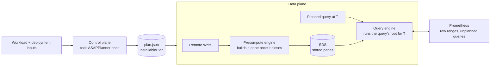

# ASAPQuery-backend on ASAPPlanner's physical DAG

## Overview

ASAPQuery-backend executes the plan ASAPPlanner selects, as given, and never selects plans itself. ASAPPlanner turns a query workload and the deployment's inputs into one physical ASAP DAG. The backend ingests data, maintains the state that DAG names, and answers each query from it.

**Goals**

- One planner: every plan the backend runs is Stage 3's selected plan, at one pinned Planner revision.
- Answers equal the Planner's own executor on the same plan.
- Lower CPU, memory and latency than Prometheus alone on the same workload, measured in absolute numbers.

**Scope**

- PromQL over Prometheus Remote Write; instant and range queries.
- All three materializations the Planner selects: at ingestion time, at query time, and at query time kept across evaluations.
- State in memory.

**Non-goals**

- Re-planning when the workload or data changes.
- Persistent state (S3) and recovery after restart.
- SQL and ClickHouse.

**Repository.** All backend code lives in ASAPQuery-backend. The backend will later merge into ASAPQuery. ASAPPlanner stays a separate repository, used as a pinned library.

## Architecture

The control plane plans once and installs the result; the data plane only executes it.



The precompute and query engines both run code compiled from the same installed DAG, so stored panes and the queries that read them cannot disagree on shape. A query the plan does not cover goes to Prometheus, and so does every raw range the plan reads at query time.

## Boundary between ASAPPlanner and ASAPQuery-backend

ASAPPlanner decides **what** to compute, when, and for how long. ASAPQuery-backend decides **how** to run it on real data. The backend calls the Planner once per installed workload and never plans. The Planner holds no deployment, storage or service concepts.

**Responsibilities**

| Concern | ASAPPlanner | ASAPQuery-backend |
| --- | --- | --- |
| Query languages | Parses and lowers PromQL, MetricsQL, SQL | Passes query text through |
| Plan search | Stage 1 candidates, Stage 2 materialization and timing, Stage 3 cost and accuracy selection | None |
| The installed plan | Produces one validated DAG, with pane chains already expanded | Installs it as `plan.json` |
| Which outputs to store | Lists them: when each is built (ingestion run or query run), its pane window, and the retention it needs | Stores them |
| Summary identity and dedup | None | SDS: the definition id comes from the sub-DAG, ignoring offset-only `TimeShift`s; identical outputs are stored once |
| Store layout, retention, eviction | States each output's required retention only | SDS: keeps each definition for the largest retention among its outputs and evicts it after that; memory now, S3 later |
| Ingestion | None | Remote Write, watermark, pane close, late samples |
| Selecting a window's samples | `RawSampleSelector`: the metric to route, the window bounds, the Scan's label matchers, and the latest-sample rule for instant selectors | Routes samples by metric and buffers them per pane |
| Computing a pane or a query | The executor compiles and runs any plan node | Calls the executor at the right time and scope |
| Time binding | States pane windows and offsets relative to an evaluation time | Picks `T`, binds stored panes and raw ranges, fetches raw samples from Prometheus |
| Unplanned queries | None | Forwards them to Prometheus |
| Deployment inputs | Consumes them | Supplies them: capabilities, AWS Fargate prices, measured costs, data facts |

**What crosses the boundary**

```
// Backend → Planner (one call)
asap_planner::plan_installable(UserInput {
    workload,                    // PromQL queries with recurrence, accuracy target, latency bound, optional range evaluation
    models: PlanningModels {     // deployment inputs
        deployment_capabilities, // summaries the runtime runs (default: the Planner executor's), raw data retained, query-time results retained
        plan_selection_settings, // cost model + unit prices (e.g. the AWS Fargate preset), measured operation costs
        ..
    },
})

// Planner → backend
InstallablePlan {
    dag,                    // the selected physical ASAP DAG, with its wire version
    queries,                // each query and the DAG root that answers it
    stored_outputs,         // node, built_at (IngestionRun | QueryRun), pane window, retention_ms
    query_time_raw_windows, // raw-sample windows read at query time
    selection,              // selected candidate id and cost per second, for reporting
}

// Backend → executor, while running
RawSampleSelector::new(&dag, &window)?.metric() / .rows(window_end_ms, samples)
compile + execute the plan's nodes in an ingestion or query scope
```

**Rules that keep the boundary**

- The backend depends only on `asap_planner` and `asap_executor`. Planner internals (frontier search, pane-chain expansion, sample-row encoding) are crate-private, and the Planner's CI checks this.
- The Planner never sees samples, stores, clocks or services. The backend never changes a plan.
- A plan the backend cannot run is refused when it is installed, never partly executed. Unsupported shapes (scalar roots, subquery or `@` windows, negative offsets) fail in `plan_installable` with a reason.

## Stored summaries (SDS)

Every DAG output the plan stores becomes one stored-summary definition. The SDS stores those outputs and nothing else.

- **Where definitions come from:** `InstallablePlan.stored_outputs`. Each entry gives the node, when it is built, and its pane window: `width_ms` ending `end_offset_ms` before the evaluation time.
- **Identity:** the SDS computes it. It is a hash over the definition's payloads and schemas, with `TimeShift` offsets zeroed, so outputs that differ only in offset share one definition. In the Example 4 workload, six 10-minute KLL panes become one definition read at offsets 0 to 50 min.
- **Storage:** panes are keyed by (definition, pane end) and held in memory.
- **Retention:** each definition is kept for the largest `retention_ms` among its outputs, then evicted.
- **Not read:** summary coverage. The SDS stores what the plan names; reuse decisions were already made by the Planner.

Identity rule: an offset-only `TimeShift` takes its input's identity, and the offset moves into the pane binding. The newest pane has no shift node and older panes do, so without this rule Example 4b would build 12 panes instead of 6.

## Precompute engine

The precompute engine builds each stored pane exactly once, when the watermark closes it, by running the builder the plan's DAG defines.

1. **Select:** Remote Write samples are routed by metric (`RawSampleSelector::metric`) and buffered per definition and pane. The selector applies the plan's own `Scan`, so its label matchers apply.
2. **Close:** a pane `(end − width, end]` closes when the watermark (newest sample minus the allowed lateness) passes `end`. Panes are open at the start, like PromQL ranges.
3. **Build:** the definition's builder, compiled from the DAG by the Planner's executor, produces the summary batch, which goes to the SDS.
4. **Evict:** the SDS drops a pane once it is older than its definition's retention. A query further behind than that is forwarded to Prometheus.

- **Late samples:** a sample for an already-built pane is dropped and counted. There are no revisions or backfill.
- **Startup:** the first pane is skipped because it may be partial.
- **Back-pressure:** `/api/v1/write` returns 503 when the engine queue is full.
- **Threading:** the Planner's DAG type is not `Send`, so the plan runs on one engine thread.

## Query engine

A planned query is answered by running its root of the DAG, compiled with the Planner's executor, at each evaluation time `T`. A query the plan does not cover goes to Prometheus unchanged.

**Inputs of one evaluation at `T`**, by when the plan builds each input:

| Input | How it is read |
| --- | --- |
| Stored output built in an ingestion run | The stored pane of its definition that ends at `T − end_offset` |
| Stored output built in a query run (kept across evaluations) | The kept result for the window ending at `T − end_offset`, if an earlier evaluation computed it after its pane closed; otherwise computed now, and kept only once its pane is closed |
| Query-time raw window | Raw samples from Prometheus for `(T − end_offset − width, T − end_offset]`, selected by the plan's `Scan` |

**Instant queries.** One evaluation at the request's time `T`. The answer is a Prometheus vector.

**Range queries.** One evaluation per step, `T = start + k · step` up to `end`; the answer is a Prometheus matrix. Raw samples are fetched once for the whole range and sliced per step. Each step reads stored panes or kept results where the plan chose them, so consecutive steps share work the same way consecutive evaluations of a recurring query do.

**Forwarding.** An evaluation that cannot run as planned is forwarded whole, with the reason in `x-asap-forward-reason`. Reasons include a stored pane or kept result that is missing (for example older than its retention), a `T` off the pane grid, or an unsupported root shape. Answered queries carry `x-asap-execution: plan`, forwarded ones `forwarded`.

**State** lives in memory only and is rebuilt from new samples after a restart.

## Evaluation

The backend is evaluated in two steps. First, its answers must equal the Planner executor's. Then its resource use is compared with Prometheus alone.

**Correctness.** An end-to-end test runs the real data-plane binary on the planner-layering PromQL Examples 1, 3a, 3b, 4a and 4b. Data enters through Remote Write, and a stand-in Prometheus serves raw ranges. Each answer is compared with the Planner executor running the same selected plan with every node at query time (`InstallablePlan::query_time_reference`). KLL answers are compared within a value tolerance of 10, about twice KLL's 0.005 rank error, because the library seeds KLL compaction randomly. All others must match exactly.

| Example | Deployment | Planner chose | Result |
| --- | --- | --- | --- |
| 1 | default | everything at query time, exact | exact |
| 3a | default | KLL at query time | 4 of 5 queries exact; the 5-year query off by 1 (987 vs 988) |
| 3b | default | KLL at query time | exact (36) |
| 3b | no raw data retained | 1-minute panes built at ingestion | exact (36) |
| 4a | default | KLL at query time | exact |
| 4b | no raw data retained | six 10-minute panes built at ingestion | exact (237 and 1237) |
| 4 B3 | query-time results kept | 1-minute panes kept across evaluations | exact at 10, 11 and 12 min; raw ranges fetched 5, 1, 1 |

**Benefit.** The same workload runs twice on one deployment. Once, Prometheus alone answers every query exactly at query time; this is the baseline. Once, the backend executes the Planner's selected plan. Both runs report absolute numbers, never ratios:

- CPU core-seconds and memory GiB over the run;
- latency per query;
- error against the exact answer, and whether it meets the query's accuracy target;
- Stage 3's predicted resource usage next to the measured values, which also checks the cost model.

Workloads: the planner-layering examples, and the Kubernetes rule set (the apiserver, etcd and kubelet rules from recorded SRE-agent traces) over seeded generated data. The deployment inputs are AWS Fargate us-east-1 unit prices, sketch-bench's measured operation costs, and distinct-count bounds read from the generated data's distribution. The baseline is a pinned Prometheus 3.x. Prometheus 2.x includes the sample at a range's start, while the Planner and executor use left-open ranges, as Prometheus 3.x does.

## Overhead of the data plane, compared with ASAPQuery

The first benefit runs show the data plane costing more than Prometheus alone, not less. This section says where that cost comes from, how ASAPQuery handles the same steps, and the fix for each cause.

**Measured totals.** Benefit harness, planner-layering examples, one sample per series every 15 s, 90 minutes of data, Prometheus 3.5.0. Prometheus and the data plane each run on 4 pinned cores. CPU is core-seconds over the whole run. Latency is the p50 of `sum by (job) (rate(http_requests_total[1m]))`.

| Series | Deployment | Prometheus alone | ASAP run: data plane + its Prometheus | Data plane peak RSS | Latency, Prometheus vs plan |
| --- | --- | --- | --- | --- | --- |
| 2,000 | raw data retained | 21.7 | 53.4 + 22.0 | 0.34 GiB (Prometheus alone: 0.09) | 11 ms vs 47 ms |
| 10,000 | raw data retained | 99.1 | 272.6 + 103.5 | 1.69 GiB (0.14) | 47 ms vs 249 ms |
| 10,000 | no raw data retained | 98.6 | 250.0 + 33.0 | 1.69 GiB (0.14) | 47 ms vs 169 ms |
| 2,000 | no raw data retained (rerun) | 18.3 | 37.1 + 6.0 | 0.35 GiB (0.09) | 10 ms vs 26 ms |

Stage 3 predicted 0.072 core-seconds for the plan it selected at 2,000 series with raw data retained, and the data plane measured 53. For the 10,000-series no-raw plan, Stage 3 predicted a 1.06 GiB peak and the data plane reached 1.69 GiB.

**How it was measured.**

- *Build.* A rerun of the 2,000-series raw-retained experiment with a release build (frame pointers and line tables on, same optimization) used 53.1 data-plane core-seconds, against 53.4 in the report. So the runs were not debug builds.
- *Profile.* `perf record -g` sampled the data plane at 499 Hz for the whole run, with raw data retained (53.1 core-seconds) and without (37.1 core-seconds). An independent profile at 10,000 series has the same top symbols.
- *In-process drivers.* Each implementation's hot path ran in-process, on one core, on the same series (1,000 per metric, `job` × `instance`) and the same four queries. Both use their own planner's configuration:
  - backend, no-raw plan: per-series rate and sum over 10 s panes, and per-series KLL (k = 506) over 60 s and 600 s panes;
  - ASAPQuery, from `asap-planner`: `MultipleIncrease` and `CountMinSketchWithHeap` over 10 s windows, and per-series `DatasketchesKLL` (K = 500) over 60 s and 600 s windows.

**Where the CPU goes.** The phase is the outermost data-plane frame of each sample; the mechanism is the innermost matching frame. Percentages are of data-plane CPU.

| Phase | Raw retained (53.1 core-s) | No raw (37.1 core-s) |
| --- | --- | --- |
| Running plan roots at query time (merge, estimate, sort, labels) | 38.2% | 43.6% |
| Kept panes built from raw samples at query time | 7.4% | 0% |
| Scan rows built from fetched raw samples | 5.6% | 0% |
| Pane builds at ingestion | 0.1% | 17.1% |
| Remote Write decode and label maps | 1.3% | 2.8% |
| HTTP server, raw-range client and JSON (tokio threads) | 15.5% | 5.6% |
| Engine thread, inside the C allocator (no frame pointers, so the caller is lost) | 30.9% | 29.6% |

| Mechanism | Raw retained | No raw |
| --- | --- | --- |
| `malloc` / `free` | 31.7% | 34.2% |
| Row clones (`Vec<Value>`) | 10.8% | 12.8% |
| Group keys (`Value::key`, `BTreeMap<Vec<Vec<u8>>, _>`) | 8.8% | 8.5% |
| Per-row memory accounting (`Value::bytes`, reservation resize) | 8.7% | 9.8% |
| Row drops | 5.3% | 7.3% |
| Batch validation (`Batch::try_new`, `Value::matches`) | 2.3% | 2.5% |
| `serde_json` | 8.1% | 3.9% |
| Sketch and accumulator kernels | **2.6%** | **7.2%** |
| Other | 21.7% | 13.8% |

The summaries themselves cost 3–7% of the data plane's CPU. The rest is the row engine that carries values to them and between operators.

**Same steps, same data, one core** (720,000 samples):

| Step | Backend | ASAPQuery |
| --- | --- | --- |
| Remote Write decode | 0.98 µs/sample | 1.00 µs/sample |
| Label maps (backend) / routing to groups (ASAPQuery) | 0.47 µs/sample | 0.77 µs/sample |
| Summary construction: pane build vs worker update | **10.5 µs/sample** | **2.3 µs/sample** |
| `sum by (job) (rate(...[1m]))` over stored state | 15.4 ms | 4.1 ms |
| `topk by (job) (10, sum_over_time(...[1m]))` | 15.5 ms (exact) | 1.0 ms (CMS with heap, approximate) |
| `quantile_over_time(0.99, ...[5m])` | 31.1 ms | 24.8 ms |
| `quantile_over_time(0.99, ...[60m])` | 62.2 ms | 33.5 ms |
| Whole run | 28.2 CPU-s | 8.3 CPU-s |

With the default (raw-retained) plan the backend evaluates the four queries in 17.9, 18.8, 57.4 and 313 ms. Those times exclude fetching. Over the run, decoding 3.57 million fetched raw samples (146 MB of JSON) takes another 3.2 s, or 0.89 µs per sample. The same backend driver with jemalloc as the global allocator used 21.7 CPU-s instead of 28.2 (−23%). Summary construction fell from 10.5 to 7.8 µs/sample and the first query from 15.4 to 11.3 ms. The two quantile queries got slower, at 39.9 and 71.4 ms.

**Causes, ranked by contribution**

| # | Cause | Evidence | How ASAPQuery does this step | Applies | Fix |
| --- | --- | --- | --- | --- | --- |
| 1 | **Row-at-a-time execution.** The executor's `Batch` is `Vec<Vec<Value>>`, not Arrow. Each sample becomes a row of enum values with its labels as `Utf8` and a JSON series identity (`promql_rows::series_row`). Operators clone rows at every source and input (`collect_rows`, `CheckedSource`). Summary builds look up each row's group in a `BTreeMap` keyed by fresh `Vec<Vec<u8>>` (`operators::summary::build_summary`) and resize a memory reservation per row. | Allocation, clones, drops, keys, accounting and validation take 68% of data-plane CPU with raw data retained and 75% without; kernels take 3–7%. Pane builds cost 10.5 µs/sample against ASAPQuery's 2.3. | The worker updates the pane's accumulator in place, per sample (`precompute_engine/worker.rs`: `process_group_samples` → `apply_sample` → `AccumulatorUpdater::update_single`/`update_keyed`). It never builds rows. Queries merge `AggregateCore` states (`SimpleEngine::merge_accumulators`). | Yes. The executor exposes the same kind of kernel interface: `asap_executor::factory::create_planner_accumulator` returns an `AccumulatorUpdater`, and states are `AggregateCore: Send + Sync`. | Stages B and C: build panes by direct update, and evaluate common query shapes over state columns. |
| 2 | **The plan recomputes at query time.** With raw data retained, Stage 3 selected no ingestion-time outputs: 12 outputs are kept across evaluations and 43 are not materialized. The two quantile queries rebuild 1,000 per-series KLLs from 5 and 60 minutes of raw samples at every evaluation. | 57 and 313 ms per evaluation in-process, against 31 and 62 ms over stored panes. 7.4% of CPU goes to kept-pane builds and 5.6% to Scan rows. Stage 3 predicted 0.072 core-seconds and the run measured 53. | Always builds at ingestion; no query-time raw path. | The choice stays the Planner's. Its cost input is what is wrong: the measured operation costs price the kernels, which are 3–7% of the real cost. | Stage E: feed the runtime's own measured costs to the Planner. Stages B–D make query-time work cost close to the kernels. |
| 3 | **Raw ranges fetched as Prometheus JSON.** Each query-time raw window or missing kept pane is an instant range-selector query (`prometheus::fetch`), decoded through `serde_json::Value`. | 15.5% of CPU on tokio threads with raw data retained; 146 MB of JSON per 90 minutes at 2,000 series; 0.89 µs to decode each sample. | Never reads raw data; an unplanned query is forwarded whole. | No equivalent. | Stage D: serve raw windows from a local buffer filled by Remote Write, and use Prometheus remote read for anything older. |
| 4 | **The glibc allocator.** | `malloc`/`free` take 32–34% of CPU. jemalloc cut the in-process driver by 23%. | jemalloc is the global allocator by default (`jemalloc` feature of `asap-query-engine`). | Yes. | Stage A. |
| 5 | **One engine thread.** The DAG holds `Rc`s, so ingestion and every query run serially on one thread. | That thread uses 85% of data-plane CPU with raw data retained and 95% without. At 10,000 series the 60-minute quantile has a 4.7 s p50 latency, and every other query and ingestion waits behind it. The rate query's p50 is 47 ms end to end, against 18 ms to evaluate. | N precompute workers, sharded by `xxh64(aggregation id, group key)` (`series_router.rs`). Each publishes its watermark; the global watermark is their minimum. Queries read the store concurrently from the HTTP runtime. | Yes, once the installed program is `Send`. | Stage D. |
| 6 | **Stored panes copied per evaluation.** `QueryEngine::evaluate` clones each stored `Batch`, which deep-copies its rows. | 4.1% of no-raw CPU in that one call, plus source clones inside the executor. | The store holds `Arc<dyn AggregateCore>`; a read clones the `Arc`. | Yes. | Stage A: store `Arc<Batch>` in the SDS. |
| 7 | **Labels rebuilt per sample.** Each Remote Write series becomes a `BTreeMap<String, String>`. `series_row` then serializes all labels to JSON for every row. | 1.3–2.8% in the write handler and 5.6–8.4% in Scan row construction. | One `labels_to_string` per series; labels are parsed only for keyed accumulators. | Yes. | Stage B: intern each label set to a series id at decode. |
| 8 | **Operators rebuilt per pane or evaluation.** | `CompiledPhysicalDAG::instantiate` takes 0.10–0.15% and `bind_with_data_sources` 0.85–1.6%. | Not applicable. | — | None needed. |
| 9 | **Debug builds.** | Ruled out: the release rerun used 53.1 core-seconds. | — | — | — |
| 10 | **Result encoding.** | `vector_response` takes 0.5–1%. | Same JSON shape. | — | None needed. |

**Memory.** The data plane's peak is 0.34 GiB at 2,000 series, against Prometheus' 0.09, and 1.69 GiB at 10,000. Three things in the code explain this, though none was measured separately:

- each stored or kept state is a row that repeats its label strings and JSON series identity;
- fetched raw ranges are held as `serde_json::Value` trees while they are decoded;
- glibc grows its arenas under allocation churn.

ASAPQuery's store interns label sets to `u32` ids and keeps windows, ids and states in parallel columns (`stores/simple_map_store`). The no-raw plan's states alone account for most of Stage 3's 1.06 GiB prediction. Stages A–C remove the row copies; the harness then checks peak memory against the prediction again.

**The two implementations, step by step**

| Step | ASAPQuery-backend data plane | ASAPQuery `asap-query-engine` |
| --- | --- | --- |
| Ingestion | Remote Write v1 (snappy, protobuf) through axum (`remote_write::decode`). Builds one `Arc<BTreeMap>` of labels per series and one `RawSample` per sample, then sends the batch to the engine thread over a bounded channel. Returns 503 when the channel is full. | Prometheus Remote Write, VictoriaMetrics import, OTLP, and CSV/JSON files. One sorted label string per series (`labels_to_string`). `route_decoded_samples` groups samples by (aggregation, group key) and sends them to sharded workers over tokio channels. |
| Summary construction | Buffers raw samples per definition and pane end. When the watermark closes a pane, `Precompute::close_panes` → `PaneBuild::run` converts them to rows, runs the plan's `Scan` (`select`), then runs the compiled build. | Updates one accumulator per (aggregation, group, pane) per sample. Tumbling and sliding windows merge panes at close (`merge_panes_for_window`). Late-data policy is drop or forward-to-store; an idle pane closes after a wall-clock grace period. |
| Sketch library | `asap_sketchlib` through the executor's kernels (`summary_kernels`). | `asap_sketchlib` through `precompute_operators`. |
| Storage | `SummaryStore`: a `BTreeMap<(DefinitionId, pane end), Batch>` owned by the engine thread. Definition identity is a hash of the sub-DAG with offsets removed. Eviction follows retention. | `SimpleMapStore`: epoch-partitioned columns of window, interned label id and `Arc<dyn AggregateCore>`, with global or per-key locking, circular-buffer or read-based cleanup, and an append-only spill file. |
| Query matching | Exact query text → plan root (`QueryEngine::program`). Anything else is forwarded. | Exact text → `QueryConfig`, then PromQL AST pattern matching (`find_matching_controller_pattern`). Binary arithmetic is split into arms. Unsupported queries are forwarded. |
| Evaluation | Instantiates the compiled root with stored panes, kept panes and raw ranges as sources, and runs it with `block_on` on the engine thread. | Reads windows from the store, merges accumulators per key, applies query-time aggregation and top-k, and runs a native DAG for range queries. |
| Result encoding | Prometheus vector or matrix JSON. | Prometheus, Elastic or ClickHouse response shapes. |
| Concurrency | One engine thread runs everything; HTTP runs on tokio. | `num_workers` precompute threads (4 by default), plus HTTP and query tasks that read the store concurrently. |
| What the planner decides | ASAPPlanner chooses, for each query: exact or summary, the sketch and its parameters for the accuracy target, the materialization (ingestion, query time, or query time kept across evaluations), pane chains and retention. It picks the plan by cost and accuracy (Stage 3) and checks it against a query-time reference. | `asap-planner` maps each query pattern to one aggregation config: accumulator type and parameters, window and slide, grouping and aggregated labels, cleanup, and punting. An optional MILP optimizer works from measured atomic costs. Everything is built at ingestion. |

## Merging with ASAPQuery: benefits and features

The merged runtime keeps ASAPQuery's low-overhead data path and the backend's single-planner correctness and coverage. ASAPPlanner decides what to compute. The runtime and its SDS decide how. All work below happens in ASAPQuery-backend. The backend later merges into ASAPQuery, replacing `asap-query-engine`'s precompute, store and query internals and `asap-planner`. ASAPPlanner stays a separate, pinned library.

**Feature matrix**

| Feature | ASAPQuery | Backend now | Merged runtime |
| --- | --- | --- | --- |
| Planner | `asap-planner` (pattern rules, optional MILP) | ASAPPlanner Stages 1–3 | ASAPPlanner only |
| Materialization choice: ingestion, query time, kept across evaluations | Ingestion only | All three | All three |
| Query-time raw windows | No | Yes, fetched from Prometheus | Yes, from a local buffer, else remote read |
| Query shapes | Fixed patterns, binary arithmetic, top-k, quantile, rollup | Any root the Planner emits (merge, estimate, sort, limit, project, grouped top-k) | Any root; common shapes on a fast evaluator |
| Accuracy targets | `accuracy_sla` per query group | Error metric, bound and failure probability per query, checked by Stage 3 | Backend's |
| Correctness reference | Docker differential matrix and PromQL compliance suite | End-to-end equality with the executor running every node at query time | Backend's, plus a parity test of each fast path |
| Summary sharing across offsets | Pane sharing inside one sliding aggregation | SDS definition identity shared across outputs and offsets | Backend's |
| Ingestion protocols | Prometheus Remote Write, VictoriaMetrics, OTLP, CSV/JSON files | Prometheus Remote Write | ASAPQuery's drivers |
| Query languages | PromQL, SQL, Elastic DSL, ClickHouse adapters | PromQL | PromQL now; others as ASAPPlanner frontends land |
| Parallel ingestion and queries | Sharded workers, concurrent store reads | One engine thread | ASAPQuery's model |
| Store | Columnar epochs, interned keys, spill file | `BTreeMap` of row batches | ASAPQuery's layout, SDS identity and retention |
| Late data and idle windows | Drop or forward-to-store; wall-clock close of idle panes | Drop and count | Drop and count; ASAPQuery's wall-clock close of idle panes |
| Workload discovery | Query tracker observes Grafana queries and re-plans (drop-in) | Fixed workload, planned once | Tracker feeds ASAPPlanner; re-install the plan |
| Runtime config swap | `update_streaming_config` via `ArcSwap` | None | Swap the installed plan |
| Deployment | Docker drop-in, quickstart, PromQL compliance suite | Benefit harness against Prometheus | Both |
| Allocator | jemalloc | glibc | jemalloc |
| Forward reason | — | `x-asap-forward-reason` header | Backend's |

**Component choice**

| Component | Comes from | Notes |
| --- | --- | --- |
| Installed plan, root per query, stored outputs, retention | Backend (from ASAPPlanner) | Unchanged contract. |
| SDS definition identity, dedup and retention | Backend | Unchanged. |
| Ingestion drivers, decode, sharded router, per-worker watermark | ASAPQuery | Labels are interned to series ids at decode. |
| Pane construction | ASAPQuery's direct per-sample update | Uses the executor's kernel factory, so states are the ones the executor builds. |
| Store layout and concurrency | ASAPQuery's columnar epochs | Holds executor `AggregateCore` states keyed by (definition, pane end, group id). |
| Query evaluation | Backend's plan roots | Common shapes run on a state-column evaluator; everything else runs on `asap-executor`. |
| Query-time raw windows | New, in the backend | A ring buffer per `Scan` metric, filled from Remote Write and sized by the plan's widest raw window. |
| HTTP adapters, fallback forwarders, tracker, drop-in | ASAPQuery | Brought over at the merge. |
| Planner | ASAPPlanner | `asap-planner` is retired at the merge. |

**Boundary with ASAPPlanner.** The rule is unchanged. ASAPPlanner fixes each output's computation: payload, schema, pane window, materialization and retention. The runtime may run that computation on any path that gives the same result.

- At install, the runtime lowers each stored definition and each root either to a fast path or to the executor, and logs which.
- A shape the fast path does not cover runs on the executor. It is never refused or approximated.
- The executor stays the reference. Each fast path has a parity test against it on the same samples: equal for exact states, within the end-to-end KLL tolerance for KLL.
- The runtime's measured costs go to the Planner as a deployment input (`MeasuredOperationCost`), never as a plan change.

**Staged plan.** Each stage reruns the benefit harness at 2,000 and 10,000 series and reports absolute numbers next to the ones above.

| Stage | Change | Target, from the measurements above |
| --- | --- | --- |
| A. Cheap runtime fixes | jemalloc as the global allocator. The SDS stores `Arc<Batch>` and sources share it instead of deep-copying. Add the in-process driver and `perf` profiling to the bench crate. | −23% CPU (measured in-process), plus the 4% spent copying panes. |
| B. Ingestion fast path | Lower `Scan(matchers) → TimeShift* → TimeRange(pane) → SummaryAgg` to per-sample updates. Each sample is checked against the Scan's matchers once, mapped to a group id, and folded into the updater from `create_planner_accumulator` for its (definition, group, pane end). At close, the states are written to the SDS in the definition's output schema, with the backend's pane rules: left-open panes, first pane skipped, lateness. This covers all 23 ingestion-time outputs of the no-raw example plan. | Summary construction from 10.5 to about 2.3 µs/sample, ASAPQuery's figure on the same data. |
| C. Query fast path | Evaluate `SummaryMerge → FinalizeExactAccumulator`/`SummaryEstimate → grouped SummaryAgg → Sort/Limit → Project` over (group id, state) columns: merge with `AggregateCore::merge_with`, take grouped top-k with a heap, and decode labels once per output series. Other roots stay on the executor. | Stored-state queries move toward ASAPQuery's 4.1 / 24.8 / 33.5 ms, from 15.4 / 31.1 / 62.2 ms. |
| D. Concurrency and local raw windows | The lowered program is plain `Send` data. Ingestion is sharded across N workers, with the global watermark taken as the minimum of the workers'. Queries run on a pool and read sealed panes concurrently. Each thread that runs executor-path roots compiles its own copy from `plan.json`. Query-time raw windows are read from the local ring buffer; Prometheus remote read (protobuf) covers anything older. The ring buffer costs 16 bytes per sample, so a 60-minute window over 10,000 series is about 38 MB. | Removes the 15.5% of CPU spent on JSON and HTTP, and stops long queries from blocking ingestion and other queries. |
| E. Cost feedback | The harness writes the runtime's measured per-operation costs, at each stage, as ASAPPlanner `MeasuredOperationCost` input. It plans again and checks Stage 3's predictions against the measured run. | Prediction and measurement agree to within a factor the harness reports; today they differ by 740× (0.072 vs 53). |
| F. ASAPQuery features | Port OTLP and VictoriaMetrics ingestion, the idle-window close, the query tracker (feeding ASAPPlanner), plan swap at runtime, the Grafana runtime-info endpoint and the PromQL compliance suite. | Feature parity for the PromQL drop-in. |
| G. Merge into ASAPQuery | Replace `asap-query-engine`'s precompute engine, store and `SimpleEngine` with this runtime, and `asap-planner` with ASAPPlanner. Keep ASAPQuery's drivers, adapters, fallback and drop-in. | One repository for the runtime; ASAPPlanner stays separate. |

**Risks**

- *Two execution paths can drift.* Mitigated by parity tests per definition and per root, the end-to-end equality suite, and the executor as the reference. The fast paths cover only the shapes that dominate measured cost.
- *Kernel or state changes on a Planner pin move.* The fast path calls the executor's kernel factory, so it changes with the pin. Parity tests run on every pin move.
- *Sharded watermarks.* A pane closes only when every worker's watermark passes it, as in ASAPQuery. One silent shard holds panes open until the wall-clock policy closes them.
- *Local raw buffer memory.* It adds memory the Planner does not price. Stage E reports it as a measured cost, and the buffer never holds more than the plan's widest raw window.
- *Stage 3 keeps choosing query-time plans until Stage E lands.* The harness reports predicted and measured cost side by side, so this stays visible.
- *Merging configuration.* ASAPQuery's tracker and drop-in produce `streaming_config` and `inference_config` YAML. After the merge they must produce an ASAPPlanner workload and install `plan.json` instead.

**Open decisions**

- Whether the local raw buffer becomes a deployment capability that the Planner prices (raw windows read locally versus from Prometheus), or stays a runtime-only choice reported through measured costs.
- Whether the executor's row-engine costs (row clones at sources, per-row reservation, byte-vector group keys) are also fixed upstream in ASAPPlanner's `asap-executor`, which would speed up the reference and the fallback path too.

## Implementation plan

| Piece | Status | Where |
| --- | --- | --- |
| Control plane: plan with the Planner, install `plan.json` | Built | ASAPQuery-backend #818 |
| Stored summaries (SDS) | Built | #819 |
| Precompute engine | Built | #820 |
| Query engine, instant queries | Built | #821 |
| Correctness end-to-end test | Built | #822 |
| Query-time results kept across evaluations | Built | #824 |
| Range queries | Built | #825 |
| Planner handoff: one `plan_installable` call, stored outputs with retention, `RawSampleSelector` | Merged in ASAPPlanner | ASAPPlanner #755, #759 |
| Fargate price preset | Merged in ASAPPlanner | ASAPPlanner #756 |
| Re-pin the backend to the Planner handoff API and drop its own chain expansion, frontier search and reference rebuild | To build | New PR |
| Benefit experiment harness and generator | In progress | New PR |
| A. jemalloc, shared stored panes, in-process driver and profiling in the bench crate | To build | New PR |
| B. Ingestion fast path: per-sample updates through the executor's kernel factory, with parity tests | To build | New PR |
| C. Query fast path over state columns for the common root shapes, with parity tests | To build | New PR |
| D. Sharded ingestion, concurrent queries, local raw windows and Prometheus remote read | To build | New PR |
| E. Runtime-measured operation costs fed to the Planner; prediction check in the harness | To build | New PR |
| F. ASAPQuery features: OTLP, VictoriaMetrics, idle-window close, query tracker, plan swap, compliance suite | To build | New PRs |
| G. Merge the backend into ASAPQuery, replacing its engine internals and `asap-planner` | Later | ASAPQuery |
