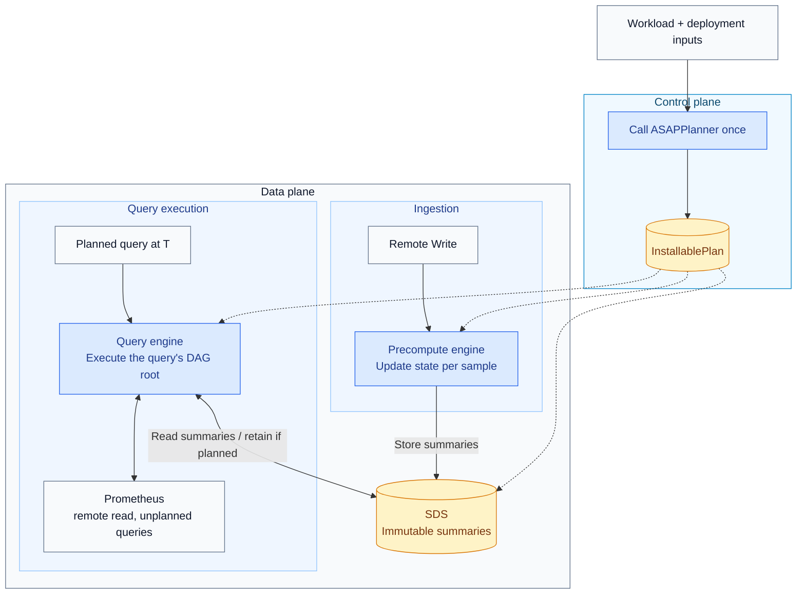

# ASAPQuery-backend on ASAPPlanner's physical DAG

ASAPPlanner turns a query workload and deployment inputs (such as runtime capabilities, prices, and measured costs) into one physical execution plan: a directed acyclic graph (DAG) of operators. ASAPQuery-backend installs that plan, ingests samples, maintains the summaries specified by the plan, and executes its operators to answer queries.

This document designs the backend: what it must achieve, how its components work, where it meets ASAPPlanner, and how it merges with ASAPQuery. The current implementation status and the latest measurements are in the appendix.

## Contents

- [Problem](#problem)
- [Goals and non-goals](#goals-and-non-goals)
- [Architecture](#architecture)
- [Boundary between ASAPPlanner and ASAPQuery-backend](#boundary-between-asapplanner-and-asapquery-backend)
- [Component design](#component-design)
  - [Control plane](#control-plane)
  - [Stored summaries (SDS)](#stored-summaries-sds)
  - [Precompute engine](#precompute-engine)
  - [Query engine](#query-engine)
  - [Raw samples](#raw-samples)
  - [Concurrency and memory](#concurrency-and-memory)
  - [Failure handling](#failure-handling)
- [Evaluation](#evaluation)
- [Alternatives considered](#alternatives-considered)
- [Merging with ASAPQuery](#merging-with-asapquery)
- [Open decisions](#open-decisions)
- [Related designs](#related-designs)
- [Appendix: status and latest measurements](#appendix-status-and-latest-measurements)

## Problem

A metrics workload repeats many queries over the same data: dashboards, alerts, recording rules. ASAPPlanner chooses, for the whole workload, what to precompute as summaries (exact accumulators or sketches), when to build them (during ingestion or at query time), and how long to keep them. That choice only pays off if a runtime executes it faithfully and cheaply. The runtime must:

- build exactly the summaries the plan names, with the same semantics as the plan's reference execution;
- answer every planned query from them;
- cost less than answering the same queries with the database alone.

## Goals and non-goals

**Goals**

- **One planner.** Every planned query executes the plan ASAPPlanner selected, unchanged.
- **Correct answers.** Each answer equals the Planner's reference execution of the same plan, with every node at query time, within the plan's accuracy target.
- **A measurable benefit.** Lower total CPU, memory and latency than Prometheus alone on the same workload, reported in absolute numbers.
- **Any query shape the Planner emits** runs through the same DAG execution, with no per-shape code.

**Non-goals**

- Re-planning when the workload or data changes. A new workload is planned and installed again.
- Durable state and recovery after restart. State is in memory and is rebuilt from new samples.
- SQL workloads. The control plane plans PromQL today, and the design keeps the language a Planner concern.

## Architecture

Dashed arrows show which data-plane components receive the installed plan; solid arrows show planning inputs and runtime operations.
- The precompute engine writes summaries to SDS.
- The query engine reads summaries, and can store query-time summaries for reuse.
- A query's DAG root is the operator that produces its final answer.
- SDS stores the immutable summaries the plan specifies: time panes, rollups over time ranges, rollups across series, and sliding-window summaries. A pane is one kind of summary, covering a bounded time interval; it is not the only kind SDS can hold.

**Repositories.** The backend's code lives in ASAPQuery-backend for now and later merges into ASAPQuery. ASAPPlanner stays a separate repository, used as a library pinned to a specific revision.

## Boundary between ASAPPlanner and ASAPQuery-backend

ASAPPlanner decides **what to compute**, **whether to compute it during ingestion or at query time**, and **how long to retain stored outputs** before eviction. ASAPQuery-backend decides **how to execute that plan on incoming samples and query requests**. The backend calls the Planner once per installed workload and executes the returned plan without modifying it. The Planner consumes descriptions of deployment capabilities and costs; it does not operate the deployment's storage or services.

| Concern | ASAPPlanner | ASAPQuery-backend |
| --- | --- | --- |
| Plan search | Stage 1 generates candidate plans; Stage 2 chooses which intermediate summaries to store; Stage 3 selects a plan using cost and accuracy targets | None |
| Installed plan | One validated DAG, with the operators for constructing and combining time panes already included | Installs it |
| Stored outputs | Specifies each output's computation phase (ingestion or query time), time coverage, and retention duration | Stores them |
| Identifying shared summaries, avoiding duplicate storage, storage layout, eviction | None | SDS |
| Operators | The physical operator library (`asap-executor`): one columnar operator per plan-node kind, per-sample state updaters, `RawSampleSelector` | The execution engine: walks the DAG node by node with those operators |
| Ingestion, watermark, pane close, late data | None | Precompute engine |
| Threads, scheduling, binding a query to its evaluation timestamp | None | Query engine and precompute engine |
| Raw samples | Specifies the time ranges of raw samples a query needs | Local ring buffer, Prometheus remote read |
| Unplanned queries | None | Forwarded to Prometheus, or refused in no-forward mode |
| Deployment inputs (capabilities, AWS Fargate prices, measured costs, data facts) | Consumes them | Supplies them |

**Planning interface: workload and deployment models → executable plan**

Once per installed workload, the backend control plane supplies the query workload and deployment inputs (capabilities, costs, and data facts) to `asap_planner::plan_installable`. The Planner returns `InstallablePlan`, which the backend saves and installs directly.

| Plan field | Role |
| --- | --- |
| `dag` | The selected operators and their dependencies. |
| `queries` | Identifies each planned query and the DAG root that answers it. |
| `stored_outputs` | Tells SDS and the engines which summaries to retain, whether ingestion or query execution builds them, their time coverage, and their retention duration. |
| `query_time_raw_windows` | Tells the runtime which raw-sample windows to fetch for query execution, and sizes its local raw buffer. |
| `selection` | Metadata identifying the selected candidate and its estimated price per second, used for logging and reporting rather than query computation. |

The DAG describes the computation. The stored-output and raw-window metadata make its storage and input requirements explicit, so the backend does not reconstruct them by walking the DAG. Selection metadata describes the planning decision and is separate from the computation itself.

**Runtime interface: samples and summaries → query answers**

After installation, the backend uses the operator library to execute the plan. These are runtime helpers, not plan fields or calls to the Planner.

| Runtime helper | Role |
| --- | --- |
| `RawSampleSelector` | Selects the raw samples that belong to a pane or query-time window: the window's metric, its `Scan` label matchers, the left-open time range, the latest sample per series for instant selectors, and no stale markers. |
| `StateColumnUpdater` | Updates aggregate or sketch states as samples arrive, merges states across shards, and seals them when a pane closes. |
| `Batch::try_from_columns` | Constructs a batch from state columns. The backend stores the batch as an immutable summary; a sealed pane is one example. |
| Compiled operators for DAG nodes | Execute the operations specified by the plan, using input batches to produce output batches. |

The Planner specifies **which summaries to compute and retain**. The operator library supplies **the computation implementations**. The backend supplies **ingestion, scheduling, storage, and query serving**.

**Rules**

- The backend depends only on `asap_planner` and `asap_executor`. Planner internals (frontier search, pane-chain expansion) are crate-private.
- The Planner never sees samples, stores, clocks or services. The backend never changes a plan.
- The data plane always executes the installed DAG node by node, for every query shape. Query shapes do not have separate execution paths that bypass the DAG.
- Each operator has exactly one implementation, in the operator library. The Planner's tests, the correctness reference and the data plane all use it.
- If the backend cannot execute a plan, installation fails with a reason before any part of that plan runs.

## Component design

### Control plane

- **Input:** a PromQL workload (queries, recurrence, accuracy targets, optional range evaluation) and deployment inputs:
  - capabilities: supported summaries, whether raw data is retained, whether query-time results may be kept;
  - plan selection settings: cost model, unit prices, measured operation costs;
  - data facts: metric types, cardinalities, value domains.
- **Planning:** one `plan_installable` call. The control plane never selects among candidates.
- **Install:** the plan is validated and written as `plan.json`. The data plane loads it at startup. In no-forward mode, installation fails unless every query has an executable plan.

### Stored summaries (SDS)

SDS holds every summary the plan stores, and nothing else. It is the runtime half of the summary model in ASAPPlanner's [Schema and Physical Data for ASAP Primitives](https://github.com/ProjectASAP/ASAPPlanner/blob/main/docs/design_docs/proposals/asap-primitive-schema.md). That document defines what a summary state means. Its §4.3 leaves to the runtime how a summary's definition and selection are stored. This section specifies that.

**Summary coverage.** In the Planner's IR, every summary node has a **coverage** with two parts (§4.2 of that document):

| Part | Question | Example: `quantile_over_time(0.99, m{job="api"}[1m] offset 2m)` |
| --- | --- | --- |
| `definition` | *What* is computed: the sub-DAG below the `SummaryAgg` with the selected conditions taken out, the summary family and its parameters, the input column and the grouping | KLL(value) per series over `Scan m` |
| `selection` | *Which rows* went in: value sets, value ranges, and time relative to the evaluation time | time `(−3m, −2m]`, `job ∈ {api}`, once label matchers below the window are lifted |

The Planner derives coverage from the DAG; it is a property of the IR, not a deployment concept. SDS uses it as follows.

- **Definition identity.** A summary definition is identified by the hash of its coverage `definition`, ignoring planning details (`timing`, `guarantee`). Two stored outputs with equal definitions are one SDS definition, whatever their time offsets or selected label values. Six 10-minute KLL panes read at offsets 0 to 50 minutes, for example, are one definition.
- **Summary instances.** Each stored summary is one instance of a definition, keyed by its **concrete selection**: the selection with relative time bound to an absolute interval when the summary is built, `(end − width, end]` for a left-open window.
  - A pane is an instance whose selection is one time interval.
  - A rollup over a time range is an instance whose selection is the union of its inputs' intervals.
  - A rollup across series keeps its definition's coarser grouping.
  - Instances are immutable and shared by reference (`Arc`).
- **Lookups.** A query binds each stored input at evaluation time `T`. It turns the input's relative selection into a concrete one and fetches the instance with that key.
- **Reuse rules, from the coverage model.** These are the Planner's rules; SDS stores instances so that a plan which uses them can find them.
  - Instances of one definition can be merged when their selections do not overlap (`SummaryMerge`). That is how panes form a window and how per-value summaries form a union.
  - An instance can be sliced only on a grouping column, and rolled up to a coarser grouping only when its family allows it (§5.6).
  - SDS never merges, slices or rolls up on its own. It stores and returns the instances the plan names.
- **Kinds.** Any output the plan stores: time panes, rollups over time ranges, rollups across series, sliding-window summaries, and query-time results kept across evaluations. Each arrives in `stored_outputs` with its coverage, its inputs (raw samples or other stored outputs), its build phase and its retention.
- **Retention.** Each definition is kept for the largest `retention_ms` among its outputs. That value already includes range-evaluation spans. Instances whose concrete time selection ends before that horizon are evicted.

**Contract with the Planner.** `InstallablePlan.stored_outputs` should carry each output's coverage: definition identity and relative selection. Then SDS identity, keys and lookups follow the Planner's semantics, and the runtime does not re-derive them from the DAG. Today the plan describes only raw-sample panes, by their time window. Describing every stored summary with its coverage is tracked in ASAPPlanner #781 and backend #837.

### Precompute engine

The precompute engine builds each ingestion-time summary exactly once, as soon as its inputs are complete: a summary over raw samples when the watermark closes its time window, and a summary over other stored summaries (a rollup over time ranges or across series, or a sliding-window summary) once all of those inputs are sealed. Summaries are built in the plan's dependency order.

1. **Route.** Each Remote Write series is interned to a dense series id at decode. Then, once per series, it is matched against each definition's `RawSampleSelector` (metric and label matchers), and its group in that definition is computed. The result is cached by series id.
2. **Update.** Each sample updates its open pane's state in place through `StateColumnUpdater`, the same code the batch build uses. A per-sample pane therefore equals a pane built from the same samples in one batch.
3. **Close.** A pane `(end − width, end]` closes when the watermark passes `end`.
   - The watermark is the newest routed sample's time minus the allowed lateness.
   - Samples with timestamps beyond a bounded distance into the future are dropped and counted; they never advance the watermark.
4. **Seal.** Each worker seals its states, `Batch::try_from_columns` turns them into a batch, and the batch is inserted into SDS. A group split across workers is built from the combined samples with the plan's batch build.
5. **Evict.** Per definition, by retention.

**Rules**

- **Late samples:** a sample for an already-built pane is dropped and counted. There are no revisions.
- **Startup:** the first pane is skipped, because it may be partial.
- **Back-pressure:** Remote Write returns 503 when the queued samples exceed a bound.
- **Counters:** accepted, late-dropped, first-pane-skipped and future-dropped samples are exposed.

### Query engine

A planned query is answered by executing its DAG root at each evaluation time `T`.

- **Compile once.** The plan is compiled once at install and shared by every query thread.
- **One query per thread.** Queries run on a fixed pool. One evaluation, and all steps of a range query, run on one thread.
- **Inputs of one evaluation at `T`:**

  | Input | How it is read |
  | --- | --- |
  | Summary built at ingestion | The definition's summary whose coverage ends at `T − offset` |
  | Query-time summary kept across evaluations | Reused if an earlier evaluation built it after its coverage closed; otherwise computed now, and stored in SDS only once its coverage is closed |
  | Query-time raw window | Raw samples for `(T − offset − width, T − offset]`, selected by the window's `RawSampleSelector` |

- **Range queries.** One evaluation per step, `T = start + k · step`, on the query's thread. Raw samples are read once for the range and sliced per step, and summaries are shared across steps.
- **Forwarding.** An evaluation that cannot run as planned is forwarded whole to Prometheus, with the reason in `x-asap-forward-reason`. Reasons include:
  - a missing summary, for example one older than its retention;
  - a `T` off the pane grid;
  - a root that cannot be compiled.

  In **no-forward mode** the same cases return an error with the reason, so every answer is computed by ASAP.

### Raw samples

- **Local buffer.** Query-time raw windows are served from a per-metric ring buffer filled by Remote Write. Each metric's buffer is sized by the longest query-time raw window of that metric in the plan. Metrics with no query-time raw window are not buffered.
- **Remote read.** Anything older than the buffer is read from Prometheus with remote read (protobuf).
- Stale markers are not samples. `RawSampleSelector` drops them, and an instant selector whose latest sample is stale yields no row.

### Concurrency and memory

- **Workers.** Ingestion is sharded by series id across N workers. Each worker owns its open-pane states, so updates take no lock. The global watermark is the minimum of the workers' watermarks.
- **Store.** SDS is a read-write lock over (definition → end → `Arc` summary).
  - Queries take the read lock only to clone the `Arc`s they need.
  - Inserts and evictions take the write lock briefly.
- **Memory accounting.** A query's execution memory limit charges what the query allocates: new states, merged results, copies. It does not charge the shared summaries it reads, which SDS already holds.
- **Allocator.** jemalloc is the global allocator.

### Failure handling

- **Installation** fails, with a reason, on a plan the backend cannot run.
- **Out-of-range timestamps** and arithmetic on pane boundaries are checked, so a bad sample is dropped and counted rather than stalling or crashing the engine.
- **Engine failure:** if an engine thread fails, the data plane reports an internal error and becomes unready. It does not report itself busy indefinitely.

## Evaluation

- **Correctness.** End-to-end tests run the data-plane binary on the planner-layering PromQL examples. Data enters through Remote Write, and every answer is compared with the Planner's reference execution of the same plan. Equality is exact, except within a stated tolerance for sketches with randomized compaction.
- **Benefit.** The same workload runs on one deployment twice:
  - once with Prometheus alone answering every query exactly (the baseline);
  - once with the backend executing the plan.

  Reported, in absolute numbers:
  - CPU core-seconds of every service, including the backend deployment's own Prometheus;
  - peak memory;
  - p50/p99 latency per query;
  - error against the exact answer, and whether it meets the target;
  - the number of forwarded evaluations.

  Benefit runs use no-forward mode, so forwarded work cannot hide in Prometheus' CPU.
- **Workloads.** The planner-layering examples, the Kubernetes recording-rule set, and ASAPQuery's random mixed workloads, over seeded generated data. The deployment inputs are AWS Fargate us-east-1 unit prices, measured operation costs, and distinct-count bounds read from the generated data.
- **Cost feedback.** The runtime measures its own per-operation costs on the deployment machine and supplies them as Planner inputs. Stage 3's predicted resource use for the selected plan is reported next to the measured use.

## Alternatives considered

- **Shape-matched fast paths** (hand-written code for common query shapes beside the DAG). Rejected: they need a second implementation of every shape kept in step with the DAG, and they cannot cover arbitrary roots. The data plane always executes the DAG; speed comes from the columnar operator library.
- **SDS inside ASAPPlanner.** Rejected: identity, deduplication, layout and eviction are deployment concerns. The Planner states only each output's computation, coverage and retention.
- **Row-at-a-time execution.** Replaced: per-row values, clones, grouping keys and memory accounting dominated data-plane CPU, and the sketch kernels were a small fraction. All operators now work on Arrow column batches with state columns.
- **The runtime deriving storage needs from the DAG.** Replaced by `stored_outputs`. The Planner already knows each output's materialization and retention, including range-evaluation spans, so the runtime reads them instead of re-deriving them.
- **Storing only raw-sample panes.** Rejected: the plan also stores rollups, sliding-window summaries and kept query-time results. Storing only panes would recompute those at every evaluation, or refuse them at install.

## Merging with ASAPQuery

The merged runtime keeps ASAPQuery's low-overhead data path and the backend's single planner and DAG execution.

**Key points**

1. **One planner.** ASAPPlanner replaces `asap-planner`. Every planned query executes the plan selected by Stage 3.
2. **One executor.** The data plane executes the installed DAG with ASAPPlanner's columnar operator library. It replaces `SimpleEngine` and pattern matching.
3. **ASAPQuery's data path.** Sharded per-sample ingestion with a per-worker watermark (the global watermark is their minimum), immutable `Arc` state shared by reference, jemalloc. The per-sample updates use the operator library's updaters, so incremental state updates produce the same states as building them from a batch of samples.
4. **The backend's SDS.** Identify summaries by their definitions, reuse them across query time offsets, and evict summaries according to the plan's retention duration.
5. **Read raw samples locally when available.** A ring buffer filled by Remote Write serves query-time raw windows; Prometheus remote read covers anything older.
6. **ASAPQuery's features come along.** OTLP and VictoriaMetrics ingestion, idle-window close, the query tracker (now feeding ASAPPlanner), plan swap at runtime, the drop-in deployment and the PromQL compliance suite.
7. **Measured costs feed future planning.** Supply runtime measurements as deployment inputs for subsequent Planner calls; they do not modify an already installed plan.

**Component choice**

| Component | From |
| --- | --- |
| Planner, installed plan, stored outputs, retention | ASAPPlanner |
| Operators and per-sample updaters | ASAPPlanner's operator library |
| DAG execution engine, SDS | Backend |
| Ingestion drivers, sharded router, watermark | ASAPQuery |
| Store concurrency | ASAPQuery's model with the backend's immutable summaries |
| Local raw windows, remote read | Backend |
| HTTP adapters, forwarding, tracker, drop-in | ASAPQuery |

**Remaining integration work**

1. Replace ASAPQuery's planner and query-pattern execution paths with the backend's `InstallablePlan` installation and compiled DAG execution.
2. Connect ASAPQuery's additional ingestion drivers, workload discovery, query tracking, runtime plan replacement, and deployment support to that execution path.
3. Preserve summary identity, retention, and per-sample update semantics across the combined runtime, and validate answers against the Planner's reference execution.
4. Extend measured-cost coverage to every operator the runtime pays for, so Stage 3's predictions match measured use.

## Open decisions

- **Pane retention.** The runtime keeps ingestion-built panes for one extra pane width beyond the plan's retention, to cover evaluations just behind the newest closed pane. Whether the Planner should model the deployment's evaluation delay explicitly remains a design question.
- **Idle shards.** A shard that stops receiving samples no longer advances its watermark (the timestamp used to decide which panes can close). Its panes then stay open.
  - A producer can close them with the event-time barrier `POST /api/v1/precompute/watermark?time_ms=T`. The barrier is queued behind acknowledged writes, closes every pane ending at or before `T`, is capped at the wall clock, and leaves input open. With several producers, it must be sent only after all of them have written through `T`.
  - Whether the runtime should also close idle panes by elapsed wall-clock time, without a producer barrier, remains open.
- **The local raw buffer.** Expose it as an explicit capability with a cost the Planner can compare, or keep it as a runtime choice whose effect is reflected in measured costs.
- **Planner dependency weight.** `plan_installable` lives in `asap-planner`, which also builds the SQL and MetricsQL frontends. A PromQL-only runtime would benefit if those frontends were optional features.

## Related designs

The precompute and query engines have their own detailed designs:
- [Precompute DAG execution](../design_docs/precompute-dag-execution.md): installing the plan, routing samples to workers, executing ready work, and publishing the selected DAG's outputs.
- [Query DAG execution](../design_docs/query-dag-execution.md): compiling, binding and executing a query's DAG root, and request consistency.

Both were written for the earlier implementation, before the runtime moved onto ASAPPlanner's installable plan. Where they differ from this document, this document is current. Reconciling them with it is open work.

## Appendix: status and latest measurements

**Status.** The backend runtime is a stack of pull requests in ASAPQuery-backend: control plane, SDS, precompute engine, query engine, correctness tests, kept query-time results, range queries, the installable-plan handoff, concurrency, per-sample ingestion, local raw windows, the columnar engine, series interning and cost feedback. They merge in that order after review. ASAPPlanner's columnar operator library is complete.

**Latest reported performance.** This is the 90-minute benefit harness with Prometheus 3.5.0, four queries, and four CPU cores allocated to each service. `s10` and `s50` are the 1,000- and 5,000-series configurations. Prometheus alone was measured in the same session, and the backend setup's Prometheus still receives the samples.
- **CPU** is core-seconds over the complete run; lower is better.
- **Total CPU** includes both services.
- **Peak RSS** is backend-only, not total system memory.

| Configuration | Prometheus alone CPU | Backend CPU | Backend's Prometheus CPU | Total CPU | Backend peak RSS (GiB) | Forwarded evaluations |
| --- | ---: | ---: | ---: | ---: | ---: | ---: |
| s10, raw retained | 18.9 | 11.2 | 8.6 | 19.8 | 0.04 | 90 |
| s10, no raw retained | 19.9 | 19.4 | 6.3 | 25.7 | 0.34 | 5 |
| s50, raw retained | 86.7 | 52.0 | 41.7 | 93.7 | 0.11 | 90 |
| s50, no raw retained | 85.3 | 84.3 | 29.9 | 114.2 | 0.81 | 5 |

In the raw-retained runs, the 90 forwarded evaluations are quantile queries whose selected exact plan the executor could not run at the time. The Planner now rejects such candidates and the executor runs exact per-series aggregates. Because forwarded work was done by Prometheus, the lower backend CPU and RSS in those runs partly reflect work done upstream. Combined CPU is above Prometheus alone in all four configurations, so these results do not yet establish a whole-system saving. All evaluations met their accuracy targets.
