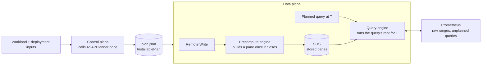

# ASAPQuery-backend on ASAPPlanner's physical DAG

## Overview

ASAPQuery-backend executes the plan ASAPPlanner selects, as given, and never selects plans itself. ASAPPlanner turns a query workload and the deployment's inputs into one physical ASAP DAG. The backend ingests data, maintains the state that DAG names, and answers each query from it.

**Goals**

- One planner: every plan the backend runs is Stage 3's selected plan, at one pinned Planner revision.
- Answers equal the Planner's own executor on the same plan.
- Lower CPU, memory and latency than Prometheus alone on the same workload, measured in absolute numbers.

**Scope**

- PromQL over Prometheus Remote Write; instant and range queries.
- All three materializations the Planner selects: at ingestion time, at query time, and at query time kept across evaluations.
- State in memory.

**Non-goals**

- Re-planning when the workload or data changes.
- Persistent state (S3) and recovery after restart.
- SQL and ClickHouse.

**Repository.** All backend code lives in ASAPQuery-backend. The backend will later merge into ASAPQuery. ASAPPlanner stays a separate repository, used as a pinned library.

## Architecture

The control plane plans once and installs the result; the data plane only executes it.



The precompute and query engines both run code compiled from the same installed DAG, so stored panes and the queries that read them cannot disagree on shape. A query the plan does not cover goes to Prometheus, and so does every raw range the plan reads at query time.

## Boundary between ASAPPlanner and ASAPQuery-backend

ASAPPlanner decides **what** to compute, when, and for how long. ASAPQuery-backend decides **how** to run it on real data. The backend calls the Planner once per installed workload and never plans. The Planner holds no deployment, storage or service concepts.

**Responsibilities**

| Concern | ASAPPlanner | ASAPQuery-backend |
| --- | --- | --- |
| Query languages | Parses and lowers PromQL, MetricsQL, SQL | Passes query text through |
| Plan search | Stage 1 candidates, Stage 2 materialization and timing, Stage 3 cost and accuracy selection | None |
| The installed plan | Produces one validated DAG, with pane chains already expanded | Installs it as `plan.json` |
| Which outputs to store | Lists them: when each is built (ingestion run or query run), its pane window, and the retention it needs | Stores them |
| Summary identity and dedup | None | SDS: the definition id comes from the sub-DAG, ignoring offset-only `TimeShift`s; identical outputs are stored once |
| Store layout, retention, eviction | States each output's required retention only | SDS: keeps each definition for the largest retention among its outputs and evicts it after that; memory now, S3 later |
| Ingestion | None | Remote Write, watermark, pane close, late samples |
| Selecting a window's samples | `RawSampleSelector`: the metric to route, the window bounds, the Scan's label matchers, and the latest-sample rule for instant selectors | Routes samples by metric and buffers them per pane |
| Computing a pane or a query | The executor compiles and runs any plan node | Calls the executor at the right time and scope |
| Time binding | States pane windows and offsets relative to an evaluation time | Picks `T`, binds stored panes and raw ranges, fetches raw samples from Prometheus |
| Unplanned queries | None | Forwards them to Prometheus |
| Deployment inputs | Consumes them | Supplies them: capabilities, AWS Fargate prices, measured costs, data facts |

**What crosses the boundary**

```
// Backend → Planner (one call)
asap_planner::plan_installable(UserInput {
    workload,                    // PromQL queries with recurrence, accuracy target, latency bound, optional range evaluation
    models: PlanningModels {     // deployment inputs
        deployment_capabilities, // summaries the runtime runs (default: the Planner executor's), raw data retained, query-time results retained
        plan_selection_settings, // cost model + unit prices (e.g. the AWS Fargate preset), measured operation costs
        ..
    },
})

// Planner → backend
InstallablePlan {
    dag,                    // the selected physical ASAP DAG, with its wire version
    queries,                // each query and the DAG root that answers it
    stored_outputs,         // node, built_at (IngestionRun | QueryRun), pane window, retention_ms
    query_time_raw_windows, // raw-sample windows read at query time
    selection,              // selected candidate id and cost per second, for reporting
}

// Backend → executor, while running
RawSampleSelector::new(&dag, &window)?.metric() / .rows(window_end_ms, samples)
compile + execute the plan's nodes in an ingestion or query scope
```

**Rules that keep the boundary**

- The backend depends only on `asap_planner` and `asap_executor`. Planner internals (frontier search, pane-chain expansion, sample-row encoding) are crate-private, and the Planner's CI checks this.
- The Planner never sees samples, stores, clocks or services. The backend never changes a plan.
- A plan the backend cannot run is refused when it is installed, never partly executed. Unsupported shapes (scalar roots, subquery or `@` windows, negative offsets) fail in `plan_installable` with a reason.

## Stored summaries (SDS)

Every DAG output the plan stores becomes one stored-summary definition. The SDS stores those outputs and nothing else.

- **Where definitions come from:** `InstallablePlan.stored_outputs`. Each entry gives the node, when it is built, and its pane window: `width_ms` ending `end_offset_ms` before the evaluation time.
- **Identity:** the SDS computes it. It is a hash over the definition's payloads and schemas, with `TimeShift` offsets zeroed, so outputs that differ only in offset share one definition. In the Example 4 workload, six 10-minute KLL panes become one definition read at offsets 0 to 50 min.
- **Storage:** panes are keyed by (definition, pane end) and held in memory.
- **Retention:** each definition is kept for the largest `retention_ms` among its outputs, then evicted.
- **Not read:** summary coverage. The SDS stores what the plan names; reuse decisions were already made by the Planner.

Identity rule: an offset-only `TimeShift` takes its input's identity, and the offset moves into the pane binding. The newest pane has no shift node and older panes do, so without this rule Example 4b would build 12 panes instead of 6.

## Precompute engine

The precompute engine builds each stored pane exactly once, when the watermark closes it, by running the builder the plan's DAG defines.

1. **Select:** Remote Write samples are routed by metric (`RawSampleSelector::metric`) and buffered per definition and pane. The selector applies the plan's own `Scan`, so its label matchers apply.
2. **Close:** a pane `(end − width, end]` closes when the watermark (newest sample minus the allowed lateness) passes `end`. Panes are open at the start, like PromQL ranges.
3. **Build:** the definition's builder, compiled from the DAG by the Planner's executor, produces the summary batch, which goes to the SDS.
4. **Evict:** the SDS drops a pane once it is older than its definition's retention. A query further behind than that is forwarded to Prometheus.

- **Late samples:** a sample for an already-built pane is dropped and counted. There are no revisions or backfill.
- **Startup:** the first pane is skipped because it may be partial.
- **Back-pressure:** `/api/v1/write` returns 503 when the engine queue is full.
- **Threading:** the Planner's DAG type is not `Send`, so the plan runs on one engine thread.

## Query engine

A planned query is answered by running its root of the DAG, compiled with the Planner's executor, at each evaluation time `T`. A query the plan does not cover goes to Prometheus unchanged.

**Inputs of one evaluation at `T`**, by when the plan builds each input:

| Input | How it is read |
| --- | --- |
| Stored output built in an ingestion run | The stored pane of its definition that ends at `T − end_offset` |
| Stored output built in a query run (kept across evaluations) | The kept result for the window ending at `T − end_offset`, if an earlier evaluation computed it after its pane closed; otherwise computed now, and kept only once its pane is closed |
| Query-time raw window | Raw samples from Prometheus for `(T − end_offset − width, T − end_offset]`, selected by the plan's `Scan` |

**Instant queries.** One evaluation at the request's time `T`. The answer is a Prometheus vector.

**Range queries.** One evaluation per step, `T = start + k · step` up to `end`; the answer is a Prometheus matrix. Raw samples are fetched once for the whole range and sliced per step. Each step reads stored panes or kept results where the plan chose them, so consecutive steps share work the same way consecutive evaluations of a recurring query do.

**Forwarding.** An evaluation that cannot run as planned is forwarded whole, with the reason in `x-asap-forward-reason`. Reasons include a stored pane or kept result that is missing (for example older than its retention), a `T` off the pane grid, or an unsupported root shape. Answered queries carry `x-asap-execution: plan`, forwarded ones `forwarded`.

**State** lives in memory only and is rebuilt from new samples after a restart.

## Evaluation

The backend is evaluated in two steps. First, its answers must equal the Planner executor's. Then its resource use is compared with Prometheus alone.

**Correctness.** An end-to-end test runs the real data-plane binary on the planner-layering PromQL Examples 1, 3a, 3b, 4a and 4b. Data enters through Remote Write, and a stand-in Prometheus serves raw ranges. Each answer is compared with the Planner executor running the same selected plan with every node at query time (`InstallablePlan::query_time_reference`). KLL answers are compared within a value tolerance of 10, about twice KLL's 0.005 rank error, because the library seeds KLL compaction randomly. All others must match exactly.

| Example | Deployment | Planner chose | Result |
| --- | --- | --- | --- |
| 1 | default | everything at query time, exact | exact |
| 3a | default | KLL at query time | 4 of 5 queries exact; the 5-year query off by 1 (987 vs 988) |
| 3b | default | KLL at query time | exact (36) |
| 3b | no raw data retained | 1-minute panes built at ingestion | exact (36) |
| 4a | default | KLL at query time | exact |
| 4b | no raw data retained | six 10-minute panes built at ingestion | exact (237 and 1237) |
| 4 B3 | query-time results kept | 1-minute panes kept across evaluations | exact at 10, 11 and 12 min; raw ranges fetched 5, 1, 1 |

**Benefit.** The same workload runs twice on one deployment. Once, Prometheus alone answers every query exactly at query time; this is the baseline. Once, the backend executes the Planner's selected plan. Both runs report absolute numbers, never ratios:

- CPU core-seconds and memory GiB over the run;
- latency per query;
- error against the exact answer, and whether it meets the query's accuracy target;
- Stage 3's predicted resource usage next to the measured values, which also checks the cost model.

Workloads: the planner-layering examples, and the Kubernetes rule set (the apiserver, etcd and kubelet rules from recorded SRE-agent traces) over seeded generated data. The deployment inputs are AWS Fargate us-east-1 unit prices, sketch-bench's measured operation costs, and distinct-count bounds read from the generated data's distribution. The baseline is a pinned Prometheus 3.x. Prometheus 2.x includes the sample at a range's start, while the Planner and executor use left-open ranges, as Prometheus 3.x does.

## Implementation plan

| Piece | Status | Where |
| --- | --- | --- |
| Control plane: plan with the Planner, install `plan.json` | Built | ASAPQuery-backend #818 |
| Stored summaries (SDS) | Built | #819 |
| Precompute engine | Built | #820 |
| Query engine, instant queries | Built | #821 |
| Correctness end-to-end test | Built | #822 |
| Query-time results kept across evaluations | Built | #824 |
| Range queries | Built | #825 |
| Planner handoff: one `plan_installable` call, stored outputs with retention, `RawSampleSelector` | Merged in ASAPPlanner | ASAPPlanner #755, #759 |
| Fargate price preset | Merged in ASAPPlanner | ASAPPlanner #756 |
| Re-pin the backend to the Planner handoff API and drop its own chain expansion, frontier search and reference rebuild | To build | New PR |
| Benefit experiment harness and generator | In progress | New PR |
