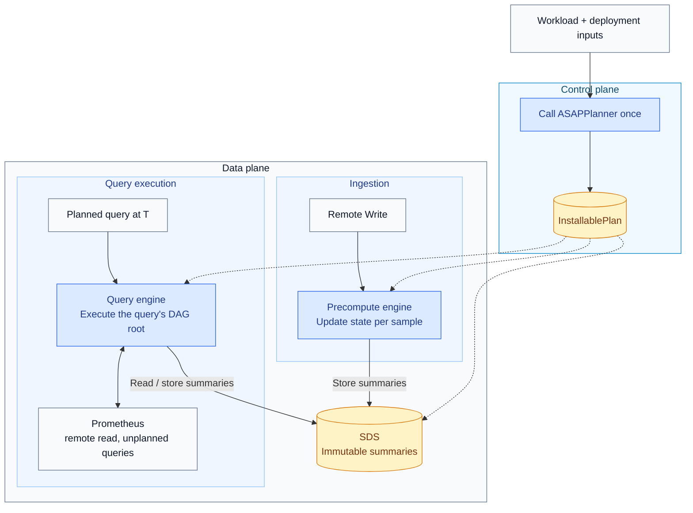

# ASAPQuery-backend on ASAPPlanner's physical DAG

ASAPPlanner turns a query workload and deployment inputs (such as runtime capabilities, prices, and measured costs) into one physical execution plan: a directed acyclic graph (DAG) of operators. ASAPQuery-backend installs that plan, ingests samples, maintains the states specified by the plan, and executes its operators to answer queries. This document covers three things:

1. the boundary between ASAPPlanner and ASAPQuery-backend;
2. how the backend compares with ASAPQuery, and where the benefit comes from;
3. the key points for merging the backend into ASAPQuery.

**Repositories.** The backend's code lives in ASAPQuery-backend for now and later merges into ASAPQuery. ASAPPlanner stays a separate repository, used as a library pinned to a specific revision.

Dashed arrows show which data-plane components receive the installed plan; solid arrows show planning inputs and runtime operations. The precompute engine writes summaries to SDS; the query engine reads summaries and can store query-time summaries for reuse. A query's DAG root is the operator that produces its final answer. SDS stores immutable summaries specified by the plan, including time panes, rollups over time ranges, rollups across series, and sliding-window summaries. A pane is one kind of summary, covering a bounded time interval; it is not the only kind SDS can hold.

## Boundary between ASAPPlanner and ASAPQuery-backend

ASAPPlanner decides **what to compute**, **whether to compute it during ingestion or at query time**, and **how long to retain stored outputs** before eviction. ASAPQuery-backend decides **how to execute that plan on incoming samples and query requests**. The backend calls the Planner once per installed workload and executes the returned plan without modifying it. The Planner consumes descriptions of deployment capabilities and costs; it does not operate the deployment's storage or services.

| Concern | ASAPPlanner | ASAPQuery-backend |
| --- | --- | --- |
| Plan search | Stage 1 generates candidate plans; Stage 2 chooses which intermediate summaries to store; Stage 3 selects a plan using cost and accuracy targets | None |
| Installed plan | One validated DAG, with the operators for constructing and combining time panes already included | Installs it |
| Stored outputs | Specifies each output's computation phase (ingestion or query time), time coverage, and retention duration | Stores them |
| Identifying shared summaries, avoiding duplicate storage, storage layout, eviction | None | SDS |
| Operators | The physical operator library (`asap-executor`): one columnar operator per plan-node kind, per-sample state updaters, `RawSampleSelector` | The execution engine: walks the DAG node by node with those operators |
| Ingestion, watermark, pane close, late data | None | Precompute engine |
| Threads, scheduling, binding a query to its evaluation timestamp | None | Query engine and precompute engine |
| Raw samples | Specifies the time ranges of raw samples a query needs | Local ring buffer, Prometheus remote read |
| Unplanned queries | None | Forwarded to Prometheus |
| Deployment inputs (capabilities, AWS Fargate prices, measured costs, data facts) | Consumes them | Supplies them |

**Planning interface: workload and deployment models → executable plan**

Once per installed workload, the backend supplies the query workload and deployment models (capabilities, costs, and data facts). The Planner returns `InstallablePlan`: the execution plan and metadata the backend needs to install it. This is the role of `asap_planner::plan_installable`; `UserInput` packages those inputs, and `models` refers to deployment models, not machine-learning models.

| Plan field | Meaning for the backend |
| --- | --- |
| `dag` | The operators to execute and their dependencies. |
| `queries` | Maps each planned query to the DAG node that produces its answer. |
| `stored_outputs` | Identifies which node outputs to store, whether to build them during ingestion or query execution (`built_at`: `IngestionRun` or `QueryRun`), the time coverage of each summary, and how long to retain it (`retention_ms`, in milliseconds). |
| `query_time_raw_windows` | Specifies which time ranges of raw samples are needed during query execution. |
| `selection` | Records the selected candidate and its estimated cost per second for reporting. |

**Runtime interface: samples and summaries → query answers**

After installation, the backend uses the operator library to execute the plan. The following names refer to separate runtime helpers, not additional plan fields or calls to the Planner.

| Runtime helper | Role |
| --- | --- |
| `RawSampleSelector` | Selects the raw samples that belong to a pane or query-time window. |
| `StateColumnUpdater` | Updates aggregate or sketch states as samples arrive, merges states across shards, and seals them when a pane closes. |
| `Batch::try_from_columns` | Constructs a batch from state columns. The backend can store the batch as an immutable summary; a sealed pane is one example. |
| Compiled operators for DAG nodes | Execute the operations specified by the plan, using input batches to produce output batches. This describes a group of operators, not a single API name. |

The Planner specifies **which summaries to compute and retain**. The operator library supplies **the computation implementations**. The backend supplies **ingestion, scheduling, storage, and query serving**.

**Rules**

- The backend depends only on `asap_planner` and `asap_executor`. Planner internals (frontier search, pane-chain expansion) are crate-private.
- The Planner never sees samples, stores, clocks or services. The backend never changes a plan.
- The data plane always executes the installed DAG node by node, for every query shape. Query shapes do not have separate execution paths that bypass the DAG.
- Each operator has exactly one implementation, in the operator library. The Planner's tests, the correctness reference and the data plane all use it.
- If the backend cannot execute a plan, installation fails with a reason before any part of that plan runs.

## ASAPQuery and ASAPQuery-backend compared

**What each does**

| | ASAPQuery | ASAPQuery-backend |
| --- | --- | --- |
| Planner | `asap-planner`: query pattern → one aggregation config; optional MILP | ASAPPlanner Stages 1–3: exact or summary, sketch and parameters per accuracy target, materialization, pane chains, retention |
| When summaries are built | During ingestion | During ingestion or at query time; query-time summaries can be retained for later evaluations |
| Query shapes | Fixed patterns, binary arithmetic, top-k, quantile | Any query shape represented by a DAG the Planner emits |
| Correctness reference | Differential tests, PromQL compliance suite | Answers checked against a reference that executes every node at query time |
| Summary sharing across offsets | Inside one sliding aggregation | SDS reuses the same stored summary across outputs and query time offsets |
| Ingestion | Remote Write, VictoriaMetrics, OTLP, files; sharded workers; per-sample update | Remote Write; sharded workers; per-sample update |
| Store | Columnar epochs, interned label ids, `Arc` states | Immutable summaries shared through `Arc` under an `RwLock` |
| Query languages | PromQL, SQL, Elastic, ClickHouse adapters | PromQL |
| Workload discovery, plan swap, drop-in | Yes | No |

**Where the backend's overhead came from.** The first benchmark runs comparing CPU use with Prometheus had the backend using 2–3× Prometheus' CPU. A profile showed the cause was the executor's row layout, not the DAG or the sketches:

- row allocation, cloning, per-row group keys and per-row memory accounting took 68–75% of data-plane CPU;
- sketch and accumulator kernels took 3–7%;
- the rest was JSON fetching of raw ranges, the glibc allocator, and one engine thread.

ASAPQuery avoids all of these: it updates states in place per sample, stores `Arc` states in columns, uses jemalloc, shards ingestion across workers, and never reads raw data.

**Fixes made, and their effect**

- *In ASAPPlanner:* every operator of the operator library is now columnar (Arrow batches, interned group ids, state columns, per-sample updaters).
- *In the backend:* jemalloc, sharded ingestion, a query thread pool, immutable summarys shared through `Arc` under an `RwLock`, per-sample ingestion, a local raw ring buffer and Prometheus remote read.

In-process measurements using the same data and queries on one CPU core (lower is better):

| Step | ASAPQuery | Backend before | Backend now |
| --- | --- | --- | --- |
| Summary construction | 2.3 µs/sample | 10.5 µs/sample | 1.2 µs/sample (per-sample updater) |
| `sum by (job) (rate(...[1m]))` | 4.1 ms | 15.4 ms | 5.3 ms |
| `topk by (job) (10, ...)` | 1.0 ms (approximate) | 15.5 ms (exact) | 5.4 ms (exact) |
| `quantile_over_time(0.99, ...[5m])` | 24.8 ms | 31.1 ms | 21.5 ms |
| `quantile_over_time(0.99, ...[60m])` | 33.5 ms | 62.2 ms | 50.4 ms |

The "now" column comes from a later benchmark session on the same machine. These are in-process operator and query timings; they do not establish a whole-system CPU improvement.

Whole-system measurements against Prometheus alone (data-plane CPU core-seconds over a 90-minute run; Prometheus 3.5.0; 4 cores each; lower is better). Here, "before" and "now" refer to the whole-system benchmark runs, separately from the in-process measurements above:

| Series | Raw data retained | Prometheus alone | Backend before | Backend now |
| --- | --- | --- | --- | --- |
| 2,000 | yes | 18.9 | 44.6 | 36.6 |
| 2,000 | no | 18.3 | 38.2 | 31.7 |
| 10,000 | yes | 85.0 | 248.0 | 152.6 |
| 10,000 | no | 90.4 | 200.6 | 133.6 |

The whole-system "Backend now" column still uses the row-based executor: those runs did not yet use a backend dependency pinned to the columnar operator library. Correctness: in the benefit runs, all 5,920 planned evaluations equal the Planner's reference answers.

**What still blocks lower whole-system CPU use than Prometheus**

- The backend must move to the columnar operator library and the per-sample updater.
- Stage 3 under-predicts the runtime's CPU by 400–1,500×. It then picks query-time plans that rebuild sketches from raw data at every evaluation. The runtime's measured costs must be fed back to the Planner as a deployment input.
- Joint planning over the Kubernetes rule set drops cheaper plans, and several common rule shapes are not yet supported (regex matchers, `histogram_quantile`, `sum without`, chained rules).

## Merging with ASAPQuery

The merged runtime keeps ASAPQuery's low-overhead data path and the backend's single planner and DAG execution.

**Key points**

1. **One planner.** ASAPPlanner replaces `asap-planner`. Every planned query executes the plan selected by Stage 3.
2. **One executor.** The data plane executes the installed DAG with ASAPPlanner's columnar operator library. It replaces `SimpleEngine` and pattern matching.
3. **ASAPQuery's data path.** Sharded per-sample ingestion with a per-worker watermark (the global watermark is their minimum), immutable `Arc` state shared by reference, jemalloc. The per-sample updates use the operator library's updaters, so incremental state updates produce the same states as building them from a batch of samples.
4. **The backend's SDS.** Identify summaries by their definitions, reuse them across query time offsets, and evict summaries according to the plan's retention duration.
5. **Read raw samples locally when available.** A ring buffer filled by Remote Write serves query-time raw windows; Prometheus remote read covers anything older.
6. **ASAPQuery's features come along.** OTLP and VictoriaMetrics ingestion, idle-window close, the query tracker (now feeding ASAPPlanner), plan swap at runtime, the drop-in deployment and the PromQL compliance suite.
7. **Measured costs feed future planning.** Supply runtime measurements as deployment inputs for subsequent Planner calls; they do not modify an already installed plan.

**Component choice**

| Component | From |
| --- | --- |
| Planner, installed plan, stored outputs, retention | ASAPPlanner |
| Operators and per-sample updaters | ASAPPlanner's operator library |
| DAG execution engine, SDS | Backend |
| Ingestion drivers, sharded router, watermark | ASAPQuery |
| Store concurrency | ASAPQuery's model with the backend's immutable summaries |
| Local raw windows, remote read | Backend |
| HTTP adapters, forwarding, tracker, drop-in | ASAPQuery |

**Implementation stages**

These statuses describe the implementation and benchmark snapshots discussed above.

| Stage | Change | Status |
| --- | --- | --- |
| A | jemalloc; panes shared by `Arc` | Done in the backend |
| B | Per-sample ingestion | Done in the backend, on the row executor |
| C | Columnar operator library in ASAPPlanner | Done except removing the row form and making compiled plans `Send + Sync` |
| D | Sharded ingestion, query pool, local raw windows, remote read | Done in the backend |
| E | Re-pin the backend to the columnar library; feed measured costs to the Planner | Next |
| F | ASAPQuery features (OTLP, VictoriaMetrics, idle close, tracker, plan swap, compliance suite) | Later |
| G | Merge into ASAPQuery, replacing `asap-query-engine` internals and `asap-planner` | Later |

For each stage, rerun the benchmark harness and report absolute CPU measurements against Prometheus alone.

**Open decisions**

- Pane retention. Retention is counted from the newest closed pane. A delayed query can therefore need a pane that has already been evicted, causing the query to be forwarded to Prometheus. Options: add a margin of one pane width in the runtime, or have the Planner include the deployment's evaluation delay in `retention_ms`.
- Idle shards. A shard that stops receiving samples no longer advances its watermark (the timestamp used to decide which panes can close). Its panes remain open unless the runtime closes them using elapsed wall-clock time; that mechanism is not implemented yet.
- Whether to expose the local raw buffer as an explicit capability with a cost the Planner can compare, or keep it as a runtime choice whose effect is reflected in measured costs.
