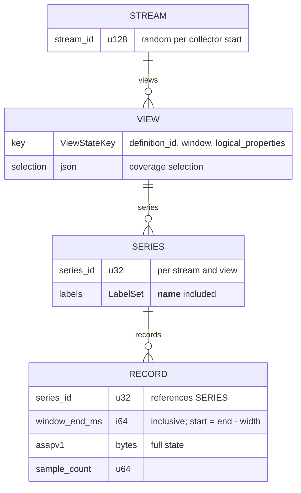

# Design: leaf sketch views precomputed in the collector

Status: proposal, for review. Decisions are recorded at the end.

## Audience and context

This document is for developers of the backend and of ASAPCollector-public,
the collector built on OTAP Dataflow (OpenTelemetry Arrow's dataflow engine)
whose `asap_sketches` processor builds windowed sketches at the edge. It
decides how the collector builds some of a plan's leaf views and how the
backend ingests the resulting states, so that the backend stores and answers
them as if its own precompute had built them.

Today every sample travels raw to the backend: the collector (or the
application) sends OTLP or Remote Write, and the backend's precompute builds
every view. A leaf view such as "a DDSketch per series per 5 s tumbling
window" folds the samples of one series and one window into one state, and
the collector can build exactly that state before the network. For a series
sampled at 10 Hz, 50 samples become one state. When no other reader needs a
metric's raw samples, the collector stops sending them to the backend.

The collector is told what to build in the planner's own terms: for each
collector view the control plane sends the view's sub-DAG of the installed
ASAPPlanner plan, and the collector depends on ASAPPlanner's types crate to
read it. Every state carries the planner's **view state key**, so the backend
finds the view by what the state is, not by a number both sides agree on.

Terms, as in ASAPPlanner (`asap-types`):

- **Plan**: the `InstallablePlan` the control plane writes: `wire_version`,
  `dag: PhysicalASAPDAG` (`nodes`, `edges`, `roots`, `scalar_roots`) and
  `query_texts`. **Plan id**: `PhysicalASAPDAG::plan_id()`, a content hash
  of the DAG (equal DAGs, equal ids).
- **View**: a materialized node of the plan, as `PhysicalASAPDAG::materialized_views()`
  returns it (`MaterializedView`). Within one installed plan a view is
  `(plan_id, node_id)`.
- **View state key**: `MaterializedView::view_state_key()`, what the
  view's stored state is:

  ```rust
  pub struct ViewStateKey {
      pub definition_id: String,          // what is computed (view_coverage.definition_id)
      pub window: Option<ViewWindow>,     // ViewWindow::Tumbling { width_ms } for a chain
      pub logical_properties: LogicalProperties, // θ, e.g. {"parameters": {"DDSketch": {"alpha": 0.05}}}
  }
  ```

  Two views with equal key and equal concrete selection (the rows that went
  in: `view_coverage.selection`) hold the same state, in any plan. Refresh
  mode, retention and storage medium are not in the key.
- **Leaf view**: a view whose child is a raw `Scan`.
- **Sub-DAG**: a leaf view's node, its `Scan` node and the edge between
  them, as a `PhysicalASAPDAG` with `roots = [view node]`.
- **Tumbling window**: a window of fixed width `w` on multiples of `w`; the
  window ending at `e` covers `(e − w, e]`.
- **State**: the summary of one series in one window; a sketch state is
  `asap_sketchlib`'s ASAPv1 bytes.
- **Collector view**: a materialized view of the installed plan that the
  collector builds instead of the backend (here always a leaf view); the
  backend only stores and reads it.

Scope:

- The design needs the planner's view state key and plan id, which are on
  the planner's main. The remaining prerequisite is the backend's planner
  and `asap_sketchlib` pin bump (Plan, step 1). It needs no other planner
  change.
- The backend changes in four places: a new ingest adapter, new `common`
  types, the collector-state ingest in precompute, and the control plane.
- The collector changes in its own repository: a capabilities command, the
  `asap-types` dependency and a sub-DAG loader, key stamping, the
  window-boundary, out-of-order and matcher fixes, and a raw-forward filter.

## Components

```text
                      ┌───────────────────────────────── collector ─────────────────────────────────┐
 application ─ OTLP ─▶│ receiver ─┬─▶ asap_sketches (planner_views) ───────────────────▶ OTLP exporter│─┐ sketch path
                      │           └─▶ raw forward (drops metrics with backend_reads_raw = false) ─▶ ...│─┤ raw path
                      └─────────────────────────────────────────────────────────────────────────────┘ │
   asap_sketches --print-capabilities ─▶ capabilities.json            ▲ collector-views.json          │
                                               │                      │                               ▼
 workload ─▶ control-plane ─▶ InstallablePlan ─┼──────────────────────┼──────▶ data-plane  POST /v1/metrics
              │ (asap-planner)                 ▼                      │         ├─ point without sketch.envelope ─▶ otlp ─▶ PrecomputeEngine::try_ingest
              └─ collector view rule (reads capabilities.json) ───────┘         └─ point with sketch.envelope ─▶ asap-sketch-otlp ─▶ ViewStateBatch
                 (same collector-views.json) ────────────────────────────▶ data-plane      ─▶ PrecomputeEngine::ingest_collector_states ─▶ committer ─▶ storage::ViewStore
```

| Component | Crate or repository | Role |
|---|---|---|
| Capabilities | ASAPCollector-public (`asap_sketches --print-capabilities`) | Declares what the collector can build (§1) |
| Collector view rule | `crates/control-plane` | Picks the leaf views of the installed plan the collector can build against the capabilities; the only copy of the rule |
| Collector-views file | `crates/control-plane` (`--emit-collector-views`) | Each collector view's sub-DAG, the plan id, which metrics the backend still reads raw, the commit grace |
| `asap_sketches` processor | ASAPCollector-public | Loads the file at start, builds each view's per-series states, stamps the view state key, exports OTLP summary points with `sketch.envelope` |
| Raw forward | ASAPCollector-public | Forwards raw samples to the backend, except metrics the file marks `false` |
| `asap-sketch-otlp` | `crates/adapters/ingest/asap-sketch-otlp` (new) | Turns those points into `common::ViewStateBatch`es; never reads the sketch bytes |
| Collector-state ingest | `crates/precompute` | Finds the view by key and selection, stages, deduplicates and merges until commit, drops late states |

**Raw path.** The raw path stays (decision 3) for every metric the backend
still reads raw: a metric is marked `backend_reads_raw: true` when a `Scan`
of it feeds a view that is not a collector view or runs at query time. A metric whose
only readers are collector views is marked `false`, and the collector's raw
forward to the backend drops it. When a collector view misses a window (the
collector was down), the query engine reports `NotReady` and the dispatcher
forwards the query to the fallback store, which receives raw samples on its
own path, not through this forward.

### Dependencies

Following the layout rules (adapters see no engine and no store):

```text
crate / repository   depends on
-------------------  ------------------------------------------------------
asap-sketch-otlp     common (ViewStateBatch), otlp (its protobuf types)
precompute           + decoding ASAPv1 through storage's existing codec (persist.rs decode_sketch)
control-plane        unchanged dependencies (asap-planner, common)
ASAPCollector-public + asap-types (ASAPPlanner's types crate), pinned git rev
```

The adapter does not decode ASAPv1. The ingest engine decodes each state
into the view's kernel with `storage`'s `decode_sketch`, because the store
holds engine-native states and a second state of one window is merged.
Decoding is not an identity check: θ is already in the key.

`asap-types` brings `serde`, `serde_json`, `thiserror` 2 and
`asap_sketchlib` into the collector build; no executor, frontend or solver
(decision 15).

## Algorithm

### 1. Capabilities and the collector view rule (control plane)

The collector declares what it can build; the backend holds no table of the
collector's sketches. `asap_sketches --print-capabilities` prints, for
today's collector (planner names; the collector maps them to its own):

```json
{"capabilities_version": 1,
 "summaries": [
   {"summary_type": {"Sketch": "DDSketch"},    "input": "value", "parameters": {"alpha": {"gt": 0, "lt": 1}}},
   {"summary_type": {"Sketch": "Kll"},         "input": "value", "parameters": {"k": {"ge": 8, "le": 2147483647}}},
   {"summary_type": {"Sketch": "Hll"},         "input": "label", "parameters": {"precision": {"ge": 14, "le": 14}}},
   {"summary_type": {"Sketch": "CountSketch"}, "input": "label", "parameters": {"width": {"ge": 1}, "depth": {"ge": 1}}},
   {"summary_type": {"Sketch": "Cms"},         "input": "label", "parameters": {"width": {"ge": 1}, "depth": {"ge": 1}}},
   {"summary_type": {"Sketch": "CmsWithHeap"}, "input": "label", "parameters": {"width": {"ge": 1}, "depth": {"ge": 1}, "heap_size": {"ge": 1}}}],
 "reductions": ["PerEntity"],
 "windows": ["Tumbling"],
 "predicate_ops": ["Eq", "Ne"],
 "window_close_delay_ms": 6000}
```

- `input: "value"`: the summary's `input` is `{"item": null, "weight":
  {"Column": "SampleValue"}}`. `input: "label"`: `item` is one label column.
- `predicate_ops`: `Compare` of a label column with a `Utf8` literal (PromQL
  `=`, `!=`); regular expressions are not supported.
- `window_close_delay_ms`: the longest time after a window's end before the
  collector emits it: the 5 s idle-close grace plus the 1 s timer period.
- The ranges are the ones the collector's config validation enforces; the
  command prints them from that code, so the two cannot drift.

The control plane reads the file with `--collector-capabilities <file>`
and refuses a `capabilities_version` it does not know. A node of the
installed plan's `dag` is a collector view if and only if all of these hold, read
from its planner fields (no cost comparison,
decision 6):

1. **View at ingestion.** It is a `MaterializedView`, refreshed at
   ingestion (`output_state.timing` is `ingestion_time`).
2. **Leaf on raw input.** `payload` is `ASAP.SummaryTumblingWindowChain`
   whose `child` is a `NonASAP.Scan` of `TimeSeries { metric }`, with no
   node in between, and the chain's `filter` is `null`.
3. **Within the capabilities.** `summary_type`, `input` and every
   `parameters` value match one `summaries` entry; `reduction` is in
   `reductions` (`PerEntity`: a `Reduce [...]` view is not a collector view, because
   one collector does not see every series of a group); the window kind is
   in `windows`; the `Scan`'s `predicates` are a conjunction of
   `predicate_ops` comparisons.

**Exact aggregates stay in the backend.** The collector's `Exact` type
(`EXv1`, every value of a window) is a baseline for comparisons, not a
`sum`, `max` or counter state, and it is not in the capabilities. Views of
`ExactAggregate` become collector views when the collector declares them.

**Known limitation: sparse series.** The rule ignores size. A series with
few samples per window can produce a state larger than its raw samples (a
DDSketch with one sample still carries its header, mapping and bins,
against about 16 bytes for the raw sample). Step 5 of the plan measures
where this happens. Cost-based choice of collector views is future work; it needs a general
planner capability (costing where a view is built).

### 2. The collector-views file (control plane)

For each collector view the control plane copies, from the installed `dag`,
the view node and its `Scan` node (unchanged, node ids included) and the
one edge between them, and sets `roots = [view node]`, `scalar_roots =
[]`. It writes one JSON file, with the planner types' own serde:

```json
{"planner_wire_version": 15,
 "plan_id": "<PhysicalASAPDAG::plan_id() of the installed plan>",
 "commit_grace_ms": 8000,
 "backend_reads_raw": {"data": true, "data_total": true},
 "views": [<PhysicalASAPDAG>, ...]}
```

- `backend_reads_raw` lists every metric a `Scan` of the plan reads.
- `commit_grace_ms` is computed as in §6.

The collector loads the file once at start (a plan change is a collector
restart, decision 14). The data plane takes the same file with
`--collector-views` and refuses it, at start and on each install, when its
`plan_id` differs from the installed plan's. The precompute engine then
compiles each refresh group without the collector views (and without a `Scan`
only they read). The query engine is unchanged; it reads a collector view
from the store like any other.

### 3. The collector: load, check, build, stamp

At start, with `planner_views: <path>` in its processor config, the
`asap_sketches` processor:

1. **Loads** the file into the planner types. A `planner_wire_version`
   other than its pinned `asap-types` writes is a load error.
2. **Checks that it can execute each sub-DAG**, and refuses to start,
   naming the view and the first failing field, unless: it is two nodes and
   one `Input` edge, root a `SummaryTumblingWindowChain` over a `Scan` of
   `TimeSeries { metric }`, and its summary, parameters, reduction, window
   and predicates are within the collector's own capabilities (the same
   table `--print-capabilities` prints). It does not check *whether* the
   view should be a collector view (timing, lifetime): that is the control plane's
   rule, written once.
3. **Reads each view's key** with `materialized_views()` on the sub-DAG and
   `view_state_key()`: the key depends only on the view node, so it equals
   the installed plan's. The selection is `coverage().selection()`.
4. **Builds** each view: sketch and parameters from θ (an out-of-range
   value is a load error, never replaced by a default), window =
   `ViewWindow::Tumbling.width_ms`, matchers = `__name__ = metric` plus each
   `Scan` predicate, one state per series with every label in the key.
5. **Stamps** every emitted state with the key and selection (§4).

With `planner_views` set, the per-sketch fields of the processor config
(`sketch_type`, `sketch_params`, `window_size`, `window_slide`,
`output_metric_name`, `agg_id`, `aggregate_by`, `omit_resource_attrs`,
`global_aggregation`, `emit_window_stats`, `transmit_sketch = false`) are a
config error: the file is the only source of truth. The pipeline YAML names
one `asap_sketches` node and does not change with the plan.

The collector's raw forward drops samples of every metric the file marks
`backend_reads_raw: false`, and forwards all others (including metrics the
plan does not read).

### 4. OTAP tiers: Schema, Dictionary, Record

The collector's data model (its `docs/data_model.md`) splits a sketch
stream into OTAP's three tiers by rate of change: **Schema** (once per
stream and view), **Dictionary** (once per series), **Record** (once per
state). The backend's `ViewStateBatch` keeps the same nesting, so Schema and
Dictionary are not repeated in every record:

| Tier | Planner source | OTLP placement | `ViewStateBatch` field | Backend handling |
|---|---|---|---|---|
| Stream | none | `sketch.stream_id` (Resource; random 128-bit per collector start) | `stream_id` | Key of the series cache |
| Schema | `view_state_key()` | `sketch.view_state_key` (Resource; the key's JSON) | `views[].key` | Find the view, with the selection |
| Schema | `coverage().selection()` (lifted label matchers) | `sketch.selection` (Resource; the planner's JSON) | `views[].selection` | as above |
| Schema | ASAPv1 format version | `sketch.schema_version` (Resource) | none (checked by the adapter) | ≤ highest supported |
| Schema | none | `sketch.type` (Resource) | none | Not read (decision 11) |
| Dictionary | `Scan` metric + the series' labels (`$promql_series_identity`) | metric name; `sketch.series_id` and labels (Scope) | `views[].series: (series_id, labels)` | Interned once per `(stream_id, view, series_id)` |
| Record | the window `(end − w, end]`, `w` from the key | point `start_time_unix_nano` (exclusive), `time_unix_nano` (inclusive) | `records[].window_end_ms` | Window key; `end` must be a multiple of `w` |
| Record | the view's `state` column | point `sketch.envelope` (ASAPv1 bytes), `count` | `records[].asapv1`, `sample_count` | Stage, dedup, merge, commit (§6) |

A chain view's selection carries no time column: its rows are indexed by
`window_end`, and the time part appears only on the `TimeRange` above it.
So the Record's window is exactly the time part the rows add, in
Prometheus's `(t − range, t]` form (§5).



**Transport.** OTAP Arrow keeps the tiers on the wire: over one stream,
Schema and Dictionary are sent once and Records reference them. OTLP HTTP
repeats the Resource (Schema) and Scope (labels) in every request. v1
accepts OTLP HTTP (every collector deployment exports with
`urn:otel:exporter:otlp_http` today, and the backend already serves
`/v1/metrics`); the OTLP adapter builds the nesting above, and the series
cache still interns each series once per stream. A later OTAP Arrow
adapter fills the same `ViewStateBatch` (decision 16).

**Collector restart.** A restart starts a new stream: new `stream_id`, and
`series_id` starts again at 1. The backend never reuses a translation
across streams, so a reset counter cannot alias two series; the new
stream's series are interned again (to the same backend series, since the
labels are the same). Entries of a stream not seen for the longest view
retention are dropped.

### 5. Window semantics: Prometheus's `(t − range, t]`

Both sides use Prometheus's boundary (decision 4). Prometheus 3.x range
selectors are left-open and right-closed. Its querying documentation
(Range Vector Selectors) says: "The range is a left-open and right-closed
interval, i.e. samples with timestamps coinciding with the left boundary of
the range are excluded from the selection, while samples coinciding with the
right boundary of the range are included in the selection." Its 3.0
migration guide ("Range selectors and lookback exclude samples coinciding
with the left boundary") records the change from the earlier left-closed
form. OTLP's metrics data model uses the same interval for a delta point,
`(start, end]` ("The time interval is inclusive of the end time"). The
planner's selection algebra writes PromQL `m[5m]` the same way: lower
`Excluded(EvaluationTimePlusMs(-300000))`, upper
`Included(EvaluationTimePlusMs(0))`.

- **Backend: already matches.** `storage::store::window_end` puts a sample at
  `t` in the window ending at `⌈t / w⌉ · w`, so windows are `(e − w, e]`, and
  `ViewInstanceKey::window_ms` is `(start, end]`.
- **Collector: must change.** `WindowState::init_window` and
  `advance_window` put a sample at `t` in `[⌊t / w⌋ · w, ⌊t / w⌋ · w + w)`,
  and `SketchEnvelope` documents `window_start_ms` as inclusive and
  `window_end_ms` as exclusive. At 10 Hz with 5 s windows every 50th sample
  lies on a boundary, and the two sides put it in different windows.

The collector change:

1. A sample at `t` belongs to the window ending at `⌈t / w⌉ · w`; a window
   closes when a sample later than its end arrives (`t > end`, not `≥`), or
   on the idle timer as today.
2. A sample is placed by its own timestamp, not into the active window
   (today an out-of-order sample lands in the active window). It goes to its
   own window while that window is open, and is dropped and counted once it
   is closed.
3. `SketchEnvelope` and the OTLP point times use `(start, end]`; the
   `sketch.window_start_ms` / `sketch.window_end_ms` attributes are removed.
4. Matchers (name, `=` or `!=`, value; `__name__` for the metric) go to
   `PrecomputeConfig::matchers`, which the runtime already evaluates.

### 6. The sketch path in the data plane

`POST /v1/metrics` decodes the request once. Each summary data point that
carries a `sketch.envelope` bytes attribute is a collector state; every other
point is a raw sample, as today. A request may carry both.

The adapter groups the collector-state points by `sketch.stream_id`, then by
(`sketch.view_state_key`, `sketch.selection`), into one `ViewStateBatch`
per stream. It refuses the request (400) when a Resource lacks one of these
attributes or they do not parse, or `sketch.schema_version` is newer than
supported. Labels are Resource attributes, then Scope attributes, then
point attributes, without any `sketch.*` key, with `__name__` = metric name
(the raw OTLP adapter's merge order).

The ingest engine then, per view and record:

1. **View.** Looks up the installed views with this key and selection
   (an index built at install from `materialized_views()`). None → rejected
   (`reason="unknown_view"`), whatever differs: another definition, θ or
   width, or a view the installed plan no longer has. Views of one plan
   with equal key and selection hold the same state; the record is stored
   for each.
2. **Window.** `window_end_ms` must be a multiple of the key's width;
   otherwise rejected (`reason="window"`).
3. **Series.** Translates `(stream_id, view, series_id)` through the series
   cache, filled from the batch's `series` table; on a miss, interns the
   labels into the store's series table, as the raw path does, so the row's
   `$promql_series_identity` is the same canonical JSON a raw sample of
   that series gets. A `series_id` in neither → rejected
   (`reason="unknown_series"`).
4. **Decode.** Decodes the ASAPv1 bytes into the view's kernel; failure →
   rejected (`reason="decode"`).
5. **Stage, dedup, merge, commit**, below.

Every rejection increments `asap_collector_states_rejected_total{view,
reason}` and logs once per view and reason per minute; the request still
returns 200 with the counts, as the raw OTLP route reports `rejected`.

**Staging.** The view store appends a view's windows in order and each
window once, so a collector view's window is committed once and whole. The engine
stages states per `(view, window)` and commits through the precompute
committer, the same path that commits a window it built (readers,
`RefreshTaskGraph` ordering, persistence and the memory budget all apply).

- **Duplicates.** Until commit, the engine keeps the set of 64-bit envelope
  hashes seen per `(view, series, window)`. A state whose hash is in the set
  is ignored and counted (`duplicate`). A set, not the last hash, so that a
  retry of one partial state after another partial was merged is still
  caught.
- **Second states.** A state with a new hash for a `(view, series, window)`
  is merged into the staged one (sketch merge): a collector that restarted
  inside a window, or two collectors that each saw part of one series.
  States are full, not deltas, and each partial covers other samples.
- **Commit time.** No raw samples of a collector view's metric need reach the
  backend, so the raw watermark cannot close its windows. A window commits
  when the backend's wall clock passes `end + commit_grace_ms`, with

  `commit_grace_ms = window_close_delay_ms + export_interval_ms + clock_skew_allowance_ms`

  from the capabilities (6 s today), the collector pipeline's export
  interval (`--collector-export-interval-ms`, default 0: today's pipelines
  export each processor message at once), and an allowance for clock skew
  (default 2 s). Default: 8 s. The control plane writes it into the file;
  each collector view's retention must exceed it.
- **No states.** A window with no staged state at commit time is not
  stored; a query that reads it gets `NotReady` and is forwarded to the
  fallback (decision 20).
- **Late states.** A state that arrives after its window committed is
  dropped and counted (`late_dropped`), whatever its reason: an export
  slower than the grace, or a collector clock behind the backend's by more
  than the allowance. The window then answers without that series' state.
  A histogram of arrival delay (`end` to arrival) per view shows when the
  grace must grow. v1 has no late merge (decision 9).

## Code interface

### `crates/common`

```rust
use asap_types::plan::materialized_view::ViewStateKey;
use asap_types::ir::properties::selection::SelectionBox;

/// Collector states from one collector stream: what the sketch-path ingest
/// adapter hands `PrecomputeEngine`. In `common` because the adapter depends only on `common`
/// and must produce it. Nested by OTAP tier, so a view's key and
/// a series' labels appear once, not per record. Never data between operators.
#[derive(Debug, Clone, PartialEq)]
pub struct ViewStateBatch {
    /// Random per collector start; scopes `series_id`.
    pub stream_id: u128,
    pub views: Vec<CollectorViewStates>,
}

/// One collector view's states in the batch.
#[derive(Debug, Clone, PartialEq)]
pub struct CollectorViewStates {
    pub key: ViewStateKey,
    /// The view's coverage selection, as the planner serializes it.
    pub selection: Vec<SelectionBox>,
    /// Series of this view's records: the OTLP adapter lists every series in
    /// the request, an OTAP adapter only new Dictionary entries.
    pub series: Vec<(u32, LabelSet)>,
    pub records: Vec<ViewStateRecord>,
}

/// One series' state in one window `(window_end_ms − width, window_end_ms]`.
#[derive(Debug, Clone, PartialEq)]
pub struct ViewStateRecord {
    pub series_id: u32,
    pub window_end_ms: i64,
    /// ASAPv1 bytes from `asap_sketchlib`: the full state.
    pub asapv1: Vec<u8>,
    /// Samples folded into the state, as the collector counted them.
    pub sample_count: u64,
}

/// What happened to a batch's records.
#[derive(Debug, Clone, Default, PartialEq, Eq)]
pub struct CollectorStateIngestReport {
    pub staged: u64,
    pub duplicate: u64,
    pub merged: u64,
    pub late_dropped: u64,
    /// By reason: `unknown_view`, `window`, `unknown_series`, `decode`.
    pub rejected: BTreeMap<&'static str, u64>,
}

impl PrecomputeEngine {
    /// Checks, stages or merges each record; waits under backpressure as
    /// `try_ingest` does. A method, not a trait: a trait is added with its
    /// second implementation, and there is one.
    pub async fn ingest_collector_states(&self, batch: ViewStateBatch)
        -> Result<CollectorStateIngestReport, IngestError>;
}
```

`storage::ViewStore` is unchanged: every collector view window is written once, at commit.

### `crates/adapters/ingest/asap-sketch-otlp`

```rust
/// Why a request's collector states could not be read; the whole request is
/// refused with 400. Per-record problems are counted, not errors.
#[derive(Debug, thiserror::Error, PartialEq)]
pub enum SketchOtlpError {
    #[error("sketch Resource without {0}")]
    MissingAttribute(&'static str),
    #[error("sketch.view_state_key is not a planner view state key: {0}")]
    ViewStateKey(String),
    #[error("sketch.selection is not a planner selection: {0}")]
    Selection(String),
    #[error("sketch.schema_version {0} is newer than supported")]
    SchemaVersion(u64),
}

/// Whether an OTLP data point carries a collector state (a `sketch.envelope`
/// bytes attribute): the route's test for the sketch path.
pub fn is_sketch_point(attributes: &[KeyValue]) -> bool;

/// The collector states of a decoded OTLP request, one batch per stream; points
/// without `sketch.envelope` are left to the raw `otlp` decoder.
pub fn decode_view_states(
    request: &ExportMetricsServiceRequest,
) -> Result<Vec<ViewStateBatch>, SketchOtlpError>;
```

The raw `otlp` decoder already skips points that carry a sketch payload; it
learns `sketch.envelope` as one more, so each point is read once.

### `crates/control-plane`

```rust
/// What `asap_sketches --print-capabilities` prints (§1).
#[derive(Debug, Clone, PartialEq, Deserialize)]
#[serde(deny_unknown_fields)]
pub struct CollectorCapabilities {
    pub capabilities_version: u32,
    pub summaries: Vec<SummaryCapability>,
    /// Reduction variant names: `PerEntity`.
    pub reductions: Vec<String>,
    pub windows: Vec<String>,
    pub predicate_ops: Vec<CompareOpKind>,
    pub window_close_delay_ms: u64,
}

#[derive(Debug, Clone, PartialEq, Deserialize)]
#[serde(deny_unknown_fields)]
pub struct SummaryCapability {
    pub summary_type: FieldDataType,
    pub input: SummaryInputKind, // Value | Label
    pub parameters: BTreeMap<String, ParameterRange>, // gt, ge, lt, le: Option<f64>
}

/// The file the collector and the data plane load.
#[derive(Debug, Clone, PartialEq, Serialize, Deserialize)]
#[serde(deny_unknown_fields)]
pub struct CollectorViewsFile {
    pub planner_wire_version: u32,
    /// `PhysicalASAPDAG::plan_id()` of the installed plan.
    pub plan_id: String,
    pub commit_grace_ms: u64,
    /// Per metric a `Scan` reads: whether a view that is not a collector view, or a
    /// query-time `Scan`, still reads its raw samples.
    pub backend_reads_raw: BTreeMap<String, bool>,
    /// One sub-DAG per collector view; `roots = [view node]`.
    pub views: Vec<PhysicalASAPDAG>,
}

/// Why a leaf view is not a collector view, for the command's report.
#[derive(Debug, Clone, PartialEq)]
pub enum NotCollectorView {
    NotOnRawScan,
    NotInCapabilities(String),
}

/// The installed plan's collector views and why each other view is not.
pub fn collector_view_dags(
    plan: &InstallablePlan,
    capabilities: &CollectorCapabilities,
    export_interval_ms: u64,
) -> (CollectorViewsFile, Vec<(PhysicalASAPNodeId, NotCollectorView)>);
```

`FieldDataType` (the chain's `summary_type`) and `CompareOpKind` are the
planner's types. CLI:
`control_plane --plan <plan.json> --collector-capabilities
<capabilities.json> [--collector-export-interval-ms <ms>]
--emit-collector-views <collector-views.json>`; the data plane takes
`--collector-views <collector-views.json>`.

## Worked example: q01

The query, from the benchmark set: `quantile_over_time(0.99, data[1m])`,
evaluated every 5 s, 10 samples/s per series, with a 5 % relative error
target. The plan the planner selects has, for q01:

```text
n0  Scan data                     (IngestionTime, None)                 shared with q02 and q03's chains
n1  SummaryTumblingWindowChain    (IngestionTime, AcrossEvaluations)    DDSketch α 0.05, PerEntity, 5 000 ms, retention 60 s
n2  TimeRange 60s                 (QueryTime)                           reads n1's windows in (T − 60 s, T]
n3  SummaryMerge                  (QueryTime)                           merges them per series
n4  SummaryEstimate Quantile(q=0.99)
n5  Project                       (root)
```

n1 passes the rule. Its sub-DAG in `collector-views.json` (schemas
shortened to their field names; the file carries them in full):

```json
{"planner_wire_version": 15, "plan_id": "…", "commit_grace_ms": 8000,
 "backend_reads_raw": {"data": true, "data_total": true},
 "views": [{
  "nodes": [
    {"id": 0,
     "payload": {"NonASAP": {"Scan": {
       "source": {"TimeSeries": {"metric": "data"}},
       "predicates": [],
       "schema": {"fields": ["ts", "value", "$promql_series_identity"], "...": "..."}}}},
     "output_state": {"timing": "ingestion_time", "primitive": "Raw"},
     "lifetime": "None",
     "output_schema": {"...": "..."}},
    {"id": 1,
     "payload": {"ASAP": {"SummaryTumblingWindowChain": {
       "child": 0,
       "summary_type": {"Sketch": "DDSketch"},
       "input": {"item": null, "weight": {"Column": "SampleValue"}},
       "reduction": "PerEntity",
       "filter": null,
       "tumbling_window_width_ms": 5000}}},
     "output_state": {"timing": "ingestion_time", "primitive": "SummaryState"},
     "lifetime": {"AcrossEvaluations": "Memory"},
     "parameters": {"DDSketch": {"alpha": 0.05}},
     "output_schema": {"fields": ["window_end", "state", "$promql_series_identity"], "...": "..."},
     "retention_ms": 60000,
     "view_coverage": {
       "definition_id": "5597d603bdf9f1a148d7c7e5344c1a97",
       "selection": [{"columns": []}]}}],
  "edges": [{"producer": 0, "consumer": 1, "role": "Input",
             "intermediate_schema": {"...": "..."},
             "data_state": {"timing": "ingestion_time", "primitive": "Raw"},
             "grouping": "NotApplicable", "window": "NotApplicable"}],
  "roots": [1],
  "scalar_roots": []}]}
```

n1's view state key is `{"definition_id":
"5597d603bdf9f1a148d7c7e5344c1a97", "window": {"tumbling": {"width_ms":
5000}}, "logical_properties": {"parameters": {"DDSketch": {"alpha":
0.05}}}}`. The collector maps it to DDSketch with `relative_accuracy =
0.05`, 5 s windows `(e − 5 s, e]`, matcher `__name__ = "data"`, one state
per series. Its pipeline config names only the file:

```yaml
sketch:
  type: urn:asap:processor:asap_sketches
  config:
    planner_views: /etc/asap/collector-views.json
```

For one series `data{region="r0",service="s0",job="j0",label_0="l0"}`, the
collector folds the 50 samples with timestamps in `(T − 5 s, T]` into one
DDSketch and exports one summary point:

| Where (tier) | Attribute | Value |
|---|---|---|
| Resource (stream) | `sketch.stream_id` | `"9b1e…"` (random at collector start) |
| Resource (Schema) | `sketch.view_state_key` | n1's key above, as JSON |
| Resource (Schema) | `sketch.selection` | `"[{\"columns\":[]}]"` |
| Resource (Schema) | `sketch.schema_version` | `1` |
| Resource (Schema) | `sketch.type` | `"DDSketch"` (not read by the backend) |
| Scope (Dictionary) | `sketch.series_id` | `17` |
| Scope (Dictionary) | labels | `region="r0"`, `service="s0"`, `job="j0"`, `label_0="l0"` |
| Metric | name | `data` |
| Point (Record) | `start_time_unix_nano` | `T − 5 s` (exclusive) |
| Point (Record) | `time_unix_nano` | `T` (inclusive) |
| Point (Record) | `sketch.envelope` | ASAPv1 bytes |
| Point (Record) | `count` | `50` |

The adapter makes one `ViewStateBatch` with one `CollectorViewStates` (n1's
key and selection), one series `(17, labels)` and one record `(17, T,
bytes, 50)`. The backend finds n1 by key and selection, checks that `T` is
a multiple of 5 s, translates `(stream_id, n1, 17)` to its series id,
decodes the state and stages it; at `T + 8 s` it commits the window. It
keeps exactly what its own precompute keeps for n1: per series, one
DDSketch state per 5 s window, for 60 s (12 windows). At evaluation time
`T`, q01 runs at query time as before: n2 selects the 12 windows ending in
`(T − 60 s, T]`, n3 merges them per series, n4 reads the 0.99 quantile. The
backend no longer runs n1. `data`'s raw samples still arrive, because n0
also feeds q02's and q03's chains (`backend_reads_raw.data = true`).

## The benchmark queries

All five are evaluated every 5 s over 1 m ranges; the planner builds each
one's leaf as a 5 s tumbling chain over its `Scan`:

| Query | Leaf view (summary type, reduction) | Collector view | Why |
|---|---|---|---|
| q01 `quantile_over_time(0.99, data[1m])` | `Sketch: DDSketch` α 0.05, `PerEntity` | yes | passes every rule |
| q02 `max_over_time(data[1m])` | `ExactAggregate: Max`, `PerEntity` | no | not in the capabilities |
| q03 `sum_over_time(data[1m])` | `ExactAggregate: Sum`, `PerEntity` | no | not in the capabilities |
| q04 `rate(data_total[1m])` | `ExactAggregate: Counter`, `PerEntity` | no | not in the capabilities |
| q05 `sum by (region, service) (sum_over_time(data[1m]))` | `ExactAggregate: Sum`, `PerEntity`; the `sum by` runs at query time | no | not in the capabilities |

For this workload the collector builds one view, the backend still builds
four, and both metrics are `backend_reads_raw: true`, so every raw sample
still reaches the backend. The expected benefit here is about zero: the
backend saves only n1's DDSketch updates, and the network carries the
collector states on top of the unchanged raw samples. With q01 alone, `data`
is read only by n1, so it is marked `false` and its raw samples no longer
reach the backend: 50 samples per series per window become one state.

## Plan

Separate PRs, each reviewed on its own. The planner's view state key and
plan id are on its main; backend implementation starts once step 1 has
bumped the pins to a planner revision that has them.

Pins (all three repositories):

1. Bump the ASAPPlanner and `asap_sketchlib` pins to the latest main
   (Decision 13), in the planner, then the backend, then the collector.

Backend:

2. This document.
3. `ViewStateBatch` in `common`, `PrecomputeEngine::ingest_collector_states` and `CollectorStateIngestReport` in `precompute`; the
   `asap-sketch-otlp` adapter; the `/v1/metrics` split; lookup by key and
   selection, the series cache, staging, the hash set, merge before commit,
   commit at grace, late drop. Test data: real ASAPv1 records the collector
   emits (captured OTLP bodies, checked in with the collector commit that
   wrote them), for each of the six sketch types, including one unknown key
   (other θ), one duplicate after a merge, one late state and one restart
   (new `stream_id`, reused `series_id`).
4. The control plane's rule with `--collector-capabilities`,
   `--emit-collector-views` (sub-DAGs, `plan_id`, `backend_reads_raw`,
   `commit_grace_ms`); the data plane's `--collector-views` with the plan-id
   check; precompute skips collector views. Tests: the benchmark plan
   gives exactly q01's sub-DAG as a collector view and marks both metrics raw; a q01-only plan marks
   `data` `false`; a regex matcher, a `Reduce` leaf or an `ExactAggregate`
   leaf gives no collector view; a file of another plan id is refused; the written
   file deserializes and `materialized_views()` on each sub-DAG gives the
   installed view's key.
5. End-to-end comparison, collector + backend against backend only, on the
   same feed, for two workloads: the five-query benchmark set (expected
   benefit about zero, above) and q01 alone (the metric has only collector-view
   readers, so its raw samples stay at the collector). Answers equal
   (exact views) or within the plan's error (sketch views) at every
   evaluation; backend ingest CPU, network bytes between collector and
   backend, collector CPU, `late_dropped`; including a sparse-series case.

Collector (ASAPCollector-public):

6. `--print-capabilities`, printed from the config validation code.
7. `asap-types` as a pinned git dependency (the backend's planner pin); the
   `planner_views` loader with the executability check; key and selection
   stamping (`sketch.view_state_key`, `sketch.selection`, `sketch.stream_id`
   on the Resource, replacing `sketch.agg_id`); `series_id` per (view,
   series); config errors for the per-sketch fields when it is set.
8. The window boundary `(e − w, e]` in `SketchEnvelope` and the point
   times (window attributes removed), placement by sample timestamp with
   drop-and-count after close, and matchers (§5). It lands before step 5,
   which needs equal windows.
9. The raw-forward filter by `backend_reads_raw`.

**Future work.** Late merge into a committed window (a store `replace`, a
view-file rewrite and result-cache invalidation), only if step 5 or
production shows a late rate worth it, measured by `late_dropped` and the
arrival-delay histogram. Cost-based choice of collector views. The OTAP Arrow adapter.

## Decisions

1. **The planner's identity, no other planner change.** A collector state is
   identified by the planner's view state key plus its concrete selection;
   within the installed plan a view is `(plan_id, node_id)`. θ and window
   width are in the key, so a state of another θ or width is simply
   `unknown_view`. Which views the collector builds is a deployment decision
   the backend's control plane makes on the installed plan.
2. **The collector is ASAPCollector-public (OTAP), sending full ASAPv1
   states.** No deltas: each record holds the whole state of one series in
   one window.
3. **Two paths.** The raw path stays for every metric the backend still
   reads raw. The sketch path carries collector states on the same
   `/v1/metrics` route; a point with `sketch.envelope` takes it.
4. **Prometheus window semantics on both sides**: `(t − range, t]`. The
   backend already uses it; the collector changes in its own PR. The window
   travels as the OTLP point times; its width comes from the key.
5. **Dedup and merge before commit.** A state whose envelope hash was
   already seen for its view, series and window is ignored and counted; a
   state with a new hash is merged.
6. **Rule-based choice of collector views first**, against the collector's declared
   capabilities. No cost comparison. Exact aggregates stay in the backend
   until the collector declares them.
7. **The collector receives the planner's own view definitions**: each
   collector view's sub-DAG, in the planner's serde; the collector depends on
   the planner's types crate, pinned. This replaces a numeric `agg_id` and
   a hand-written collector config. The backend's precompute skips collector
   views. The data plane refuses a collector-views file of another `plan_id`.
8. **The collector declares its capabilities** (`--print-capabilities`);
   the control plane's rule reads them. The rule exists once, in the control
   plane; the collector checks only that it can execute each sub-DAG.
9. **No late merge in v1.** A state after commit is dropped and counted.
   The store's put-once contract is unchanged.
10. **Raw forwarding follows the readers.** The file lists, per metric,
    whether the backend still reads it raw; the collector drops raw
    samples to the backend for metrics marked `false`.
11. **`sketch.type` is informational.** The collector keeps emitting it
    (its data model and its other sinks use it); the backend never reads it,
    since the key's θ names the sketch and the ASAPv1 bytes carry their own
    kind.
12. **`ViewStateBatch` is nested by OTAP tier** (stream → view → series →
    records); the OTLP adapter builds the nesting, an OTAP adapter fills the
    same type.
13. **One planner and one sketchlib, the latest.** The backend and the
    collector pin the same ASAPPlanner revision, the latest main; the
    planner, the backend and the collector pin the same `asap_sketchlib`
    revision, the latest main. All three are bumped together. Both sides
    read the same JSON with `deny_unknown_fields`, versioned by
    `INSTALLABLE_PLAN_WIRE_VERSION`, and the collector refuses a
    collector-views file with another `planner_wire_version`. Step 3's
    captured records stay the compatibility test, one per sketch type, and
    step 4 checks in the benchmark's `collector-views.json` and tests that it
    deserializes, so a format change fails a test. No sketch type, HLL
    included, is left out on version grounds.
14. **Plan reinstall.** A view whose definition, θ and width did not change
    keeps its key across plans. The control plane rewrites the file and the
    collector restarts on every reinstall. Until then, states of unchanged
    views keep matching, states of removed views are `unknown_view`, and new
    views are `NotReady` (forwarded). A live reload is later work.
15. **Dependency weight on the collector build.** `asap-types` adds
    `serde_json` and `thiserror` 2; with one `asap_sketchlib` pin (Decision
    13) it adds no second sketchlib. Accept it. Measure the collector's clean build
    time before and after in step 7.
16. **Transport: OTLP HTTP or OTAP Arrow.** V1 accepts OTLP HTTP. Next, an
    OTAP Arrow adapter fed by `urn:otel:exporter:otap`, decoding with the
    `arrow-ipc` and `tonic` the backend already builds, rather than the
    collector's `otel-arrow-dfe-*` crates, which would add a second
    `datafusion` (53 next to 54) and `tonic` (0.14 next to 0.12).
17. **Stream identity on OTLP.** OTLP HTTP has no stream.
    `sketch.stream_id`, a random 128-bit value drawn at collector start; on
    OTAP Arrow the gRPC stream is the stream.
18. **Sub-DAG validity.** No planner function extracts a sub-DAG. The loader
    calls `materialized_views()` on each sub-DAG, which validates it, and
    step 4 tests this on the benchmark plan. If the planner refuses such a DAG,
    file the need against the planner in its terms.
19. **One processor for all views, or one per view.** One `asap_sketches`
    node that builds every view in the file, keyed by (view, series); the
    pipeline YAML never changes with the plan.
20. **A window with no state at commit time.** It may mean the collector was
    down, or that no series had samples. Do not store it; queries over it
    are `NotReady` and forwarded to the fallback, which is correct in both
    cases. Revisit if idle views forward often.
21. **Clock-skew allowance.** 2 s by default (hosts run NTP, which keeps
    them within milliseconds); raise it if the arrival-delay histogram or
    `late_dropped` shows skew.

## Open questions

None open.
