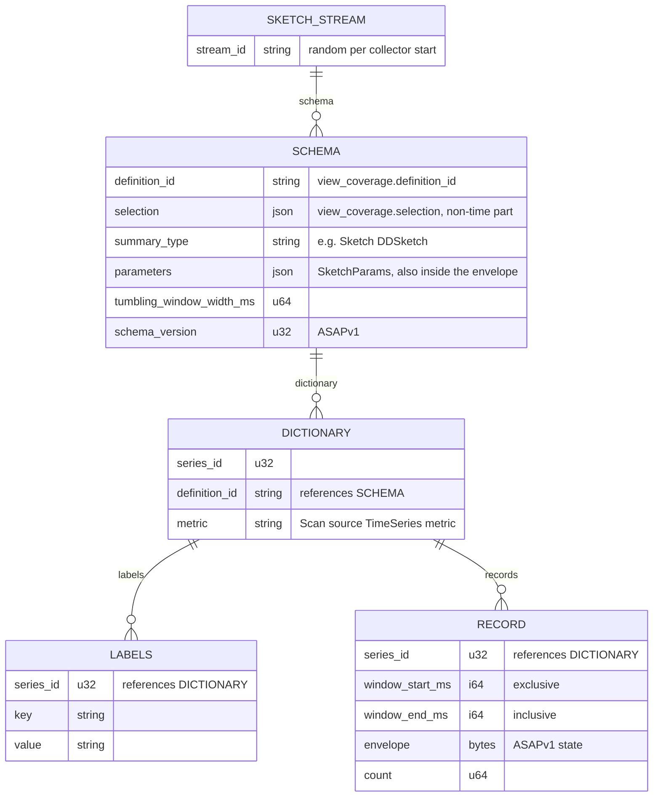

# Design: leaf sketch views precomputed in the collector

Status: proposal, for review. Decisions are recorded at the end.

## Audience and context

This document is for developers of the backend and of ASAPCollector-public,
the collector built on OTAP Dataflow (OpenTelemetry Arrow's dataflow engine)
whose `asap_sketches` processor builds windowed sketches at the edge. It
decides how the collector builds some of a plan's leaf views and how the
backend ingests the resulting states, so that the backend stores and answers
them as if its own precompute had built them.

Today every sample travels raw to the backend: the collector (or the
application) sends OTLP or Remote Write, and the backend's precompute builds
every view. A leaf view such as "a DDSketch per series per 5 s tumbling
window" folds the samples of one series and one window into one state, and
the collector can build exactly that state before the network. For a series
sampled at 10 Hz, 50 samples become one state.

The collector is told what to build in the planner's own terms: for each
pushed view the control plane sends the view's sub-DAG of the installed
ASAPPlanner plan (`Scan` → `SummaryTumblingWindowChain`, with schema,
summary type, parameters and window), and the collector depends on
ASAPPlanner's types crate to read it. Every state the collector emits
carries the view's planner content id, so the backend finds the view by
design rather than by a number both sides agree on.

Terms, as in ASAPPlanner (`asap-types`):

- **Plan**: the `InstallablePlan` the control plane writes: `wire_version`,
  `dag: PhysicalASAPDAG` (`nodes`, `edges`, `roots`, `scalar_roots`) and
  `query_texts`.
- **View**: a materialized node of the plan: a `PhysicalASAPDAGNode` whose
  `lifetime` is `AcrossEvaluations`, with `retention_ms` and
  `view_coverage` set.
- **View coverage**: `view_coverage` = `{definition_id, selection}`.
  `definition_id` is the plan-scope content id of what the view computes
  (the 128-bit FNV-1a hash, in hex, of the expanded definition), equal
  across plans, processes and restarts for the same computation.
  `selection` is the rows that went in: the label matchers lifted out of
  the `Scan`, and, for a range over a chain, the time interval.
- **Parameters**: the node's `parameters: SketchParams` (θ), for example
  `{"DDSketch": {"alpha": 0.05}}`. Not part of `definition_id` (below).
- **Leaf view**: a view whose child is a raw `Scan`.
- **Sub-DAG**: a leaf view's node, its `Scan` node and the edge between
  them, as a `PhysicalASAPDAG` with `roots = [view node]`.
- **Tumbling window**: a window of fixed width `w` on multiples of `w`; the
  window ending at `e` covers `(e − w, e]`.
- **State**: the summary of one series in one window; a sketch state is
  `asap_sketchlib`'s ASAPv1 bytes.
- **Pushed view**: a leaf view the collector builds; the backend only stores
  and reads it.

Scope:

- ASAPPlanner does not change. It already exports what this design needs:
  the plan's serde types (`PhysicalASAPDAG`, `PhysicalASAPDAGNode`,
  `PhysicalASAPDAGEdge`, `ViewCoverage`, `SketchParams`), the content id
  on each view, the view's parameters, window width, schema and retention.
  Where a public read path is missing, it is listed as an open question
  with the minimal need, not as a planner change.
- The backend changes in four places: a new ingest adapter, a new `common`
  type, the view store's write path, and the control plane.
- The collector changes in its own repository: a dependency on the
  planner's types crate, a sub-DAG loader, id stamping, and the
  window-boundary, out-of-order and matcher fixes.

## Components

```text
                         ┌──────────────────────────── collector ────────────────────────────┐
 application ── OTLP ──▶ │ receiver ─┬─▶ asap_sketches (planner_views) ─────▶ OTLP exporter │──┐ sketch path
                         │           └─▶ raw forward ───────────────────────▶ OTLP exporter │──┤ raw path
                         └───────────────────────────────────────────────────────────────────┘  │
                                                  ▲ pushed-views.json (planner sub-DAGs)        │
                                                  │                                              ▼
 workload ─▶ control-plane ─▶ InstallablePlan ────┼──────────────▶ data-plane  POST /v1/metrics
              │  (asap-planner, unchanged)        │                 ├─ record without sketch.envelope ─▶ otlp ─▶ IngestEngine (raw path)
              └─ pushed_view_dags ────────────────┘                 └─ record with sketch.envelope ─▶ asap-sketch-otlp ─▶ ViewStateBatch
                 (same file) ──────────────────────▶ data-plane              ─▶ precompute committer ─▶ storage (view store, persistence)
```

| Component | Crate or repository | Role |
|---|---|---|
| Push-down rule | `crates/control-plane` | Picks the pushable leaf views of the installed plan (rule below) |
| Sub-DAG extraction | `crates/control-plane` (`control_plane --emit-pushed-views`) | Writes `pushed-views.json`: each pushed view's sub-DAG, serialized with the planner's own serde |
| `asap_sketches` processor | ASAPCollector-public | Loads `pushed-views.json` at start, builds each view's per-series states over tumbling windows, and exports OTLP summary points carrying `sketch.envelope` and `sketch.definition_id` |
| `asap-sketch-otlp` | `crates/adapters/ingest/asap-sketch-otlp` (new) | Decodes those OTLP records into a `common::ViewStateBatch`; never reads the sketch bytes |
| `ViewStateBatch` | `crates/common` (new type) | Pushed states between the adapter and the ingest engine |
| `/v1/metrics` route | `crates/data-plane` | One route for both paths: a data point with `sketch.envelope` goes to the sketch path, any other to the raw path |
| Pushed-state ingest | `crates/precompute` | Finds the view by `definition_id` and selection, checks the state against the plan, stages it until the window commits, deduplicates, merges late states |
| Late-state merge | `crates/storage` | Replaces a committed window's rows with merged rows and persists them |

The raw path stays (decision 3). The raw samples of a metric still go to the
backend when a view that is not pushed reads that metric, when a query-time
`Scan` reads it, and for the fallback: when a pushed view misses a window
(the collector was down), the query engine reports `NotReady` and the
dispatcher forwards the query, as for any view that is not ready.

### Dependencies

Following the layout rules (adapters see no engine and no store):

```text
crate / repository   depends on
-------------------  ------------------------------------------------------
asap-sketch-otlp     common (ViewStateBatch), otlp (its protobuf types)
precompute           + decoding ASAPv1 through storage's existing codec (persist.rs decode_sketch)
control-plane        unchanged dependencies (asap-planner, common)
ASAPCollector-public + asap-types (ASAPPlanner's types crate), pinned git rev
```

The adapter does not decode ASAPv1: it hands the bytes on. Decoding needs
the executor's kernels, and `storage` already rebuilds every kernel from
ASAPv1 for persistence (`decode_sketch`), so the ingest engine reuses that.

`asap-types` brings `serde`, `serde_json`, `thiserror` 2 and
`asap_sketchlib` (for `SketchAlgorithm`) into the collector build; no
executor, frontend or solver (open question 12).

## Algorithm

### 1. Push-down rule (control plane)

The first version is rule based, with no cost comparison (decision 6). A
node of the installed plan's `dag` is pushed if and only if all of these
hold, read from its planner fields:

1. **View at ingestion.** `lifetime` is `AcrossEvaluations`,
   `output_state.timing` is `ingestion_time`, and `view_coverage` is set.
2. **Leaf on raw input.** `payload` is `ASAP.SummaryTumblingWindowChain`
   whose `child` is a node with payload `NonASAP.Scan` and `source`
   `TimeSeries { metric }`, with no node in between.
3. **Per series.** `reduction` is `PerEntity`: one state per series and
   window. A `Reduce [...]` view is not pushed, because one collector does
   not see every series of a group.
4. **Tumbling window.** `tumbling_window_width_ms` is set; it becomes the
   collector's window.
5. **Supported sketch and parameters.** `summary_type` is
   `{"Sketch": <algorithm>}` and `parameters` the matching `SketchParams`,
   both in the collector's table:

   | `summary_type` | `parameters` | collector sketch | collector parameters |
   |---|---|---|---|
   | `{"Sketch": "DDSketch"}` | `DDSketch { alpha }` | `ddsketch` | `relative_accuracy = alpha` |
   | `{"Sketch": "Kll"}` | `Kll { k }` | `kll` | `k` |
   | `{"Sketch": "Hll"}` | `Hll { precision: 14 }` only | `hll` | none (fixed at 14) |
   | `{"Sketch": "CountSketch"}` | `CountSketch { width, depth }` | `countsketch` | `width`, `depth` |
   | `{"Sketch": "Cms"}` | `Cms { width, depth }` | `countminsketch` | `width`, `depth` |
   | `{"Sketch": "CmsWithHeap"}` | `CmsWithHeap { width, depth, heap_size }` | `countminsketch_heap` | `columns = width`, `rows = depth`, `k = heap_size` |

   The `input` must match what the collector inserts: DDSketch and KLL
   insert each sample's value (`input` is `{"item": null, "weight":
   {"Column": "SampleValue"}}`); the frequency and cardinality sketches
   insert a key and are pushed only when the item is a label the collector
   keys by. Any other summary (`ExactAggregate`, UnivMon, Hydra, KMV, an
   HLL of another precision) is not pushed.
6. **Expressible filter.** The chain's `filter` is `null`, and the `Scan`'s
   `predicates` are a conjunction of `Compare` nodes with `op` `Eq` or `Ne`
   between a label column and a `Utf8` literal (PromQL `=`, `!=`), which
   the collector's `LabelMatcher` evaluates. A regular-expression matcher
   is not pushed.

**Exact aggregates stay in the backend.** The collector's `asap_sketches`
processor builds only the six sketches above. Its `Exact` type (`EXv1`,
the exact baseline window holding every value) is a baseline for
comparisons, not a `sum`, `max` or counter state. Views of `ExactAggregate`
(`Sum`, `Max`, `Min`, `Counter`, …) are therefore not pushed. They become
pushable when the collector builds those states, with counter-reset
handling for `Counter`.

**Known limitation: sparse series.** The rule ignores size. A series with few
samples per window can produce a sketch state larger than its raw samples
(a DDSketch with one sample still carries its header, mapping and bins,
against about 16 bytes for the raw sample). Step 4 of the plan measures
where this happens. Push-down that compares costs is future work; it needs
a general planner capability (costing where a view is built), to be
discussed later.

### 2. Sub-DAG extraction and the pushed-views file (control plane)

For each pushed view the control plane copies, from the installed
`dag`, the view node and its `Scan` node (both unchanged, node ids
included) and the one edge between them, and sets `roots = [view node]`,
`scalar_roots = []`. Nothing is re-derived or renamed: the collector reads
the same values the backend's precompute would compile.

It writes them to one JSON file, serialized with the planner types' own
serde:

```json
{"planner_wire_version": 15, "views": [<PhysicalASAPDAG>, ...]}
```

`planner_wire_version` is the plan's `wire_version`. The collector loads
the file once at start (recommended over a control endpoint: one file, no
new protocol, and a plan change is a collector restart anyway, below). The
data plane takes the same file with `--pushed-views`; it does not change
the `InstallablePlan`.

The precompute engine skips the pushed views: at install it compiles each
refresh group without the pushed leaf views (and without a `Scan` only they
read). The query engine is unchanged; it reads a pushed view from the store
like any other.

**Plan reinstall.** A view whose computation did not change keeps its
`definition_id`, so its states keep matching across a reinstall even if its
node id changes. The control plane writes a new file; the collector picks
it up on restart. Until then, states of views the new plan no longer has
are rejected as `unknown_view`, and the views the new plan adds are built
by the collector only after its restart (the backend reports them
`NotReady` meanwhile, and the dispatcher forwards those queries).

### 3. The collector: load, check, build, stamp

At start, with `planner_views: <path>` in its processor config, the
`asap_sketches` processor:

1. **Loads** the file with `serde_json` into the planner types. A
   `planner_wire_version` other than the one its pinned `asap-types`
   writes is a load error.
2. **Checks each sub-DAG's shape** and refuses to start, naming the view's
   `definition_id` and the first failing field, unless the sub-DAG is
   exactly: two nodes, one `Input` edge, root = the
   `SummaryTumblingWindowChain`, child a `Scan` of `TimeSeries { metric }`,
   `reduction` `PerEntity`, `filter` `null`, a summary type and parameters
   from the table in step 1, `Scan` predicates only label `Eq`/`Ne`
   against a string, and `view_coverage` present. These are the push-down
   rule's conditions; the collector checks them again so a hand-edited or
   stale file fails at load rather than producing wrong states.
3. **Maps** each view to its internal window state: sketch and parameters
   from the table (an out-of-range value is a load error, never replaced
   by a default), window = `tumbling_window_width_ms`, matchers =
   `__name__ = metric` plus each `Scan` predicate, one state per series
   with every label in the key.
4. **Stamps** every emitted state with the view's `definition_id` and
   `selection` and the window (attribute names in §4).

With `planner_views` set, the per-sketch fields of the processor config
(`sketch_type`, `sketch_params`, `window_size`, `window_slide`,
`output_metric_name`, `agg_id`, `aggregate_by`, `omit_resource_attrs`,
`global_aggregation`, `emit_window_stats`, `transmit_sketch = false`) are a
config error: the file is the only source of truth. The pipeline YAML then
names one `asap_sketches` node and does not change when the plan does.

### 4. OTAP tiers: what goes in Schema, Dictionary and Record

The collector's data model (its `docs/data_model.md`) splits a sketch
stream into OTAP's three tiers by rate of change: **Schema** (config-time,
once per stream), **Dictionary** (once per series), **Record** (once per
state). The planner's view fields fall into the same tiers by design:

| Tier | Planner source | Collector field (OTLP placement) | Backend handling |
|---|---|---|---|
| Schema | `view_coverage.definition_id` | `sketch.definition_id` (Resource, string, 32 hex), replaces `sketch.agg_id` | Look up the installed views with this id; none → reject `unknown_view` |
| Schema | `view_coverage.selection` (non-time part: lifted label matchers) | `sketch.selection` (Resource, the planner's JSON of the selection) | Parse to `Vec<SelectionBox>`, compare with `==` to pick among views of one id |
| Schema | `summary_type` + `parameters` | `sketch.type` (Resource); the parameters are inside the ASAPv1 envelope (`sketch.size` ignored) | Decode the envelope, compare its parameters with the view's `parameters` |
| Schema | `tumbling_window_width_ms` | none; implied by the view | Check `end − start` = width and `end` a multiple of it |
| Schema | ASAPv1 format version | `sketch.schema_version` (Resource) | ≤ highest supported |
| Schema | stream identity (not planner) | `sketch.stream_id` (Resource, random 128-bit per collector start) | Key of the Dictionary cache below |
| Dictionary | `Scan.source.TimeSeries.metric` + the series' labels (the view's group key column `$promql_series_identity`) | metric name; Scope attributes (labels) and `sketch.series_id` | Intern once per `(stream_id, series_id)` into the store's series table |
| Record | the time part of the selection: this window `(end − w, end]` | point `sketch.window_start_ms` (exclusive), `sketch.window_end_ms` (inclusive), and the point times | The state's window key |
| Record | the view's `state` column | point `sketch.envelope` (ASAPv1 bytes), `count` | Stage, dedup, commit (§7) |

How `view_coverage` itself splits:

| `view_coverage` part | Example (q01) | Tier | Why |
|---|---|---|---|
| `definition_id` | `5597d603bdf9f1a148d7c7e5344c1a97` | Schema | Constant per view |
| `selection`, label boxes | `[{"columns": []}]` (no matcher); with `data{region="r0"}`: `region in ["r0"]` | Schema | Constant per view |
| `selection`, time interval | none on a chain's own coverage; each window is `(end − 5 s, end]` | Record | Differs per state |

A chain view's stored `selection` carries no time column: its rows are
indexed by `window_end`, and the time part appears only on the `TimeRange`
above it. So the Record's window is exactly the time part the view's rows
add, in Prometheus's `(t − range, t]` form (§5).

`definition_id` does not cover the parameters or the selection: the
planner computes it from the memo group's expression, which holds neither.
Checked on the benchmark plan: q01 with α 0.05 and with α 0.01 both give
`5597d603bdf9f1a148d7c7e5344c1a97`; `data{region="r0"}` moves the matcher
into `selection`. A view is therefore identified by `(definition_id,
selection)`, and its parameters are checked from the decoded state (open
question 11).

As entities, with planner names (one stream may carry several views, and
the same labels under two views are two Dictionary entries, as in the
collector's data model):



**Transport.** OTAP Arrow keeps the tiers on the wire: over one stream,
Schema and Dictionary are sent once and Records reference them. OTLP HTTP
flattens them: each request repeats the Resource (Schema) and Scope
(labels) above its points, so labels and Schema attributes travel once per
request and series rather than once per stream. The logical mapping above
is the same in both.

*Recommendation: v1 accepts OTLP HTTP; an OTAP Arrow receiver follows.*
Every collector deployment exports with `urn:otel:exporter:otlp_http`
today, and the backend already serves `/v1/metrics`, so v1 needs no new
listener. Decoding OTAP Arrow with the collector's own crates
(`otel-arrow-dfe-pdata` and its engine crates) would bring `datafusion`
53 and `tonic` 0.14 next to the backend's `datafusion` 54 and `tonic`
0.12: two copies of each in the build. The Arrow receiver is the next
step, built on the `arrow-ipc` 58 and `tonic` the backend already has and
fed by the collector's `urn:otel:exporter:otap` (open question 13). With
OTLP the Dictionary saving is still had on the backend side: the adapter
interns each `(stream_id, series_id)` once and reuses the series id for
every later record.

**Collector restart.** A restart starts a new stream: new `stream_id`, and
the collector's `series_id` counter starts again at 1. The backend never
reuses a translation across streams, so a reset counter cannot alias two
series; the new stream's Dictionary entries are interned again (to the
same backend series, since the labels are the same). Entries of a stream
not seen for the longest view retention are dropped.

### 5. Window semantics: Prometheus's `(t − range, t]`

Both sides use Prometheus's boundary (decision 4). Prometheus 3.x range
selectors are left-open and right-closed. Its querying documentation
(Range Vector Selectors) says: "The range is a left-open and right-closed
interval, i.e. samples with timestamps coinciding with the left boundary of
the range are excluded from the selection, while samples coinciding with the
right boundary of the range are included in the selection." Its 3.0
migration guide ("Range selectors and lookback exclude samples coinciding
with the left boundary") records the change from the earlier left-closed
form. OTLP's metrics data model uses the same interval for a delta point,
`(start, end]` ("The time interval is inclusive of the end time"). The
planner's selection algebra writes PromQL `m[5m]` the same way: lower
`Excluded(EvaluationTimePlusMs(-300000))`, upper
`Included(EvaluationTimePlusMs(0))`.

- **Backend: already matches.** `storage::store::window_end` puts a sample at
  `t` in the window ending at `⌈t / w⌉ · w`, so windows are `(e − w, e]`, and
  `ViewInstanceKey::window_ms` is `(start, end]`.
- **Collector: must change.** `WindowState::init_window` and
  `advance_window` put a sample at `t` in `[⌊t / w⌋ · w, ⌊t / w⌋ · w + w)`,
  and `SketchEnvelope` documents `window_start_ms` as inclusive and
  `window_end_ms` as exclusive. At 10 Hz with 5 s windows every 50th sample
  lies on a boundary, and the two sides put it in different windows, so a
  pushed view and a backend-built view of the same data differ.

The collector change:

1. A sample at `t` belongs to the window ending at `⌈t / w⌉ · w`; a window
   closes when a sample later than its end arrives (`t > end`, not `≥`), or
   on the idle timer as today.
2. A sample is placed by its own timestamp, not into the active window:
   today a sample older than the active window (out of order, from another
   source) lands in the active window. It goes to its own window while that
   window is open, and is dropped and counted once it is closed.
3. `window_start_ms` is exclusive and `window_end_ms` inclusive, in the
   envelope, the `sketch.window_*_ms` attributes and the OTLP point times.
4. Matchers (name, `=` or `!=`, value; `__name__` for the metric), passed
   to `PrecomputeConfig::matchers`, which the runtime already evaluates;
   with `planner_views` they come from the `Scan` predicates.

### 6. The sketch path in the data plane

`POST /v1/metrics` decodes the request once. Each summary data point that
carries a `sketch.envelope` bytes attribute is a pushed state; every other
point is a raw sample, as today. A request may carry both.

The adapter (`asap-sketch-otlp`) reads, per pushed state, the fields of the
tier table in §4, and requires: `sketch.definition_id`,
`sketch.selection`, `sketch.stream_id` and `sketch.series_id` present;
`sketch.type` known; `sketch.schema_version` ≤ the highest supported; the
window attributes equal to the point's `start_time_unix_nano` /
`time_unix_nano` in ms with `start < end`; `sketch.envelope` non-empty.
Labels are Resource attributes, then Scope attributes, then point
attributes, without any `sketch.*` key, with `__name__` = metric name (the
raw OTLP adapter's merge order).

The ingest engine then, per state:

1. **View.** Looks up the installed views with this `definition_id` and an
   equal `selection`. None → rejected (`reason="unknown_view"`; for
   example a collector still running a file from an earlier plan).
2. **Window.** Requires `end − start` = the view's
   `tumbling_window_width_ms` and `end` a multiple of it. Otherwise
   rejected (`reason="window"`).
3. **Parameters.** Decodes the ASAPv1 bytes with `storage`'s codec into the
   view's kernel and compares the decoded parameters with the view's
   `parameters`, exactly (decision 5). A matching id does not imply
   matching parameters (§4), so this check is required, not a formality.
   A state that does not decode, or decodes with other parameters, is
   rejected (`reason="decode"`, `reason="params"`).
4. **Series.** Translates `(stream_id, series_id)` through the
   per-stream Dictionary cache; on a miss, interns the record's label set
   into the store's series table, as the raw path does, so the view row's
   `$promql_series_identity` is the same canonical JSON a raw sample of
   that series gets.
5. **Stage, dedup, commit.** See below.

Every rejection increments
`asap_pushed_states_rejected_total{view, reason}` and logs once per view and
reason per minute; the request still returns 200 with the rejected count, as
the raw OTLP route reports `rejected`.

### 7. Staging, deduplication, late states

The view store appends a view's windows in order and each window once, and
other refresh groups may read a pushed view (a wider level of its chain), so
a pushed window is committed once and whole. The engine stages pushed states
per `(view, window)` and commits through the precompute committer, the same
path that commits a window it built (readers, `RefreshTaskGraph` ordering,
persistence and the memory budget all apply).

- **Commit time.** No raw samples of a pushed view's metric need reach the
  backend, so the raw watermark cannot close its windows. A pushed window
  commits when the wall clock passes `end + push_grace_ms` (default 10 s:
  the collector's 5 s idle-close grace plus an export interval).
- **Duplicates.** A state for a `(view, series, window)` that already has a
  state with the same bytes (compared by a 64-bit hash of the envelope, kept
  per key for the view's retention) is ignored and counted
  (`asap_pushed_states_duplicate_total{view}`). This covers exporter
  retries.
- **Second states.** A state for a `(view, series, window)` that already has
  a state with other bytes is merged into it (sketch merge). This covers two
  partial states: a collector that restarted inside a window, or two
  collectors that each saw part of one series. Merging is safe because the
  states are full, not deltas, and each partial covers different samples.
- **Late states.** A state that arrives after its window committed:
  - within the view's retention, it is merged into the committed window
    (deduplicated as above), through `merge_late_rows` below, which writes
    the merged window to memory and to its view file;
    `asap_pushed_states_late_merged_total{view}`;
  - beyond the retention, it is dropped;
    `asap_pushed_states_late_dropped_total{view}`.

A late merge changes a window a query may already have read. The result
cache keeps final answers per evaluation time, so the merge drops the cached
answers whose range covers the merged window (open question 6).

## Code interface

### `crates/common`

```rust
/// States the collector built for pushed views: what the sketch-path ingest
/// adapter hands the ingest engine. Never data between operators.
#[derive(Debug, Clone, PartialEq)]
pub struct ViewStateBatch {
    pub states: Vec<PushedViewState>,
}

/// One series' state of one pushed view in one window.
#[derive(Debug, Clone, PartialEq)]
pub struct PushedViewState {
    /// The view's `view_coverage.definition_id` (32 hex digits).
    pub definition_id: String,
    /// The view's `view_coverage.selection`, as the planner serializes it.
    pub selection: Vec<SelectionBox>,
    /// Which sketch the bytes hold, as the record declares it.
    pub sketch: PushedSketch,
    /// ASAPv1 envelope bytes from `asap_sketchlib`: the full state.
    pub asapv1: Vec<u8>,
    /// The collector stream and its series id: the Dictionary key.
    pub stream_id: u128,
    pub series_id: u32,
    /// The series' labels, `__name__` included.
    pub labels: LabelSet,
    /// The window `(start_ms, end_ms]`.
    pub window_ms: (i64, i64),
    /// Samples folded into the state, as the collector counted them.
    pub sample_count: u64,
}

/// The sketches the collector builds.
#[derive(Debug, Clone, Copy, PartialEq, Eq, Hash)]
pub enum PushedSketch { DDSketch, Kll, Hll, CountSketch, Cms, CmsWithHeap }

/// What happened to a batch's states.
#[derive(Debug, Clone, Default, PartialEq, Eq)]
pub struct ViewStateIngestReport {
    pub staged: u64,
    pub duplicate: u64,
    pub late_merged: u64,
    pub late_dropped: u64,
    /// Rejected states by reason (`unknown_view`, `window`, `decode`, `params`).
    pub rejected: BTreeMap<&'static str, u64>,
}

/// Takes states the collector built for pushed views. Implemented by the
/// ingest engine, next to `IngestEngine`.
#[async_trait]
pub trait ViewStateIngest: Send + Sync {
    /// Checks, stages or merges each state; waits under backpressure as
    /// `IngestEngine::ingest` does.
    async fn ingest_view_states(&self, batch: ViewStateBatch)
        -> Result<ViewStateIngestReport, IngestError>;
}
```

`SelectionBox` is `asap_types::ir::properties::selection::SelectionBox`,
which `common` can already name.

`ViewStore::put`'s contract ("each key is put once and never rewritten")
gains one exception, for late states:

```rust
pub trait ViewStore: Send + Sync {
    // put, get, instances, evict_before, timestamp_range_per_view: unchanged

    /// Replaces the committed instance under `key` with `instance` (the old
    /// one merged with late states). `false` when `key` is not stored
    /// (evicted, or never committed).
    fn replace(&self, key: ViewInstanceKey, instance: ViewInstance) -> bool;
}
```

and the backend's own store, which the engines use directly:

```rust
// crates/storage/src/store.rs
impl ViewStore {
    /// Replaces the rows of `view`'s committed window `time_range_ms` with
    /// `batches` (copy on write: runs reading the old rows keep them); the
    /// window is re-queued for its view file. `Err` when the window is not
    /// stored.
    pub fn merge_late_rows(
        &mut self,
        view: &MaterializedView,
        time_range_ms: (i64, i64),
        batches: Vec<Batch>,
    ) -> Result<(), Error>;
}
```

### `crates/adapters/ingest/asap-sketch-otlp`

```rust
/// Why a request's pushed states could not be read (the whole request is
/// refused with 400; per-state problems are counted, not errors).
#[derive(Debug, thiserror::Error, PartialEq)]
pub enum SketchOtlpError {
    #[error("sketch record without {0}")]
    MissingAttribute(&'static str),
    #[error("unknown sketch.type {0:?}")]
    UnknownSketchType(String),
    #[error("sketch.schema_version {0} is newer than supported")]
    SchemaVersion(u64),
    #[error("sketch.selection is not a planner selection: {0}")]
    Selection(String),
    #[error("window attributes ({start_ms}, {end_ms}] disagree with the point's times")]
    Window { start_ms: i64, end_ms: i64 },
}

/// Whether an OTLP data point carries a pushed state (a `sketch.envelope`
/// bytes attribute): the route's test for the sketch path.
pub fn is_sketch_point(attributes: &[KeyValue]) -> bool;

/// The pushed states of a decoded OTLP metrics request; points without
/// `sketch.envelope` are left to the raw `otlp` decoder.
pub fn decode_view_states(
    request: &ExportMetricsServiceRequest,
) -> Result<ViewStateBatch, SketchOtlpError>;
```

The raw `otlp` decoder already skips points that carry a sketch payload; it
learns `sketch.envelope` as one more such attribute, so one request body is
decoded by both and each point is read once.

### `crates/control-plane`

```rust
/// The file the collector and the data plane load: each pushed view's
/// sub-DAG of the installed plan, in the planner's serde.
#[derive(Debug, Clone, PartialEq, Serialize, Deserialize)]
#[serde(deny_unknown_fields)]
pub struct PushedViewsFile {
    /// The installed plan's `wire_version`.
    pub planner_wire_version: u32,
    /// One per pushed view: its node, its `Scan` and the edge between
    /// them; `roots = [view node]`.
    pub views: Vec<PhysicalASAPDAG>,
}

/// Why a leaf view is not pushed, for the command's report.
#[derive(Debug, Clone, PartialEq)]
pub enum NotPushed {
    NotOnRawScan,
    NotPerSeries,
    NotTumbling,
    UnsupportedSummary(String),
    UnsupportedParameters(String),
    FilterNotExpressible(String),
}

/// The installed plan's pushed views, by the rule of this design, as
/// sub-DAGs, and why each other view is not pushed.
pub fn pushed_view_dags(plan: &InstallablePlan)
    -> (PushedViewsFile, Vec<(PhysicalASAPNodeId, NotPushed)>);
```

CLI: `control_plane --plan <plan.json> --emit-pushed-views
<pushed-views.json>` reads a saved plan and writes the file; the data plane
takes `--pushed-views <pushed-views.json>`.

## Worked example: q01

The query, from the benchmark set: `quantile_over_time(0.99, data[1m])`,
evaluated every 5 s, 10 samples/s per series, with a 5 % relative error
target. The plan the planner selects has, for q01:

```text
n0  Scan data                     (IngestionTime, None)                 shared with q02 and q03's chains
n1  SummaryTumblingWindowChain    (IngestionTime, AcrossEvaluations)    DDSketch α 0.05, PerEntity, 5 000 ms, retention 60 s
n2  TimeRange 60s                 (QueryTime)                           reads n1's windows in (T − 60 s, T]
n3  SummaryMerge                  (QueryTime)                           merges them per series
n4  SummaryEstimate Quantile(q=0.99)
n5  Project                       (root)
```

n1 passes the rule. Its sub-DAG in `pushed-views.json` (schemas
shortened to their field names; the file carries them in full):

```json
{"planner_wire_version": 15, "views": [{
  "nodes": [
    {"id": 0,
     "payload": {"NonASAP": {"Scan": {
       "source": {"TimeSeries": {"metric": "data"}},
       "predicates": [],
       "schema": {"fields": ["ts", "value", "$promql_series_identity"], "...": "..."}}}},
     "output_state": {"timing": "ingestion_time", "primitive": "Raw"},
     "lifetime": "None",
     "output_schema": {"...": "..."}},
    {"id": 1,
     "payload": {"ASAP": {"SummaryTumblingWindowChain": {
       "child": 0,
       "summary_type": {"Sketch": "DDSketch"},
       "input": {"item": null, "weight": {"Column": "SampleValue"}},
       "reduction": "PerEntity",
       "filter": null,
       "tumbling_window_width_ms": 5000}}},
     "output_state": {"timing": "ingestion_time", "primitive": "SummaryState"},
     "lifetime": {"AcrossEvaluations": "Memory"},
     "parameters": {"DDSketch": {"alpha": 0.05}},
     "output_schema": {"fields": ["window_end", "state", "$promql_series_identity"], "...": "..."},
     "retention_ms": 60000,
     "view_coverage": {
       "definition_id": "5597d603bdf9f1a148d7c7e5344c1a97",
       "selection": [{"columns": []}]}}],
  "edges": [{"producer": 0, "consumer": 1, "role": "Input",
             "intermediate_schema": {"...": "..."},
             "data_state": {"timing": "ingestion_time", "primitive": "Raw"},
             "grouping": "NotApplicable", "window": "NotApplicable"}],
  "roots": [1],
  "scalar_roots": []}]}
```

The collector maps it to: DDSketch with `relative_accuracy = 0.05`, 5 s
tumbling windows `(e − 5 s, e]`, matcher `__name__ = "data"`, one state per
series. Its pipeline config names only the file:

```yaml
sketch:
  type: urn:asap:processor:asap_sketches
  config:
    planner_views: /etc/asap/pushed-views.json
```

For one series `data{region="r0",service="s0",job="j0",label_0="l0"}`, the
collector folds the 50 samples with timestamps in `(T − 5 s, T]` into one
DDSketch and exports one summary point:

| Where | Attribute | Value |
|---|---|---|
| Resource (Schema) | `sketch.definition_id` | `"5597d603bdf9f1a148d7c7e5344c1a97"` |
| Resource (Schema) | `sketch.selection` | `"[{\"columns\":[]}]"` |
| Resource (Schema) | `sketch.type` | `"DDSketch"` |
| Resource (Schema) | `sketch.schema_version` | `1` |
| Resource (Schema) | `sketch.stream_id` | `"9b1e…"` (random at collector start) |
| Scope (Dictionary) | `sketch.series_id` | `17` |
| Scope (Dictionary) | labels | `region="r0"`, `service="s0"`, `job="j0"`, `label_0="l0"` |
| Metric | name | `data` |
| Point (Record) | `sketch.window_start_ms` | `T − 5000` (exclusive) |
| Point (Record) | `sketch.window_end_ms` | `T` (inclusive) |
| Point (Record) | `sketch.envelope` | ASAPv1 bytes |
| Point (Record) | `count` | `50` |

The backend finds n1 by `definition_id` and selection, checks that the
window is 5 s wide and ends on a multiple of 5 s, decodes the envelope and
checks α = 0.05, translates `(stream_id, 17)` to its series id, and stages
the state. It keeps exactly what its own precompute keeps for n1: per
series, one DDSketch state per 5 s window, for the view's 60 s retention
(12 windows). At evaluation time `T` (a multiple of 5 s), q01 runs at query
time as before: n2 selects the 12 windows ending in `(T − 60 s, T]`, n3
merges the 12 states of each series into one, and n4 reads the 0.99
quantile. That chain, the result cache and the fallback do not change. The
backend no longer runs n1, and `data`'s raw samples still arrive because
the `Scan` n0 also feeds q02's and q03's chains.

## The benchmark queries

All five are evaluated every 5 s over 1 m ranges; the planner builds each
one's leaf as a 5 s tumbling chain over its `Scan`:

| Query | Leaf view (summary type, reduction) | Pushed | Why |
|---|---|---|---|
| q01 `quantile_over_time(0.99, data[1m])` | `Sketch: DDSketch` α 0.05, `PerEntity` | yes | passes every rule |
| q02 `max_over_time(data[1m])` | `ExactAggregate: Max`, `PerEntity` | no | exact aggregate: the collector builds none |
| q03 `sum_over_time(data[1m])` | `ExactAggregate: Sum`, `PerEntity` | no | exact aggregate |
| q04 `rate(data_total[1m])` | `ExactAggregate: Counter`, `PerEntity` | no | exact counter state |
| q05 `sum by (region, service) (sum_over_time(data[1m]))` | `ExactAggregate: Sum`, `PerEntity`; the `sum by` runs at query time | no | exact aggregate |

So for this workload the collector builds one view, the backend still builds
four, and both metrics' raw samples still reach the backend. Step 4 of the
plan measures what that saves; a workload whose metric is read only by
pushed views saves the raw samples too.

## Plan

Separate PRs, each reviewed on its own.

Backend:

1. This document.
2. `ViewStateBatch` and `ViewStateIngest` in `common`; the
   `asap-sketch-otlp` adapter; the `/v1/metrics` split; lookup by
   `definition_id` and selection, the Dictionary cache, staging, dedup,
   late merge and `ViewStore::merge_late_rows`. Test data: real ASAPv1
   records the collector emits (captured OTLP bodies, checked in with the
   collector commit that wrote them), for each of the six sketch types,
   including one with mismatched parameters, one unknown id, one duplicate,
   one late state and one restart (new `stream_id`, reused `series_id`).
3. The control plane's push-down rule and `--emit-pushed-views`; the data
   plane's `--pushed-views`; the precompute engine skips pushed views.
   Tests: the benchmark plan pushes exactly q01's sub-DAG above; a plan
   with a regex matcher, a `Reduce` leaf or an `ExactAggregate` leaf pushes
   nothing; the written file deserializes into `PhysicalASAPDAG`s that
   pass the planner's `validate`.
4. End-to-end comparison, collector + backend against backend only, on the
   same feed: answers equal (exact views) or within the plan's error
   (sketch views) at every evaluation; backend ingest CPU, network bytes
   between collector and backend, and collector CPU; including a sparse
   series case for the limitation above.

Collector (ASAPCollector-public):

5. `asap-types` as a pinned git dependency (same rev as the backend's
   planner pin); the `planner_views` loader with the shape check and the
   mapping table; config errors for the per-sketch fields when it is set.
6. Stamping: `sketch.definition_id`, `sketch.selection` and
   `sketch.stream_id` on the Resource, replacing `sketch.agg_id`;
   `series_id` per (view, series).
7. The window boundary `(e − w, e]`, placement by sample timestamp with
   drop-and-count after close, and matchers (§5). It lands before step 4,
   which needs equal windows.

## Decisions

1. **ASAPPlanner does not change.** Which views the collector builds is a
   deployment decision the backend's control plane makes on the installed
   plan; the plan and its `InstallablePlan` format are unchanged. The
   planner already exports the types and ids the collector reads.
2. **The collector is ASAPCollector-public (OTAP), sending full ASAPv1
   states.** No deltas: each record holds the whole state of one series in
   one window.
3. **Two paths.** The raw path (raw OTLP or Remote Write to the backend)
   stays, for views that are not pushed, query-time `Scan`s and the
   fallback. The sketch path carries pushed states on the same
   `/v1/metrics` route; a record with `sketch.envelope` takes the sketch
   path.
4. **Prometheus window semantics on both sides**: `(t − range, t]`, as
   Prometheus 3.x range selectors. The backend already uses it; the
   collector changes in its own PR.
5. **Parameters match the plan exactly**; the backend rejects a state whose
   decoded parameters differ, and counts it. A state delivered twice for the
   same view, series and window is ignored the second time, and counted.
   A late state within retention is merged into the stored state; beyond
   retention it is dropped and counted.
6. **Rule-based push-down first**: a view is pushed iff its leaf reads raw
   input directly, is per series, uses a tumbling window, its sketch type
   and parameters are among the collector's (DDSketch, KLL, HLL,
   CountSketch, Count-Min, Count-Min-heap), and its filter is expressible
   by the collector's matchers. No cost comparison. Exact aggregates stay
   in the backend, since the collector builds none. Cost-based push-down
   is future work and needs a general planner capability.
7. **The collector receives the planner's own view definitions.** The
   control plane sends each pushed view's sub-DAG of the installed plan,
   serialized with the planner's serde; the collector depends on the
   planner's types crate, pinned. Every emitted state carries the view's
   `view_coverage.definition_id` (with its selection) and its window, and
   the backend matches it against the installed plan's views. This
   replaces a numeric `agg_id` and a hand-written collector config. The
   backend's precompute skips pushed views.

## Open questions

Each with a recommendation.

1. **Dedup vs. merge of a second state for the same (view, series,
   window).** *Recommend:* §7's reading: a byte-identical state is a
   duplicate and ignored; a state with other bytes is merged (collector
   restart mid-window, two collectors with parts of one series). The
   alternative, "any second state is ignored", is simpler but loses data
   on a restart.
2. **How the collector encodes the window.** *Recommend:* `(start, end]`
   in the envelope, the attributes and the point times after the collector
   change; the adapter requires the three to agree and the width and
   alignment to match the view, and rejects and counts anything else.
3. **Clock skew and commit time.** *Recommend:* commit on the backend's
   wall clock at `end + push_grace_ms` (default 10 s); treat later states
   as late (merge within retention); export a per-view histogram of
   arrival delay. Hosts are assumed to run NTP.
4. **Result cache after a late merge.** *Recommend:* drop cached answers
   whose evaluation range covers the merged window. The alternative is not
   to cache answers whose newest window is still inside the grace period.
5. **sketchlib versions differ.** The collector pins `asap_sketchlib`
   `60101c6`, the backend `355093f`, and the planner `389530c`; the
   collector's HLL is an Ertl HLL, the backend's kernel Classic.
   *Recommend:* PR 2's captured records are the compatibility test, one per
   sketch type. Until the pins agree, leave HLL off the pushable list if
   its envelope does not decode into the backend kernel.
6. **Selective raw forwarding.** A metric whose views are all pushed need
   not reach the backend raw. *Recommend:* the pushed-views file later also
   lists the metrics the backend still reads raw (a `Scan` not only under
   pushed views); in v1 the collector keeps forwarding everything.
7. **Out-of-order samples in the collector.** *Recommend:* include the fix
   in the collector's window PR: place each sample by its own timestamp,
   and drop and count it once its window has closed.
8. **Planner types pin and compatibility between collector and backend.**
   Both read the same JSON; the types are `deny_unknown_fields` and the
   plan carries `wire_version` (15 today). *Recommend:* the collector pins
   the same ASAPPlanner rev as the backend's `asap-planner` pin and is
   bumped in the same change; the loader refuses a file whose
   `planner_wire_version` differs from its own, so a mismatch fails at
   start, not as wrong states.
9. **Serde stability of the planner types.** The plan-file format is the
   planner's own and versioned by `INSTALLABLE_PLAN_WIRE_VERSION`; there is
   no promise across versions. *Recommend:* rely on it only between equal
   wire versions (question 8); PR 3 checks in the benchmark's
   `pushed-views.json` and tests that it deserializes and validates, so a
   planner bump that changes the format shows up as a failing test.
10. **Plan reinstall.** Unchanged views keep their `definition_id`.
    *Recommend:* the control plane rewrites the file and the collector
    restarts on every reinstall; states of unchanged views keep matching
    across it, states of removed views are rejected as `unknown_view` until
    the restart, and new views are `NotReady` (forwarded) until the
    collector builds them. A live reload is later work.
11. **`definition_id` does not cover parameters or selection.** Verified on
    the benchmark plan: α 0.05 and α 0.01 give the same id, and a label
    matcher moves into `selection`. *Recommend:* identify a pushed view by
    `(definition_id, selection)`, sent once per Resource, and check the
    parameters from the decoded state (§6 step 3). If one plan ever holds
    two views with equal id and selection but different parameters, the
    decoded parameters pick the view; the control plane reports such a
    plan.
12. **Dependency weight on the collector build.** `asap-types` adds
    `serde_json`, `thiserror` 2 and a second `asap_sketchlib` rev (the
    planner's) to the collector; it brings no executor, frontend or solver.
    *Recommend:* accept it; it disappears with question 5's single
    sketchlib pin. Measure the collector's clean build time before and
    after in PR 5.
13. **Transport: OTLP HTTP or OTAP Arrow.** *Recommend:* v1 accepts OTLP
    HTTP (every collector deployment exports `otlp_http` today; the backend
    already serves `/v1/metrics`; the Dictionary saving is recovered by the
    `(stream_id, series_id)` cache). Next, an OTAP Arrow receiver fed by
    `urn:otel:exporter:otap`, decoding with the `arrow-ipc` and `tonic`
    the backend already builds, rather than the collector's
    `otel-arrow-dfe-*` crates, which would add a second `datafusion` (53
    next to 54) and `tonic` (0.14 next to 0.12).
14. **Stream identity on OTLP.** OTLP HTTP has no stream, so the Dictionary
    key needs one. *Recommend:* `sketch.stream_id`, a random 128-bit value
    the collector draws at start and puts on every Resource; on OTAP Arrow
    the gRPC stream is the stream. A restart is a new stream, which
    replaces the earlier concern that `sketch.series_id` resets on restart.
15. **Reading `definition_id` from outside the planner.** In the planner's
    types, `ViewCoverage`'s fields are crate-private and its
    `definition_id()` accessor exists only under the `test-support`
    feature; edges likewise have no public constructor outside it. Serde
    reads and writes all of them. *Minimal need:* a public read of a plan
    node's view coverage id and selection from a deserialized plan.
    *Recommend:* until the planner offers one, both sides read the two
    values from the node's JSON (`view_coverage.definition_id`,
    `view_coverage.selection`), and the control plane builds a sub-DAG by
    filtering the installed DAG's `nodes` and cloning its `edges`, which
    the public fields allow; neither enables `test-support` in production.
16. **Sub-DAG validity.** No planner function extracts a sub-DAG.
    *Minimal need:* that a two-node DAG copied from an installed plan, with
    `roots = [view]`, passes `PhysicalASAPDAG::validate`. *Recommend:* the
    collector's loader calls `validate` on each sub-DAG and PR 3 tests it
    on the benchmark plan; if `validate` refuses such a DAG, the loader
    keeps only its own shape check and the need is filed against the
    planner in planner terms.
17. **One processor for all views, or one per view.** *Recommend:* one
    `asap_sketches` node that builds every view in the file, so the
    pipeline YAML never changes with the plan; the processor keys state by
    (view, series), as the collector's data model already allows several
    Schemas on one stream.
